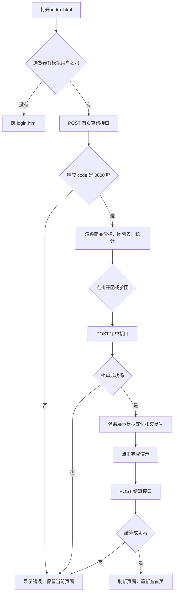
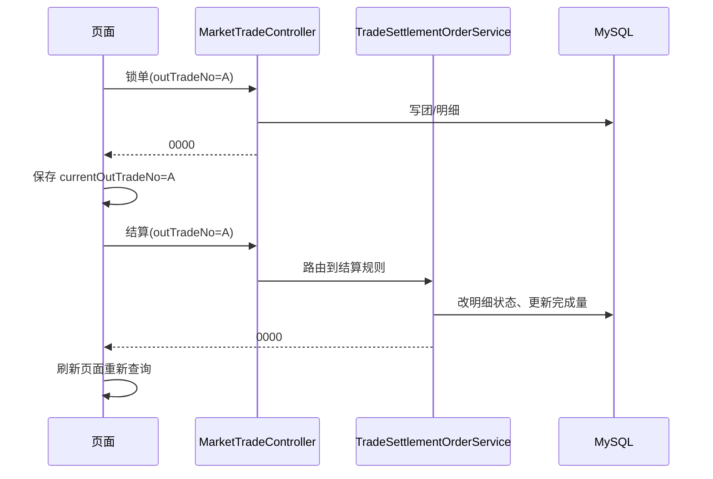

# 20 / 3-2：前端接上后端接口

> 2-15 已经做出首页查询和结算接口。本节把页面里写死的商品、团和价格替换成接口数据，并把“开团/参团 → 锁单 → 模拟支付 → 结算”的请求串起来。
>
> 对应[原文第 20 节](../orgin-tutorial/3.第3部分：外部对接「静态页面」/20-3-2-DeepSeek处理UI与接口对接.md)，参考分支 `3-2-250203-xfg-ui-2-interface`。**前端由 AI 实现**，你读关键代码、按本文复验即可，不要求手敲样式；后端 Java 不改。

## 0. 本节要解决的问题

上一节页面的价格、团、人数都是 HTML 里写死的。运营改了活动或价格，页面不会变；团已经过期，页面却还在展示。这叫**假数据页面**。

本节让页面变成“后端怎么说，页面怎么显示”：



**怎么读这张图：** 只有 `0000` 才往下一步走。页面显示成功不等于后端成功，前端必须先判断响应里的业务码。

**本节不做：** 真实支付、二维码、扫码验签、真实登录鉴权。按钮叫“完成演示”，点击后只调用结算接口，不产生真实扣款。

## 1. 文件改了什么

| 文件 | 作用 |
| --- | --- |
| `docs/dev-ops/nginx/html/index.html` | 删掉写死的团卡片和价格；增加错误提示位、交易号展示位 |
| `docs/dev-ops/nginx/html/js/index.js` | 请求首页、渲染、锁单、结算、错误处理 |
| `docs/dev-ops/nginx/html/login.html` | 上一节已改成模拟登录，本节不重复 |

后端接口地址固定为：

```javascript
const BASE_URL = 'http://127.0.0.1:8091'
```

页面通过 HTTP 打开，不能双击 `file://` 打开，否则请求和 Cookie 行为可能不一致。

## 2. 只读三段关键代码

### 2.1 首页请求：页面参数怎么变成 JSON

```javascript
const response = await fetch(`${BASE_URL}/api/v1/gbm/index/query_group_buy_market_config`, {
  method: 'POST',
  headers: {'Content-Type': 'application/json'},
  body: JSON.stringify({userId, source: SOURCE, channel: CHANNEL, goodsId: GOODS_ID})
})
const result = await response.json()
if (result.code !== '0000') {
  showPageError(`首页查询失败：${result.info || result.code}`)
  return
}
renderMarketConfig(result.data, userId)
```

对应关系：

| 前端字段 | 后端接收 | 用途 |
| --- | --- | --- |
| `userId` | `GoodsMarketRequestDTO.userId` | 查询是哪个用户在看 |
| `source / channel` | 同名字段 | 营销渠道，也用于结算规则里的渠道校验 |
| `goodsId` | 同名字段 | 查哪个商品的活动 |

`fetch` 的 `response.json()` 只把响应体转成对象，**不会自动判断业务成功**；`HTTP 200` 也可能返回 `0002 / 0003` 这类业务错误，所以必须看 `result.code`。

### 2.2 响应映射：哪个字段显示在哪里

```javascript
const {goods, teamList = [], teamStatistic} = data

// 商品促销文案：优惠金额 + 统计人数
promotionText.textContent =
  `直降 ¥${goods.deductionPrice.toFixed(0)}，${teamStatistic.allTeamUserCount}人再抢，参与马上抢到`

// 每个团还剩几人：目标人数 - 锁单人数
const remaining = team.targetCount - team.lockCount
```

| 页面位置 | 后端字段 | 说明 |
| --- | --- | --- |
| “直降 ¥10” | `goods.deductionPrice` | 优惠金额，不是原价 |
| “2人再抢” | `teamStatistic.allTeamUserCount` | 该活动的参团人数统计 |
| 单独购买价格 | `goods.originalPrice` | 原价，这节课不发起单独购买锁单 |
| 开团价格 | `goods.payPrice` | 拼团实付价 |
| 剩余人数 | `targetCount - lockCount` | 前端计算，不在 DTO 里 |
| 倒计时 | `validTimeCountdown` | 后端按截止时间算好 |
| 空列表 | `teamList.length === 0` | 显示“赶紧去开团”，不显示 0 个团卡片 |

这里有一个刻意保留的差异：其余用户的团不携带 `outTradeNo`，只有自己的团才保存交易号。**别人的外部单号没有必要暴露到页面上。**

### 2.3 锁单与结算：`outTradeNo` 必须贯穿两次请求

```javascript
// 锁单：带着页面生成的模拟交易号
body: JSON.stringify({
  userId, teamId: teamId || null, activityId: 100123, goodsId: GOODS_ID,
  source: SOURCE, channel: CHANNEL, outTradeNo,
  notifyUrl: `${BASE_URL}/api/v1/test/group_buy_notify`
})
```

锁单成功后：

```javascript
currentOutTradeNo = outTradeNo
showPaymentModal(price)
```

点击“完成演示”才调用结算：

```javascript
body: JSON.stringify({
  userId, source: SOURCE, channel: CHANNEL,
  outTradeNo: currentOutTradeNo, outTradeTime: Date.now()
})
```

为什么不能省：

- 锁单接口返回成功的 `outTradeNo`，说明“这一笔预占”已创建。
- 结算接口用 `outTradeNo + userId` 找未结算明细；没有它，后端无法知道你结算的是哪一笔。
- 页面如果在锁单失败后还展示支付弹窗，会让用户以为锁单成功；所以代码先判断 `code === '0000'`，再弹窗。



**图的意思：** 结算请求里的 A 必须和锁单请求一致；页面保存这个值，才把两次独立 HTTP 请求连成一笔业务。

## 3. 2026-10-30 的 AI 验证记录

真实后端（8091）本轮未启动；我在仓库外复制页面，只把接口地址改为本机模拟服务，然后用 `ego-browser` 验证了前端行为。**这不是后端集成验证。**

| 场景 | 观察结果 |
| --- | --- |
| 首页返回一个团 | 文案“直降 ¥10，2人再抢”；按钮显示原价 100、拼团价 90；剩余 1 人；倒计时出现 |
| 点击参团 | 出现锁单请求；弹窗金额 90.00，交易号有值 |
| 点击完成演示 | 出现“支付&结算成功”；关闭提示后页面刷新并重新请求首页 |
| 空 `teamList` | 显示“小伙伴，赶紧去开团吧！”，没有团按钮 |
| 首页返回 `0002` | 页面显示“首页查询失败：非法参数”，不渲染假数据 |
| 无登录 Cookie | 回到模拟登录页 |
| JavaScript 语法 | `node --check js/index.js` 无输出、退出码 0 |

**未验证：** 真实 Spring Boot 接口、MySQL 写入、Redis、锁单失败业务码、跨域实际配置、并发。模拟服务只证明前端请求和渲染逻辑，不证明后端。

## 4. 你的真实复验步骤

前提：独立测试库；启动自己的 Application；不要拿共享业务库反复试。

### 4.1 启动

1. 在 IDEA 启动 `Application`，确认日志端口是 `8091`。
2. 用 IDEA 内置服务器或本地静态服务打开 `docs/dev-ops/nginx/html/index.html`，用 HTTP 地址而不是文件路径。
3. 打开 F12 → Network → 保留日志。

### 4.2 首页查询

1. 先在模拟登录页输入你的测试用户，再回到首页。
2. Network 找到 `query_group_buy_market_config`，检查请求体四个字段。
3. 看响应 `code`：
   - `0000`：记录 `goods.deductionPrice`、`teamStatistic.allTeamUserCount`、`teamList` 条数。
   - 非 `0000`：记录 `code / info`，此时页面应显示错误，不应显示价格和团。
4. 对照页面：
   - 直降金额 = `deductionPrice`。
   - 底部开团价 = `payPrice`；单独购买价 = `originalPrice`。
   - 团卡片剩余人数 = `targetCount - lockCount`。
   - 空列表时出现开团提示。

### 4.3 锁单与结算

1. 点击“参与拼团”或“开团购买”，Network 应出现 `lock_market_pay_order`。
2. 请求体里记下 `outTradeNo`；确认弹窗展示的是同一个交易号。
3. 点击“完成演示”，Network 出现 `settlement_market_pay_order`；请求体 `outTradeNo` 必须与锁单一致。
4. 结算成功后页面刷新，首页请求再次发出。
5. 用上一步的 `outTradeNo` 在独立库执行只读查询：

```sql
select user_id, out_trade_no, team_id, status, out_trade_time
from group_buy_order_list
where out_trade_no = '这里填刚才的交易号';
```

期望：`status=1`，`out_trade_time` 有值。再按 team_id 查 `group_buy_order`，核对 `complete_count` 是否按当前团进度增加。

### 4.4 失败分支

1. 停掉 Application，刷新页面：应看到请求失败提示，不应出现假价格。
2. 用一个空商品 ID 的请求验证后端 `0002`：页面应提示错误。
3. 不要为了让页面“看起来成功”而手动改前端判断 `code` 的逻辑。

### 4.5 交给我的证据

- Network 中三个请求的截图或 JSON。
- 非空 `teamList` 的响应原文。
- 结算后 SQL 的 `status / out_trade_time / complete_count` 前后对比。
- 一个失败场景的页面提示。

## 5. 面试表达边界

可以讲：

> 在拼团营销学习项目中，完成静态页面与营销接口的联调：首页请求对应商品 DTO，按 `goods/teamList/teamStatistic` 分层渲染；锁单保存外部交易号，结算时复用以关联同一笔业务；失败响应按业务码展示，不把 HTTP 200 当作成功。

不能讲：

- “实现了真实支付或扫码验签”。
- “前端保证了并发幂等”。
- “这套 UI 是我独立设计或手写的”。
- 没有完成独立库验证前，不要声称“全链路数据库验证通过”。

## 6. 收口

1. **HTTP 200 不等于业务成功**：先判断响应 `code`，再渲染或提示。
2. **页面数据来自响应**：价格、团、统计都按字段映射；空列表是业务状态，不是 bug。
3. **交易号串起锁单与结算**：没有成功锁单，不能进入结算；两次请求不是同一件事。
4. **前端是交互层，不是安全边界**：金额、资格、支付真实性最终由后端判断。

复验完成后，把第 4.5 节的证据发我；我审阅通过后会停下来，等你提交 Git。
