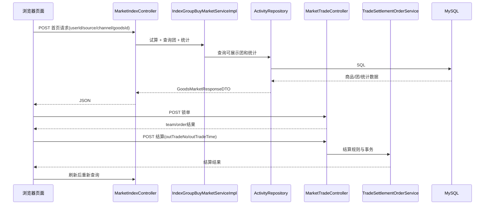
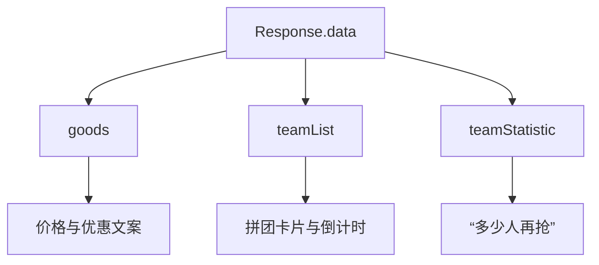
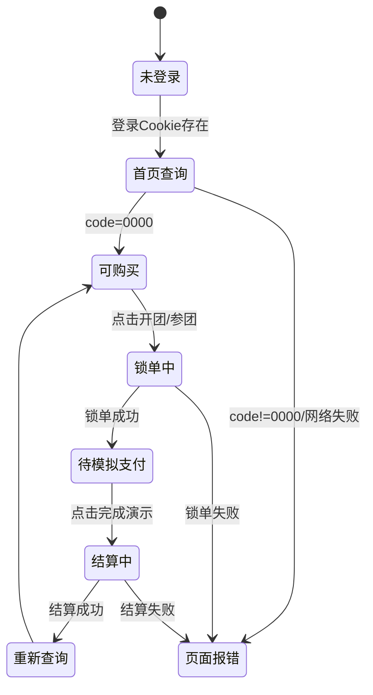

# 20 / 3-2：让拼团页面真正使用后端数据

> 2-15 已经提供首页查询、锁单和结算接口；本节把静态页面中的写死数据替换为接口数据。前端由 AI 实现，你只需要看关键请求、响应映射和真实浏览器结果。

## 0. 本节边界

本节只改 `docs/dev-ops/nginx/html/index.html` 和 `js/index.js`：

```text
打开页面
  → 读取模拟登录 Cookie
  → POST 首页接口
  → 用 goods / teamList / teamStatistic 渲染页面
  → 点击参团/开团
  → POST 锁单
  → 点击完成支付
  → POST 结算
  → 刷新页面重新查询
```



图中第一个箭头是“页面展示数据从哪里来”；锁单和结算是两次不同请求，不能把“弹窗显示”当作已锁单，也不能把“点击按钮”当作已结算。

## 1. 你只需要看三段前端代码

### 1.1 首页请求：把页面输入变成 JSON

关键位置：`index.js` 的 `fetch('/api/v1/gbm/index/query_group_buy_market_config')`。

```javascript
fetch(baseUrl + '/api/v1/gbm/index/query_group_buy_market_config', {
  method: 'POST',
  headers: {'Content-Type': 'application/json'},
  body: JSON.stringify({
    userId,
    source: 's01',
    channel: 'c01',
    goodsId: '9890001'
  })
})
```

这四个字段对应 `GoodsMarketRequestDTO`，不是随便拼出的页面参数。响应的外层 `code` 先判断，再读取 `data`：

```javascript
const {goods, teamList, teamStatistic} = response.data
```

### 1.2 响应映射：后端字段进入页面

```javascript
promotionText.textContent =
  `直降 ¥${goods.deductionPrice.toFixed(0)}，` +
  `${teamStatistic.allTeamUserCount}人再抢，参与马上抢到`

const remaining = team.targetCount - team.lockCount
```

这里的 `remaining` 不是后端新字段，而是前端根据两个后端字段计算的展示值。金额来自接口，不再信任 HTML 里原来的 `data-price="40"`。

页面分层关系：



白话：后端不是返回一整段 HTML，而是返回结构化数据；前端把不同对象放到不同区域。这样换商品或团数据时不用改页面骨架。

### 1.3 结算请求：点击完成才通知后端

```javascript
fetch(baseUrl + '/api/v1/gbm/trade/settlement_market_pay_order', {
  method: 'POST',
  headers: {'Content-Type': 'application/json'},
  body: JSON.stringify({
    source: 's01',
    channel: 'c01',
    userId,
    outTradeNo,
    outTradeTime: new Date().getTime()
  })
})
```

`outTradeNo` 必须来自刚才锁单成功的那笔交易；没有它不能把一个陌生订单当成已支付。`outTradeTime` 是本地模拟支付时间，真实系统应来自可信支付平台，不能相信浏览器自己报“我已付款”。

## 2. 我已实现的前端改动

前端文件由 AI 按本节边界实现，不要求你手敲 CSS。实现规则：

- 页面加载先检查模拟用户名；没有用户名回到 `login.html`。
- 页面加载 POST 首页接口；接口失败显示明确提示，不把空数据伪装成成功。
- `teamList` 为空显示“赶紧开团”的空状态；非空时动态生成团卡片。
- 自己的团保留 `outTradeNo`，其他用户的卡片不把外部单号放到 DOM。
- 开团或参团先 POST 锁单，成功后才显示模拟支付弹窗。
- 完成演示才 POST 结算；成功后刷新首页，重新读取数据库结果。
- 单独购买只保留页面演示，不把它当作拼团锁单。

前端静态文件的修改不改变 Java 接口签名；真实数据口径仍由后端 DTO 和 Controller 决定。

## 3. 真实验证：浏览器才是本节测试入口

前提：Application 已启动在 `8091`，MySQL/Redis 可用，使用你自己的独立测试数据。不要运行全量测试包，不要在共享库里重复锁单。

### 3.1 首页查询

1. 用浏览器打开 `docs/dev-ops/nginx/html/index.html` 的 HTTP 地址。
2. 没有模拟用户名时应跳登录页；输入测试用户后回到首页。
3. F12 → Network，找到 `query_group_buy_market_config`。
4. 检查 Request Payload 有 `userId/source/channel/goodsId`。
5. 检查 Response：
   - `code=0000` 才进入渲染；
   - 商品价格来自 `data.goods`；
   - `teamList=[]` 时显示空状态；
   - 非空时显示团卡片，剩余人数等于 `targetCount-lockCount`；
   - 统计文案来自 `teamStatistic.allTeamUserCount`。

### 3.2 开团与结算

1. 用一个未使用的测试用户和新外部单号点击“开团购买”。
2. Network 中确认先出现 `lock_market_pay_order`，且响应成功后才出现支付弹窗。
3. 点击“完成演示”，确认出现 `settlement_market_pay_order`，请求中 `outTradeNo` 与锁单请求一致。
4. 结算成功后页面刷新，再观察首页请求和响应；团的 `completeCount` 应反映新的数据库状态。
5. 断开后端或填错接口地址，确认页面显示失败提示；不能把网络失败刷新成成功。
6. 输入空 `goodsId` 或空支付时间，确认后端返回 `0002`，页面不应伪造成功。



白话：只有“锁单成功”才能进入模拟支付，只有“结算成功”才刷新并重新读后端。任何失败都停在失败分支，不应凭前端按钮改变数据库。

## 4. 这节不声称什么

- 页面请求打通，不等于真实支付验签。
- 浏览器传来的时间和用户 ID不能作为生产可信凭据。
- 页面刷新后数据正确，不等于结算并发幂等已经解决。
- 本节不增加 Java 测试；真实验证以浏览器 Network、响应 JSON 和独立库前后查询为准。

## 5. 你回看时只记三件事

1. **接口契约**：请求字段要对应 DTO，响应对象要对应页面区域。
2. **状态链**：查询 → 锁单 → 模拟支付 → 结算 → 再查询；按钮本身不代表业务成功。
3. **边界**：前端负责交互，后端负责价格、资格、订单和结算；前端不能成为安全边界。

本节完成后我会审阅浏览器与接口结果，明确通过范围并停下；你提交 Git、确认继续后，才进入后续章节。
