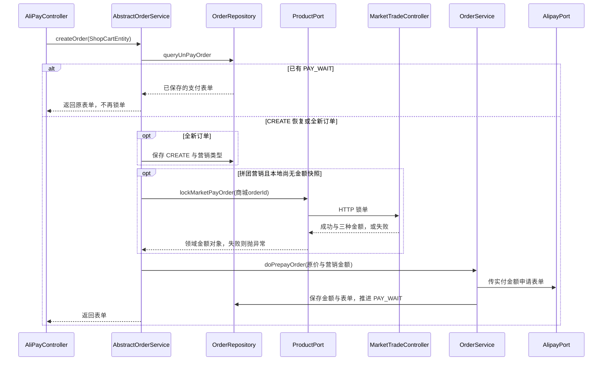
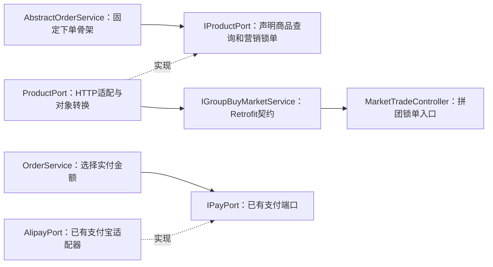

# 25 / 3-3：小商城对接营销锁单

> 前置：你已经学完独立商城。本节不重建商城，也不修改原 `s-pay-mall`；只把已有商城下单链路接到拼团锁单。
>
> 原文：[学习序号 25 / 3-3](../orgin-tutorial/4.第3部分：外部对接「小型支付商城」/25-3-3-小商城对接营销锁单.md)。下一节 26 / 3-4 才接营销结算。本节不改前端、不重新部署、不新增 MQ。

## 0. 先把工程和数据边界钉住

| 角色 | 根目录 | 本节允许做什么 |
| --- | --- | --- |
| 拼团服务 | `E:\dev\java\group-buy-market\group-buy-market` | 你手敲金额贯通代码，AI 写教程和审阅 |
| 商城对接副本 | `E:\dev\java\group-buy-market\s-pay-mall-market` | 你手敲商城对接代码，使用独立 Git 仓库 |
| 已完成的原商城 | `E:\dev\java\group-buy-market\s-pay-mall` | **严格只读，不改代码、配置、文档和 Git 状态** |
| 作者参考 | 拼团仓库的 `reference/` | 只读，用 `git show/diff`，不切分支 |

你已确认创建独立数据库 **`s-pay-mall-market`**。这证明库已创建，**不等于副本的数据源已经指过去**：运行前须在 IDEA 的 `local` 配置与运行参数中核对 JDBC 最后的库名，并在连接上执行 `select database();`。不要把密码、密钥贴到笔记或聊天里。

当前副本父 artifactId 是 `s-pay-mall-market`，子目录仍为 `s-pay-mall-*`，包名仍是 `com.sirius`。下文商城路径均相对 **`s-pay-mall-market` 根目录**，不是原商城目录。不为了目录名一致批量改包名、模块名或 JAR 名。

新副本复制过来的 `AGENTS.md`、记忆和学习指南仍含“原商城已完成”的路径与部署上下文；它们不能证明新副本已完成对接或部署。此处按本次明确边界操作，不重开原商城验收。Git 写操作只由你执行；开始实现前在新商城仓库建立自己的对接分支，拼团继续使用当前对接分支，不合并回两侧主分支。

由你在确认新商城工作区改动已妥善保留后执行（AI不执行）：

```bash
git -C "E:/dev/java/group-buy-market/s-pay-mall-market" status --short
git -C "E:/dev/java/group-buy-market/s-pay-mall-market" switch -c 261105-sirius-market-lock-order
```

若同名分支已存在，不重复创建或强制覆盖，先检查 `git branch --show-current`。本节只在拼团仓库维护这份教程及进度，不把复制来的商城历史进度当成本节验收。

本节目标：

1. 解释为什么商城订单号要作为拼团的 `outTradeNo`。
2. 沿新单、重复锁单两条路，把三种金额带回商城。
3. 把营销插入现有三条下单路径，保留你抽出的 `IPayPort`。
4. 营销失败时停止申请支付表单；无营销仍按原价下单。
5. 用真实接口与双库记录证明结果，而不是只看一条成功日志。

## 1. 从一笔 100 元订单推导设计

### 1.1 为什么商城不能自己减 10 元

假设同一商品在两侧都配置原价 100 元，拼团试算优惠 10 元，应付 90 元。

- 商城知道用户买了什么、自己的订单号是什么，负责创建支付宝支付单。
- 拼团知道活动是否有效、用户能否参加、队伍有没有位置，负责确定优惠并占一个名额。
- 商城若只调用“试算”就按 90 元收费，没有锁名额：用户可能付完款却进不了团。
- 商城若自己写 `100 - 10`，就把另一套系统的规则抄了一份；规则一改，两边就可能不一致。

所以本节要的不是“查一下价格”，而是 **锁单成功后，拿到这笔交易的价格快照，再申请支付表单**。

| 金额 | 拼团响应 | 商城落库 | 含义 |
| --- | --- | --- | --- |
| 原价 | `originalPrice` | `total_amount` | 商城商品订单的原价快照；两侧商品配置必须一致 |
| 优惠额 | `deductionPrice` | `market_deduction_amount` | 减掉多少钱，不是折后价 |
| 实付额 | `payPrice` | `pay_amount` | 传给 `IPayPort`，最终进入支付宝 `total_amount` |

示例是 `100 = 10 + 90`，不是 `100 = 90 + 90`。无营销则是 `100 = 0 + 100`。原商城的 1.68 元替身商品不变；只改新副本中的测试商品为 100 元以对齐拼团。

### 1.2 三个单号不是同一个概念

| 标识 | 谁生成 | 用在哪里 |
| --- | --- | --- |
| 商城 `orderId` | 商城 `CreateOrderAggregate` | 商城订单主标识；传给支付宝作为 `out_trade_no` |
| 拼团请求 `outTradeNo` | **复用商城 `orderId`** | 拼团识别同一外部交易，重复调用查原锁单 |
| 拼团响应 `orderId` | 拼团服务 | 拼团自己的营销订单号，不能拿它替换商城订单号 |

幂等的大白话：同一笔商城单重试，不应该再占一个拼团名额。为此每次重试都传同一个商城订单号；不能在 HTTP 适配器中重新随机生成。

### 1.2.1 订单号长度也是契约，不只是字段名相同

2026-11-06用户真实联调发现：商城原生成器为14位，而拼团明细表 `out_trade_no` 只有 `varchar(12)`。当前用户已在**新商城副本**的 `CreateOrderAggregate.buildOrderEntity` 把 `RandomStringUtils.randomNumeric(14)` 改为 `randomNumeric(12)`，新单链路由用户报告跑通；原商城生成器不改。

这里约束的是**外部订单号所落的字段**，不是因为“拼团内部order_id是12位，所以所有系统订单号都必须12位”。DTO都是String，Java编译和JSON契约检查发现不了数据库长度冲突。若将来要兼容14位外部号，可以评估扩展拼团out_trade_no；本节采纳12位新商城单号这个最小适配，不改库字段上限。

在新商城 `s-pay-mall-domain/src/main/java/com/sirius/domain/order/model/aggregate/CreateOrderAggregate.java` 的原builder中只改生成行：

```java
.orderId(RandomStringUtils.randomNumeric(12)) // 适配拼团out_trade_no的varchar(12)约束
```

旧教程没有检查此限制，并给出了14字符的 `L25-DIRECT-0001`，属于备课遗漏。第6节示例现为11字符的 `L25-DIR-0001`。随机12位不是全局唯一ID方案，仍依赖数据库唯一约束；缩短随机空间的碰撞风险不能描述为已消除。

失败后已有的14位CREATE不会因为修改生成器自动变短：恢复会复用旧号。核对这些测试单时用新测试用户创建新单，或先确认两侧数据再单独处理；**不截断旧号、不单边改关联号、不批量删除订单**。

`TradeRepository.lockMarketPayOrder` 当前把所有insert异常都转为INDEX_EXCEPTION，因此长度超限、字段不存在、非空约束等也可能显示“唯一索引错误”。这是历史异常分类缺陷；按用户本次报错与修复核对定位，不冒充代理已复现JDBC长度异常。真实根因应看原始SQLException，不能只凭包装码认定唯一键重复。本节建议后续收窄为捕获重复键异常并保留原因，未授权不代改。

### 1.3 在哪里接入现有流程



图从已有下单入口开始。PAY_WAIT 已有可用表单，直接返回；CREATE 是本地单已建、支付信息未完成，需要恢复。新订单先落 CREATE，再锁团，然后才申请支付表单。**锁单失败会中断当前调用，但先前保存的 CREATE 可能仍在，这不是“什么都没发生”。**

### 1.4 为什么不在 AbstractOrderService 里写 HTTP

照直写：领域里拼 URL、JSON、Retrofit 和错误码。结果是“是否参与营销”的业务流程与“怎样发网络请求”绑死，也违反 domain 不依赖 infrastructure 的方向。

沿用参考章节的端口结构：



图中实线是使用，虚线是实现。**端口适配**把外部通信挡在领域外；**模板方法**保留 `AbstractOrderService` 的下单骨架，把支付执行留给 `OrderService`。代价是多一层 DTO 映射，但不需要复制整套商城，更不需要把支付宝 SDK 搬回 domain。

本节沿用作者把锁单放进 `IProductPort` 的做法；职责以后真的变复杂再考虑拆营销端口，不为这一次调用预设一套新框架。

## 2. 动手前：只核对，不改原工程

1. 分别在拼团、新商城执行 `git status --short`，确认 IDEA 打开的绝对路径。
2. 使用 JDK 8：IDEA Project SDK、运行 JRE、Maven Runner JRE 都要核对。终端默认 JDK 21 不代表项目用的是 8。
3. 新商城选择 `local`，确认 JDBC 指向 `s-pay-mall-market`，且其中已有原商城结构的 `pay_order` 表。只有空库时，由你审阅原建表 SQL 后在**新库**建表，不把含 DROP 的脚本重放到已有业务库。
4. 拼团使用隔离测试库和独立 Redis 数据范围，不随意清空 Redis。商城是 Guava 内存缓存，**没有第二套 Redis**。
5. 本地拼团 8091、新商城 8080；原商城进程不同时占 8080。本节不操作云端配置。
6. 准备有效的拼团活动、商品和渠道。示例 `100123 / 9890001 / s01 / c01` 只有在当前库实际有效时才能用；检查活动起止时间、人群限制、可参与次数和组队有效期，不照抄历史日期。

先在 IDEA 定位三处：`AbstractOrderService.createOrder`、`OrderService.doPrepayOrder`、`AlipayPort.doPrepayOrder`。现在传给支付宝的是原价；本节最后应变成领域选择的实付价，`AlipayPort` 本身不用改。

## 3. 第一阶段：拼团侧把金额快照贯通

**本节路径根：`group-buy-market`。** 共七个已有文件，加一条由你执行的增量 SQL。下面小文件给完整内容；长历史文件只给完整目标方法或逐处差异，不让你重抄无关结算代码。

### 3.1 表与三个金额载体

先在拼团隔离库执行 `show columns from group_buy_order_list like 'pay_price';`。不存在才执行：

```sql
alter table group_buy_order_list
    add column pay_price decimal(10, 2) default null comment '本笔拼团订单实付金额';
```

旧明细的 NULL 不会自动补上；本轮用新测试单。不要用今天重新试算的价格回填历史交易，也不要不看数据就把全表改成固定 90 元。

在已有 `GroupBuyOrderList` 的 `deductionPrice` 后增加字段，其余不变：

```java
/** 实付金额快照；重复锁单从明细读取，不重新计算。 */
private BigDecimal payPrice;
```

IDEA 文件：`group-buy-market-infrastructure/src/main/java/com/sirius/infrastructure/dao/po/GroupBuyOrderList.java`。已有 `BigDecimal` import，不重复引入。

领域返回对象要让调用者拿到三种金额。

**文件**：`group-buy-market-domain/src/main/java/com/sirius/domain/trade/model/entity/MarketPayOrderEntity.java`
```java
package com.sirius.domain.trade.model.entity;

import com.sirius.domain.trade.model.valobj.TradeOrderStatusEnumVO;
import lombok.AllArgsConstructor;
import lombok.Builder;
import lombok.Data;
import lombok.NoArgsConstructor;
import java.math.BigDecimal;

/** 一笔营销锁单的结果；金额属于该订单快照，而不是当前页面报价。 */
@Data
@Builder
@AllArgsConstructor
@NoArgsConstructor
public class MarketPayOrderEntity {
    private String teamId;
    private String orderId;
    /** 原价。 */
    private BigDecimal originalPrice;
    /** 优惠额。 */
    private BigDecimal deductionPrice;
    /** 实付额。 */
    private BigDecimal payPrice;
    private TradeOrderStatusEnumVO tradeOrderStatusEnumVO;
}
```

HTTP 响应保持现有协议，只补两个字段。

**文件**：`group-buy-market-api/src/main/java/com/sirius/api/dto/LockMarketPayOrderResponseDTO.java`
```java
package com.sirius.api.dto;

import lombok.AllArgsConstructor;
import lombok.Builder;
import lombok.Data;
import lombok.NoArgsConstructor;
import java.math.BigDecimal;

/** 营销锁单响应；orderId 是拼团订单号，三个金额均由拼团服务确定。 */
@Data
@Builder
@AllArgsConstructor
@NoArgsConstructor
public class LockMarketPayOrderResponseDTO {
    private String orderId;
    private BigDecimal originalPrice;
    private BigDecimal deductionPrice;
    private BigDecimal payPrice;
    /** 0 表示初始锁单；不是支付成功。 */
    private Integer tradeOrderStatus;
}
```

### 3.2 仓储：不要漏掉“已有单”这条返回路

文件：`group-buy-market-infrastructure/src/main/java/com/sirius/infrastructure/adapter/repository/TradeRepository.java`。

先替换完整查询方法：

```java
@Override
public MarketPayOrderEntity queryMarketPayOrderEntityByOutTradeNo(String userId, String outTradeNo) {
    GroupBuyOrderList req = new GroupBuyOrderList();
    req.setUserId(userId);
    req.setOutTradeNo(outTradeNo);
    GroupBuyOrderList record = groupBuyOrderListDao.queryGroupBuyOrderRecordByOutTradeNo(req);
    if (record == null) return null;
    return MarketPayOrderEntity.builder()
            .teamId(record.getTeamId())
            .orderId(record.getOrderId())
            .originalPrice(record.getOriginalPrice())
            .deductionPrice(record.getDeductionPrice())
            .payPrice(record.getPayPrice())
            .tradeOrderStatusEnumVO(TradeOrderStatusEnumVO.valueOf(record.getStatus()))
            .build();
}
```

然后在 `lockMarketPayOrder` 内，**构建明细 `GroupBuyOrderList`** 的 builder 中紧接优惠额加一行（不是已经有 payPrice 的团主表 builder）：

```java
.originalPrice(payDiscountEntity.getOriginalPrice())
.deductionPrice(payDiscountEntity.getDeductionPrice())
.payPrice(payDiscountEntity.getPayPrice())
.status(TradeOrderStatusEnumVO.CREATE.getCode())
```

最后把该方法末尾的返回语句替换为：

```java
return MarketPayOrderEntity.builder()
        .orderId(orderId)
        .originalPrice(payDiscountEntity.getOriginalPrice())
        .deductionPrice(payDiscountEntity.getDeductionPrice())
        .payPrice(payDiscountEntity.getPayPrice())
        .tradeOrderStatusEnumVO(TradeOrderStatusEnumVO.CREATE)
        .build();
```

为什么三处都要改：新单从试算参数拿金额，重试从数据库快照拿金额；漏查询映射会出现“第一次 90 元，第二次 null”。本节不重算旧单。

### 3.3 Controller：两条响应分支都补齐

文件：`group-buy-market-trigger/src/main/java/com/sirius/trigger/http/MarketTradeController.java`。

`lockMarketPayOrder` 中“存在旧单”和“新锁单完成”各有一个响应 builder。两处都把金额部分改成：

```java
.orderId(marketPayOrderEntity.getOrderId())
.originalPrice(marketPayOrderEntity.getOriginalPrice())
.deductionPrice(marketPayOrderEntity.getDeductionPrice())
.payPrice(marketPayOrderEntity.getPayPrice())
.tradeOrderStatus(marketPayOrderEntity.getTradeOrderStatusEnumVO().getCode())
```

不更改响应码、不新增 `teamId` 返回字段、不改已有结算方法。

### 3.4 Mapper：写进去，还必须查得出

文件：`group-buy-market-app/src/main/resources/mybatis/mapper/group_buy_order_list_mapper.xml`。

在 `dataMap` 的 `deduction_price` 后增加：

```xml
<result column="pay_price" property="payPrice"/>
```

只替换下面两个语句，保留其他查询与结算 SQL：

```xml
<insert id="insert" parameterType="com.sirius.infrastructure.dao.po.GroupBuyOrderList">
    insert into group_buy_order_list(
        user_id, team_id, order_id, activity_id, start_time,
        end_time, goods_id, source, channel, original_price, deduction_price, pay_price, status,
        out_trade_no, biz_id, create_time, update_time
    ) values(
        #{userId}, #{teamId}, #{orderId}, #{activityId}, #{startTime},
        #{endTime}, #{goodsId}, #{source}, #{channel}, #{originalPrice}, #{deductionPrice}, #{payPrice}, #{status},
        #{outTradeNo}, #{bizId}, now(), now()
    )
</insert>

<select id="queryGroupBuyOrderRecordByOutTradeNo"
        parameterType="com.sirius.infrastructure.dao.po.GroupBuyOrderList" resultMap="dataMap">
    select user_id, team_id, order_id, activity_id, start_time,
           end_time, goods_id, source, channel, original_price, deduction_price, pay_price, status,
           out_trade_no
    from group_buy_order_list
    where out_trade_no = #{outTradeNo} and user_id = #{userId} and status = 0
</select>
```

阶段检查：用同一 userId/outTradeNo 连续调用两次锁单，第二次订单号和三种金额不变，明细行数不增加。具体请求见第 6 节。此时先不要改商城流程。

## 4. 第二阶段：新商城准备契约和字段

**本节路径根：`s-pay-mall-market`。** 从这里开始禁止在原 `s-pay-mall` 窗口敲代码。

### 4.1 先加表字段，不重建表

在新商城连接中执行 `select database();`，必须为 `s-pay-mall-market`；检查三个字段不存在后执行：

```sql
alter table pay_order
    add column market_type int not null default 0 comment '营销类型：0无营销，1拼团',
    add column market_deduction_amount decimal(10, 2) default null comment '优惠额快照',
    add column pay_amount decimal(10, 2) default null comment '实付额快照';
```

`total_amount` 仍是原价，不能把它直接覆盖成 90。原有行会得到无营销类型 0；本轮使用新用户，不擅自批量重算旧订单金额。

### 4.2 营销类型与结果对象

目的：业务层要表达“是否参与营销”和“锁到了什么价”，不让领域认识 Retrofit DTO。

**文件**：`s-pay-mall-domain/src/main/java/com/sirius/domain/order/model/valobj/MarketTypeVO.java`

```java
package com.sirius.domain.order.model.valobj;

import lombok.AllArgsConstructor;
import lombok.Getter;

/** 下单营销方式；没有传营销信息的旧页面仍走 NO_MARKET。 */
@Getter
@AllArgsConstructor
public enum MarketTypeVO {
    NO_MARKET(0),
    GROUP_BUY_MARKET(1);

    private final Integer code;
}
```

**文件**：`s-pay-mall-domain/src/main/java/com/sirius/domain/order/model/entity/MarketPayDiscountEntity.java`

```java
package com.sirius.domain.order.model.entity;

import lombok.AllArgsConstructor;
import lombok.Builder;
import lombok.Data;
import lombok.NoArgsConstructor;
import java.math.BigDecimal;

/** 外部营销锁单成功后形成的金额快照；不包含 HTTP 客户端对象。 */
@Data
@Builder
@NoArgsConstructor
@AllArgsConstructor
public class MarketPayDiscountEntity {
    private BigDecimal originalPrice;
    private BigDecimal deductionPrice;
    private BigDecimal payPrice;
}
```

### 4.3 订单与支付结果保留金额

以下是已有字段后**新增的完整字段块**，不是整类覆盖。两文件已有 `BigDecimal` 的才无需补 import。

文件：`s-pay-mall-domain/src/main/java/com/sirius/domain/order/model/entity/OrderEntity.java`，在类末尾加入：

```java
/** 创建订单时就保存选择，恢复 CREATE 时不能被新请求改成原价单。 */
private Integer marketType;
/** 金额随支付信息写入，CREATE 中可能尚未取得快照。 */
private BigDecimal marketDeductionAmount;
private BigDecimal payAmount;
```

文件：`s-pay-mall-domain/src/main/java/com/sirius/domain/order/model/entity/PayOrderEntity.java`，先加 `import java.math.BigDecimal;`，在类末尾加入：

```java
/** 本次申请支付单使用的营销类型和金额，交给仓储持久化。 */
private Integer marketType;
private BigDecimal marketDeductionAmount;
private BigDecimal payAmount;
```

文件：`s-pay-mall-infrastructure/src/main/java/com/sirius/infrastructure/dao/po/PayOrder.java`，在类末尾加入：

```java
private Integer marketType;
private BigDecimal marketDeductionAmount;
private BigDecimal payAmount;
```

这些字段此时还不改变订单行为。`CreateOrderAggregate.buildOrderEntity` 签名保持不变：原价快照仍按你的实现传入，营销类型在新单组装时再设置。

### 4.4 扩展下单入参，立刻成对修改调用方

这里 `ShopCartEntity` 增字段会改变 Lombok 全参构造器，因此同一轮把 Controller 的两参构造调用改成 builder，不能把它留红等下一步。

**文件**：`s-pay-mall-domain/src/main/java/com/sirius/domain/order/model/entity/ShopCartEntity.java`
```java
package com.sirius.domain.order.model.entity;

import com.sirius.domain.order.model.valobj.MarketTypeVO;
import lombok.AllArgsConstructor;
import lombok.Builder;
import lombok.Data;
import lombok.NoArgsConstructor;

/** 下单意图；teamId 为空表示开团，价格不由客户端传入。 */
@Data
@Builder
@AllArgsConstructor
@NoArgsConstructor
public class ShopCartEntity {
    private String userId;
    private String productId;
    private String teamId;
    private Long activityId;
    private MarketTypeVO marketTypeVO;
}
```

**文件**：`s-pay-mall-api/src/main/java/com/sirius/api/dto/CreatePayRequestDTO.java`

```java
package com.sirius.api.dto;

import lombok.Data;

/** 创建支付单；教学项目仍由请求传 userId，不宣称已做可信登录身份绑定。 */
@Data
public class CreatePayRequestDTO {
    private String userId;
    private String productId;
    /** 空值表示开团。 */
    private String teamId;
    private Long activityId;
    /** 不传或0表示无营销，1表示拼团。 */
    private Integer marketType;
}
```

文件：`s-pay-mall-trigger/src/main/java/com/sirius/trigger/http/AliPayController.java`，新增 import：

```java
import com.sirius.domain.order.model.valobj.MarketTypeVO;
import com.sirius.types.exception.AppException;
import org.apache.commons.lang3.StringUtils;
```

替换整个 `createPayOrder` 方法，**保留原有 `payNotify`、公钥字段和订单服务注入**：

```java
@Override
@PostMapping("create_pay_order")
public Response<String> createPayOrder(@RequestBody CreatePayRequestDTO request) {
    Integer type = request.getMarketType();
    if (StringUtils.isAnyBlank(request.getUserId(), request.getProductId())
            || (type != null && type != 0 && type != 1)
            || (Integer.valueOf(1).equals(type) && request.getActivityId() == null)) {
        return Response.<String>builder()
                .code(ResponseCode.ILLEGAL_PARAMETER.getCode())
                .info(ResponseCode.ILLEGAL_PARAMETER.getInfo()).build();
    }
    MarketTypeVO marketType = Integer.valueOf(1).equals(type)
            ? MarketTypeVO.GROUP_BUY_MARKET : MarketTypeVO.NO_MARKET;
    try {
        PayOrderEntity payOrder = orderService.createOrder(ShopCartEntity.builder()
                .userId(request.getUserId())
                .productId(request.getProductId())
                .teamId(request.getTeamId())
                .activityId(request.getActivityId())
                .marketTypeVO(marketType)
                .build());
        log.info("下单完成 orderId={}", payOrder.getOrderId());
        return Response.<String>builder()
                .code(ResponseCode.SUCCESS.getCode())
                .info(ResponseCode.SUCCESS.getInfo())
                .data(payOrder.getPayUrl()).build();
    } catch (AppException e) {
        log.warn("下单被业务规则拒绝 userId={} code={}", request.getUserId(), e.getCode());
        return Response.<String>builder().code(e.getCode()).info(e.getInfo()).build();
    } catch (Exception e) {
        log.error("下单失败 userId={}", request.getUserId(), e);
        return Response.<String>builder()
                .code(ResponseCode.UN_ERROR.getCode())
                .info(ResponseCode.UN_ERROR.getInfo()).build();
    }
}
```

此处只校验网络入参。不要让任意整数被默认为无营销；锁单失败返回的业务码也不能被成功响应盖掉。暂未接营销服务的中间态不要启动写库下单。

### 4.5 网络契约先落盘

新建请求、响应和响应外壳。`channel` 拼写两端一致；不用参考配置里误拼的 `chanel`。商城不依赖拼团的 api JAR，而是通过 JSON 契约通信。

**文件**：`s-pay-mall-infrastructure/src/main/java/com/sirius/infrastructure/gateway/dto/LockMarketPayOrderRequestDTO.java`

```java
package com.sirius.infrastructure.gateway.dto;

import lombok.Data;

/** 发往拼团服务的锁单请求；outTradeNo 必须是商城订单号。 */
@Data
public class LockMarketPayOrderRequestDTO {
    private String userId;
    private String teamId;
    private Long activityId;
    private String goodsId;
    private String source;
    private String channel;
    private String outTradeNo;
    private String notifyUrl;
}
```

**文件**：`s-pay-mall-infrastructure/src/main/java/com/sirius/infrastructure/gateway/dto/LockMarketPayOrderResponseDTO.java`

```java
package com.sirius.infrastructure.gateway.dto;

import lombok.Data;
import java.math.BigDecimal;

/** 拼团响应数据；orderId 是营销单号，不能覆盖本地订单号。 */
@Data
public class LockMarketPayOrderResponseDTO {
    private String orderId;
    private BigDecimal originalPrice;
    private BigDecimal deductionPrice;
    private BigDecimal payPrice;
    private Integer tradeOrderStatus;
}
```

**文件**：`s-pay-mall-infrastructure/src/main/java/com/sirius/infrastructure/gateway/response/Response.java`
```java
package com.sirius.infrastructure.gateway.response;

import lombok.Data;

/** 外部营销服务响应外壳；HTTP 200 不代表业务 code 成功。 */
@Data
public class Response<T> {
    private String code;
    private String info;
    private T data;
}
```

**文件**：`s-pay-mall-infrastructure/src/main/java/com/sirius/infrastructure/gateway/IGroupBuyMarketService.java`

```java
package com.sirius.infrastructure.gateway;

import com.sirius.infrastructure.gateway.dto.LockMarketPayOrderRequestDTO;
import com.sirius.infrastructure.gateway.dto.LockMarketPayOrderResponseDTO;
import com.sirius.infrastructure.gateway.response.Response;
import retrofit2.Call;
import retrofit2.http.Body;
import retrofit2.http.POST;

/** 拼团 HTTP 契约，具体网络执行由基础设施适配器负责。 */
public interface IGroupBuyMarketService {
    /**
     * 锁定一笔营销交易，可能创建团或增加团锁单量。
     * 同一 userId/outTradeNo 重试读取原锁单；非0000不能创建优惠支付单。
     */
    @POST("api/v1/gbm/trade/lock_market_pay_order")
    Call<Response<LockMarketPayOrderResponseDTO>> lockMarketPayOrder(
            @Body LockMarketPayOrderRequestDTO request);
}
```

### 4.6 端口声明与实现一起改

为什么这里校验 HTTP 和金额：外部响应是系统边界，不保证请求成功就有 body，更不保证业务成功就有合法金额。反过来，领域内部对象不需要层层重复判空。

**文件**：`s-pay-mall-domain/src/main/java/com/sirius/domain/order/adapter/port/IProductPort.java`
```java
package com.sirius.domain.order.adapter.port;

import com.sirius.domain.order.model.entity.MarketPayDiscountEntity;
import com.sirius.domain.order.model.entity.ProductEntity;

/** 商品与本节营销能力端口；领域不依赖 HTTP DTO 或 Retrofit。 */
public interface IProductPort {
    /** 根据商品ID取得商品快照来源。 */
    ProductEntity queryProductByProductId(String productId);

    /**
     * 为商城orderId锁定营销价，teamId为空开团，否则参团。
     * 成功返回金额快照；拒绝、网络异常或非法响应均抛异常，不能返回null降级原价。
     */
    MarketPayDiscountEntity lockMarketPayOrder(String userId, String teamId,
            Long activityId, String productId, String orderId);
}
```

**文件**：`s-pay-mall-infrastructure/src/main/java/com/sirius/infrastructure/adapter/port/ProductPort.java`
```java
package com.sirius.infrastructure.adapter.port;

import com.sirius.domain.order.adapter.port.IProductPort;
import com.sirius.domain.order.model.entity.MarketPayDiscountEntity;
import com.sirius.domain.order.model.entity.ProductEntity;
import com.sirius.infrastructure.gateway.IGroupBuyMarketService;
import com.sirius.infrastructure.gateway.ProductRPC;
import com.sirius.infrastructure.gateway.dto.LockMarketPayOrderRequestDTO;
import com.sirius.infrastructure.gateway.dto.LockMarketPayOrderResponseDTO;
import com.sirius.infrastructure.gateway.dto.ProductDTO;
import com.sirius.infrastructure.gateway.response.Response;
import com.sirius.types.exception.AppException;
import org.springframework.beans.factory.annotation.Value;
import org.springframework.stereotype.Component;
import java.io.IOException;
import java.math.BigDecimal;

/** 外部商品/营销适配器；把网络响应转换成领域对象，不静默吞掉锁单失败。 */
@Component
public class ProductPort implements IProductPort {
    private final ProductRPC productRPC;
    private final IGroupBuyMarketService groupBuyMarketService;

    @Value("${app.config.group-buy-market.source}")
    private String source;
    @Value("${app.config.group-buy-market.channel}")
    private String channel;
    @Value("${app.config.group-buy-market.notify-url}")
    private String notifyUrl;

    public ProductPort(ProductRPC productRPC, IGroupBuyMarketService groupBuyMarketService) {
        this.productRPC = productRPC;
        this.groupBuyMarketService = groupBuyMarketService;
    }

    @Override
    public ProductEntity queryProductByProductId(String productId) {
        ProductDTO dto = productRPC.queryProductByProductId(productId);
        return ProductEntity.builder()
                .productId(dto.getProductId()).productName(dto.getProductName())
                .productDesc(dto.getProductDesc()).price(dto.getPrice()).build();
    }

    @Override
    public MarketPayDiscountEntity lockMarketPayOrder(String userId, String teamId,
            Long activityId, String productId, String orderId) {
        LockMarketPayOrderRequestDTO request = new LockMarketPayOrderRequestDTO();
        request.setUserId(userId);
        request.setTeamId(teamId);
        request.setActivityId(activityId);
        request.setGoodsId(productId);
        request.setSource(source);
        request.setChannel(channel);
        request.setOutTradeNo(orderId);
        request.setNotifyUrl(notifyUrl);
        try {
            retrofit2.Response<Response<LockMarketPayOrderResponseDTO>> http =
                    groupBuyMarketService.lockMarketPayOrder(request).execute();
            if (!http.isSuccessful()) {
                if (http.errorBody() != null) http.errorBody().close();
                throw new AppException("MKT_HTTP", "营销服务HTTP调用失败");
            }
            Response<LockMarketPayOrderResponseDTO> body = http.body();
            if (body == null) throw new AppException("MKT_RESPONSE", "营销服务返回空响应");
            if (!"0000".equals(body.getCode())) {
                throw new AppException("MKT_REJECTED", "营销锁单失败：" + body.getInfo());
            }
            LockMarketPayOrderResponseDTO data = body.getData();
            if (data == null || data.getOriginalPrice() == null
                    || data.getDeductionPrice() == null || data.getPayPrice() == null
                    || data.getOriginalPrice().compareTo(BigDecimal.ZERO) <= 0
                    || data.getDeductionPrice().compareTo(BigDecimal.ZERO) < 0
                    || data.getPayPrice().compareTo(BigDecimal.ZERO) <= 0
                    || data.getOriginalPrice().compareTo(
                            data.getDeductionPrice().add(data.getPayPrice())) != 0) {
                throw new AppException("MKT_RESPONSE", "营销服务金额契约不完整或不一致");
            }
            return MarketPayDiscountEntity.builder()
                    .originalPrice(data.getOriginalPrice())
                    .deductionPrice(data.getDeductionPrice())
                    .payPrice(data.getPayPrice()).build();
        } catch (IOException e) {
            throw new AppException("MKT_NETWORK", "营销服务连接失败，未创建支付单", e);
        }
    }
}
```

`MKT_*` 是新商城对外的本节错误码字符串，不假称它们来自原枚举；`0000` 仍是唯一成功。外部业务码与本地码不混用，详情通过 info 说明。这里没有自动重试，超时配置也未另做生产化改造。

注意：请求超时不证明拼团没写成功。因此“失败停止支付”不等于“跨系统回滚”。后续用**同一个商城订单号**重试查询原锁单；本节不宣称分布式事务。

### 4.7 Bean 装配：微信客户端不要被替换

保留现有微信 `Retrofit` Bean，新增的是拼团接口 Bean，内部单独构造其 Retrofit，避免两个同类型 Retrofit Bean 导致现有注入歧义。

**文件**：`s-pay-mall-app/src/main/java/com/sirius/config/Retrofit2Config.java`
```java
package com.sirius.config;

import com.sirius.infrastructure.gateway.IGroupBuyMarketService;
import com.sirius.infrastructure.gateway.IWeixinApiService;
import org.springframework.beans.factory.annotation.Value;
import org.springframework.context.annotation.Bean;
import org.springframework.context.annotation.Configuration;
import retrofit2.Retrofit;
import retrofit2.converter.jackson.JacksonConverterFactory;

/** 装配微信和拼团两个不同根地址的HTTP客户端。 */
@Configuration
public class Retrofit2Config {
    private static final String BASE_URL = "https://api.weixin.qq.com/";

    @Bean
    public Retrofit retrofit() {
        return new Retrofit.Builder().baseUrl(BASE_URL)
                .addConverterFactory(JacksonConverterFactory.create()).build();
    }

    @Bean
    public IWeixinApiService weixinApiService(Retrofit retrofit) {
        return retrofit.create(IWeixinApiService.class);
    }

    @Bean
    public IGroupBuyMarketService groupBuyMarketService(
            @Value("${app.config.group-buy-market.api-url}") String apiUrl) {
        return new Retrofit.Builder().baseUrl(apiUrl)
                .addConverterFactory(JacksonConverterFactory.create()).build()
                .create(IGroupBuyMarketService.class);
    }
}
```

## 5. 第三阶段：落库与订单流程成环

### 5.1 仓储三处映射必须成环

文件：`s-pay-mall-infrastructure/src/main/java/com/sirius/infrastructure/adapter/repository/OrderRepository.java`。不改支付成功、事件发送和关单方法。

在 `doSaveOrder` 的 `po.setStatus(...)` 后追加：

```java
po.setMarketType(order.getMarketType());
```

创建时就保存营销意图；如果等申请表单成功后才保存，锁单失败留下的 CREATE 单会忘记自己本来要参团。

在 `queryUnPayOrder` 返回 builder 的 `.payUrl(...)` 后、`.build()` 前追加：

```java
.marketType(result.getMarketType())
.marketDeductionAmount(result.getMarketDeductionAmount())
.payAmount(result.getPayAmount())
```

在 `updateOrderPayInfo` 请求 builder 的 `.payUrl(...)` 后、`.build()` 前追加：

```java
.marketType(payOrderEntity.getMarketType())
.marketDeductionAmount(payOrderEntity.getMarketDeductionAmount())
.payAmount(payOrderEntity.getPayAmount())
```

### 5.2 模板与子类同一轮修改，保留 IPayPort

下面两个完整文件一起落盘。先有实体与端口，再改它们，避免签名引用不存在的类。

**文件**：`s-pay-mall-domain/src/main/java/com/sirius/domain/order/service/AbstractOrderService.java`
```java
package com.sirius.domain.order.service;

import com.sirius.domain.order.adapter.port.IProductPort;
import com.sirius.domain.order.adapter.repository.IOrderRepository;
import com.sirius.domain.order.model.aggregate.CreateOrderAggregate;
import com.sirius.domain.order.model.entity.MarketPayDiscountEntity;
import com.sirius.domain.order.model.entity.OrderEntity;
import com.sirius.domain.order.model.entity.PayOrderEntity;
import com.sirius.domain.order.model.entity.ProductEntity;
import com.sirius.domain.order.model.entity.ShopCartEntity;
import com.sirius.domain.order.model.valobj.MarketTypeVO;
import com.sirius.domain.order.model.valobj.OrderStatusVO;
import com.sirius.types.exception.AppException;
import lombok.extern.slf4j.Slf4j;
import java.math.BigDecimal;

/** 下单骨架：复用支付单，或恢复/创建本地单后先锁营销，再申请支付。 */
@Slf4j
public abstract class AbstractOrderService implements IOrderService {
    protected final IOrderRepository repository;
    protected final IProductPort port;

    public AbstractOrderService(IOrderRepository repository, IProductPort port) {
        this.repository = repository;
        this.port = port;
    }

    @Override
    public PayOrderEntity createOrder(ShopCartEntity cart) throws Exception {
        // 领域的直接调用者也可省略营销方式，保持原来的普通下单能力。
        MarketTypeVO type = cart.getMarketTypeVO() == null
                ? MarketTypeVO.NO_MARKET : cart.getMarketTypeVO();
        OrderEntity order = repository.queryUnPayOrder(cart);
        if (order != null) {
            // 同用户同商品沿用旧单语义，不把原价单悄悄改成营销单，反之亦然。
            if (!type.getCode().equals(order.getMarketType())) {
                throw new AppException("MKT_CONFLICT", "已有不同营销方式的未支付订单，请先处理原订单");
            }
            if (OrderStatusVO.PAY_WAIT.equals(order.getOrderStatusVO())) {
                log.info("复用PAY_WAIT订单 orderId={}", order.getOrderId());
                return PayOrderEntity.builder().orderId(order.getOrderId())
                        .payUrl(order.getPayUrl()).build();
            }
            log.info("恢复CREATE订单 orderId={}", order.getOrderId());
        } else {
            ProductEntity product = port.queryProductByProductId(cart.getProductId());
            order = CreateOrderAggregate.buildOrderEntity(
                    product.getProductId(), product.getProductName(), product.getPrice());
            order.setMarketType(type.getCode());
            doSaveOrder(CreateOrderAggregate.builder().userId(cart.getUserId())
                    .productEntity(product).orderEntity(order).build());
        }

        MarketPayDiscountEntity discount = null;
        if (MarketTypeVO.GROUP_BUY_MARKET.equals(type)) {
            if (order.getPayAmount() != null && order.getMarketDeductionAmount() != null) {
                // 恢复已有金额快照的CREATE单，不用今日活动价覆盖旧单。
                discount = MarketPayDiscountEntity.builder()
                        .originalPrice(order.getTotalAmount())
                        .deductionPrice(order.getMarketDeductionAmount())
                        .payPrice(order.getPayAmount()).build();
            } else {
                if (cart.getActivityId() == null) {
                    throw new AppException("0002", "拼团下单必须提供活动ID");
                }
                discount = port.lockMarketPayOrder(cart.getUserId(), cart.getTeamId(),
                        cart.getActivityId(), cart.getProductId(), order.getOrderId());
                // 两侧是同一商品，原价不一致时拒绝收费，而非覆盖商城商品快照。
                if (order.getTotalAmount().compareTo(discount.getOriginalPrice()) != 0) {
                    throw new AppException("MKT_PRICE", "商城与拼团的商品原价不一致");
                }
            }
        }
        return doPrepayOrder(order.getProductName(), order.getOrderId(),
                order.getTotalAmount(), discount);
    }

    /** 先保存CREATE订单；后续远程失败仍保留原单号用于恢复。 */
    protected abstract void doSaveOrder(CreateOrderAggregate aggregate);

    /** discount为空仅表示无营销；营销失败必须抛异常，不能传空值走原价。 */
    protected abstract PayOrderEntity doPrepayOrder(String productName, String orderId,
            BigDecimal totalAmount, MarketPayDiscountEntity discount) throws Exception;
}
```

**文件**：`s-pay-mall-domain/src/main/java/com/sirius/domain/order/service/OrderService.java`
```java
package com.sirius.domain.order.service;

import com.sirius.domain.order.adapter.port.IPayPort;
import com.sirius.domain.order.adapter.port.IProductPort;
import com.sirius.domain.order.adapter.repository.IOrderRepository;
import com.sirius.domain.order.model.aggregate.CreateOrderAggregate;
import com.sirius.domain.order.model.entity.MarketPayDiscountEntity;
import com.sirius.domain.order.model.entity.PayOrderEntity;
import com.sirius.domain.order.model.valobj.MarketTypeVO;
import com.sirius.domain.order.model.valobj.OrderStatusVO;
import org.springframework.stereotype.Service;
import javax.annotation.Resource;
import java.math.BigDecimal;
import java.util.List;

/** 订单具体实现：确定实付额，调用已有支付端口，并保存支付快照。 */
@Service
public class OrderService extends AbstractOrderService {
    @Resource
    private IPayPort port;

    public OrderService(IOrderRepository repository, IProductPort port) {
        super(repository, port);
    }

    @Override
    protected void doSaveOrder(CreateOrderAggregate aggregate) {
        repository.doSaveOrder(aggregate);
    }

    @Override
    protected PayOrderEntity doPrepayOrder(String productName, String orderId,
            BigDecimal totalAmount, MarketPayDiscountEntity discount) throws Exception {
        BigDecimal payAmount = discount == null ? totalAmount : discount.getPayPrice();
        String form = port.doPrepayOrder(productName, orderId, payAmount);
        PayOrderEntity result = new PayOrderEntity();
        result.setOrderId(orderId);
        result.setPayUrl(form);
        result.setOrderStatus(OrderStatusVO.PAY_WAIT);
        result.setMarketType(discount == null ? MarketTypeVO.NO_MARKET.getCode()
                : MarketTypeVO.GROUP_BUY_MARKET.getCode());
        result.setMarketDeductionAmount(discount == null ? BigDecimal.ZERO
                : discount.getDeductionPrice());
        result.setPayAmount(payAmount);
        repository.updateOrderPayInfo(result);
        return result;
    }

    @Override
    public void changeOrderPaySuccess(String orderId) {
        repository.changeOrderPaySuccess(orderId);
    }
    @Override
    public List<String> queryNoPayNotifyOrder() {
        return repository.queryNoPayNotifyOrder();
    }
    @Override
    public List<String> queryTimeoutCloseOrderList() {
        return repository.queryTimeoutCloseOrderList();
    }
    @Override
    public boolean changeOrderClose(String orderId) {
        return repository.changeOrderClose(orderId);
    }
}
```

注意两个 `port`：父类字段是商品端口，子类字段是支付端口，这是你已有的命名，本节不顺手重命名。`IPayPort` 与 `AlipayPort` 签名和实现都不改；只是把传进去的金额从原价变成已选择的实付额。

### 5.3 SQL 映射最后补齐

文件：`s-pay-mall-app/src/main/resources/mybatis/mapper/pay_order_mapper.xml`。

在 `dataMap` 中加入三个映射：

```xml
<result column="market_type" property="marketType"/>
<result column="market_deduction_amount" property="marketDeductionAmount"/>
<result column="pay_amount" property="payAmount"/>
```

替换下列三个语句；保留支付回调、查单、关单 SQL，不能退回参考里的旧缺陷。

```xml
<insert id="insert" parameterType="com.sirius.infrastructure.dao.po.PayOrder">
    insert into pay_order(user_id, product_id, product_name, order_id, order_time,
                          total_amount, status, market_type, market_deduction_amount, pay_amount,
                          create_time, update_time)
    values(#{userId}, #{productId}, #{productName}, #{orderId}, #{orderTime},
           #{totalAmount}, #{status}, #{marketType}, #{marketDeductionAmount}, #{payAmount},
           now(), now())
</insert>

<select id="queryUnPayOrder" parameterType="com.sirius.infrastructure.dao.po.PayOrder" resultMap="dataMap">
    select product_id, product_name, order_id, order_time, total_amount, status, pay_url,
           market_type, market_deduction_amount, pay_amount
    from pay_order
    where user_id = #{userId} and product_id = #{productId}
      and status in ('CREATE', 'PAY_WAIT')
    order by id desc limit 1
</select>

<update id="updateOrderPayInfo" parameterType="com.sirius.infrastructure.dao.po.PayOrder">
    update pay_order set pay_url = #{payUrl}, status = #{status},
           market_type = #{marketType}, market_deduction_amount = #{marketDeductionAmount},
           pay_amount = #{payAmount}, update_time = now()
    where order_id = #{orderId}
</update>
```

仅加 insert 不够：CREATE 恢复要读出营销类型，申请表单完成要写入实付额；PO、读映射、写映射缺一处都会断链。

### 5.4 只改新副本的商品替身

**文件**：`s-pay-mall-infrastructure/src/main/java/com/sirius/infrastructure/gateway/ProductRPC.java`
```java
package com.sirius.infrastructure.gateway;

import com.sirius.infrastructure.gateway.dto.ProductDTO;
import org.springframework.stereotype.Service;
import java.math.BigDecimal;

/** 对接演示的商品替身；仅在新副本把价格调成与拼团相同的100元。 */
@Service
public class ProductRPC {
    public ProductDTO queryProductByProductId(String productId) {
        ProductDTO product = new ProductDTO();
        product.setProductId(productId);
        product.setProductName("MyBatisBook");
        product.setProductDesc("拼团对接演示商品");
        product.setPrice(new BigDecimal("100.00"));
        return product;
    }
}
```

替身仍对任意 productId 返回同样数据，不宣称已经接入真实商品目录；真实联调必须传拼团库存在的商品 ID。

### 5.5 配置：只合并到新副本 local，不覆盖密钥

在新商城 `s-pay-mall-app/src/main/resources/application-local.yml` 的现有 `app.config` 下合并 `group-buy-market`。若已有 `app` 或 `config`，不要再建同名顶层键；不替换整份文件。

```yaml
app:
  config:
    group-buy-market:
      api-url: http://127.0.0.1:8091/
      notify-url: http://127.0.0.1:8091/api/v1/test/group_buy_notify
      source: s01
      channel: c01
```

- Retrofit 的根地址以 `/` 结尾，相对 `@POST` 路径不带开头 `/`。
- `notify-url` 暂指向拼团已有的演示接收口，只为满足开团时通知地址贯通；**不是商城的正式营销回调，不代表 3-4 已完成**。本节不要付款或手工结算来触发成团通知。
- 支付宝的 `notify_url/return_url` 是另一套地址，保留新副本自己的沙箱配置，本轮不更改微信或云端平台配置。
- 运行 profile 必须是 `local`，确认数据源连接新库、端口不冲突。配置里有密钥，不能提交真实 local 文件。

当前拼团演示通知口在真实源码中应存在；若你删掉它，先停下说明情况，不能把404地址当成已实现的业务接收口。锁单本身不发成团通知。

## 6. 真实验证：按这张单子操作

以下均是**操作步骤与预期判据，不是本轮已跑出的输出**。不强制新增纯学习测试，不运行整个 app 测试包。

### 6.1 先验证拼团：同单重试仍返回原金额

准备：隔离拼团库有效活动与新测试用户，启动拼团 8091。在接口工具新建 POST：

```text
http://127.0.0.1:8091/api/v1/gbm/trade/lock_market_pay_order
```

Header：`Content-Type: application/json`。请求示例：

```json
{
  "userId": "lesson25-direct-01",
  "teamId": null,
  "activityId": 100123,
  "goodsId": "9890001",
  "source": "s01",
  "channel": "c01",
  "outTradeNo": "L25-DIR-0001",
  "notifyUrl": "http://127.0.0.1:8091/api/v1/test/group_buy_notify"
}
```

1. IDEA 在 `TradeRepository.lockMarketPayOrder` 断点，第一次应走写明细；响应 `code=0000`，金额为当前活动配置对应的三种金额，示例 100/10/90。
2. **完全相同请求再发一次**，应命中 Controller 的已有订单分支，原营销订单号与金额不变。
3. 在同一拼团连接查：

```sql
select user_id, team_id, order_id, out_trade_no,
       original_price, deduction_price, pay_price, status
from group_buy_order_list
where user_id = 'lesson25-direct-01' and out_trade_no = 'L25-DIR-0001';
```

判据：只有一行，`pay_price` 非空。第二次响应 null 时依次查 select、resultMap、仓储查询 builder、Controller 旧单 builder。

这条单用于拼团独立核对，不是商城订单，别混入后面的商城证据。

### 6.2 商城新单：检查真正签进支付表单的金额

前提：两个服务已启动且数据隔离，运行 local。新商城 POST：

```text
http://127.0.0.1:8080/api/v1/alipay/create_pay_order
```

```json
{
  "userId": "lesson25-mall-01",
  "productId": "9890001",
  "teamId": null,
  "activityId": 100123,
  "marketType": 1
}
```

在 IDEA 按顺序下断点：

| 位置 | 看什么 | 为什么 |
| --- | --- | --- |
| `AbstractOrderService` 保存 CREATE 后 | 本地 orderId 与 marketType=1 | 先有稳定单号和营销意图 |
| `ProductPort` 执行 HTTP 前 | outTradeNo=商城 orderId | 同单重试不会随机换号 |
| `MarketTradeController` 新锁单返回 | 三种金额 | 本次业务成功，不只是网络通了 |
| `OrderService` 调支付端口前 | payAmount=90 | 不把原价传给支付宝 |
| `AlipayPort` 组装 bizContent 后 | total_amount="90.00" 或等值数值 | 证明真正签进表单的是实付额 |

接口返回的 `data` 是 HTML form 字符串，不是普通支付 URL；查看其中 `biz_content` 的 `out_trade_no` 与 `total_amount`。如果工具转义了字符串，在 IDEA 看 `AlipayPort` 断点即可。**本节不提交表单、不付款**，所以不需要浏览器自动化，不宣称已经验证沙箱到账或营销结算。

新商城 SQL（同一窗口先确认 `select database();`）：

```sql
select user_id, product_id, order_id, status, total_amount,
       market_type, market_deduction_amount, pay_amount
from pay_order
where user_id = 'lesson25-mall-01' and product_id = '9890001'
order by id desc;
```

复制这里的商城 order_id，用它去拼团库查：

```sql
-- 把下方值换成刚查出的商城order_id，不是拼团响应orderId。
select user_id, team_id, order_id, out_trade_no,
       original_price, deduction_price, pay_price, status
from group_buy_order_list
where user_id = 'lesson25-mall-01' and out_trade_no = '实际商城订单号';
```

判据：商城一笔 PAY_WAIT，原价100、营销1、优惠10、实付90；拼团一笔初始锁单，outTradeNo对应商城单，金额一致。用实际配置值作准，不以硬编码 90 判断所有活动。

### 6.3 PAY_WAIT 复用与无营销回归

- 把 6.2 原请求再发一次：商城订单号和 form 不变，断点不进入 `ProductPort.lockMarketPayOrder`；两侧行数不增加。
- 换新用户 `lesson25-normal-01`，只传 userId/productId，不传三个营销字段：应不调用拼团，商城 `market_type=0 / market_deduction_amount=0 / pay_amount=total_amount=100`。
- 同一用户同商品已有未支付单时，不允许从原价切成营销或反过来；应返回 `MKT_CONFLICT`，不是沿用原价表单却展示优惠。

### 6.4 业务拒绝、网络失败与 CREATE 恢复

每次使用独立测试用户，避免被已有 PAY_WAIT 提前返回掩盖失败。

**A. 业务拒绝**：新用户请求一个你确认不存在的活动。预期 code 非0000，无支付表单；商城可能保留 `CREATE / market_type=1 / pay_amount=NULL`，拼团没有本次新明细。看日志与断点证明 `IPayPort` 没被调用。

**B. 网络失败**：由你在 IDEA 停止本轮测试用的拼团实例，再用新用户下营销单。预期 `MKT_NETWORK` 或相应失败，不返回原价支付表单。不要停原商城、云服务或别人的进程。

**C. 恢复同一个 CREATE**：重新启动该拼团实例，使用 B 的**同一用户、商品、活动和teamId**重发。商城查回原 CREATE，复用原商城订单号，完成锁单后推进 PAY_WAIT；不是再建一个商城单号。

**D. 金额已存在的恢复**：仅在隔离新库、用户自行执行的局部故障实验中，选一笔本节 PAY_WAIT 单，记录原值后把该单 status 临时改为 CREATE，其他金额不改。重发同一请求，断点应读本地90元快照，不再锁团。结束后确认恢复为 PAY_WAIT，且两侧仍一行。不要把这种人为造故障称为真实掉单复现。

B 失败时拼团可能已写成功但响应丢失；C 用原 outTradeNo 再查是为收敛这种不确定性。本地事务不能包住另一个服务，更不能用一条 `@Transactional` 宣称支付与拼团原子提交。

### 6.5 参团路径：teamId 从库里查，不假设响应有它

用 6.2 新建团明细中的 `team_id`，确认团仍有效且有空位。换一个新商城用户，保持商品和活动一致，把该值填入 `teamId` 下单。

预期：拼团明细两笔属于同一团，团 `lock_count` 加1、`complete_count` 不变；新用户的商城单按优惠价 PAY_WAIT。当前锁单响应没有 teamId 字段，所以旧教程“从返回 teamId 再参团”的说法不适用于你的契约。

不要用 `teamId=null` 测参团，那会再开一个团。不要并发压满团：现有锁单 SQL 数量上限风险是历史欠账，不由本节字段贯通修复。

## 7. 本节边界与参考差异

| 项目 | 参考3-3 / 旧教程 | 本节基于你的工程 |
| --- | --- | --- |
| 商城起点 | 独立拿出的作者商城工程 | 已完成商城的独立副本，不改原商城 |
| 支付SDK位置 | 参考OrderService直接使用AlipayClient | 保留你的IPayPort/AlipayPort |
| 商品快照 | 参考聚合签名不同 | 保留你已修好的 price 入参 |
| 营销失败 | **参考ProductPort catch后return null，会走原价** | 抛异常停止申请支付表单；这是主动修正，不是照搬参考 |
| CREATE恢复 | 参考“有营销金额”分支可能走无营销重载 | 本地有快照用快照，否则同单号重锁 |
| 配置拼写 | 参考使用chanel | 本节统一channel，JSON仍为channel |
| 本节结算 | 未来章节 | 不修改支付成功事件、营销结算或正式通知接收 |

参考快照均为 `3-3-250209-xfg-s-pay-mall-lock-order`：

- 营销：`reference/group-buy-market`，提交 `6b85e0e959d1fb76da810f029d7cb5854641d583`。核对 api DTO、领域实体、TradeRepository、明细PO/Mapper、MarketTradeController。
- 商城：`reference/s-pay-mall-ddd-market`，提交 `45e2765d2ddea6e3ed662f681d9f4340b5dfc9fd`。核对 AbstractOrderService、OrderService、ProductPort、Retrofit2Config、订单对象和Mapper。
- 只读对照，没有用 master 的后续结算、退款或 MQ 能力补本节。

仍未解决的边界：

1. 同用户同商品最近一笔未支付单仍是现有复用口径；本节只新增营销类型冲突拦截，**未持久化 activityId/teamId 到商城订单**。已有营销单不要切活动/切队伍；恢复必须保持原请求上下文。跨活动/跨团多购物车需要另行建模，不宣称支持。
2. 支付等待期间名额过期、关单后释放占位、超时重试与分布式一致性不在本节。未支付却已经占团是锁单的副作用，不能把取消弹窗当成退单释放。
3. 请求 userId 仍是教学入口，不是完整认证；响应字段校验不等于服务间认证。
4. 本节金额限定支付宝正金额支付场景，不支持0元单。没有熔断、自动重试与生产级故障恢复。
5. 支付成功到营销结算在26 / 3-4再接；本节返回表单不能说明营销已结算，更不能说明成团已通知商城。

## 8. 自测与小结

先独立回答，再看下面参考分析：

1. 为什么第一次锁单直接返回金额还不够，明细表必须存 pay_price？
2. 为什么拼团返回的 orderId 不能拿去做商城支付号？
3. 商城已经有一条 CREATE，锁单失败后你再发请求，哪一个标识必须不变？
4. PAY_WAIT 复用和 CREATE 恢复为什么不能写成相同分支？
5. 两侧仓库和数据库分开了，是否就有跨服务事务？请举出一个半成功窗口。

<details>
<summary>参考分析（先答再展开）</summary>

1. 重试走“查已有未支付单”，必须从数据库取出原成交快照，否则新单有金额、旧单没金额，或被今日价格覆盖。
2. 两套系统各有自己的主单号；商城orderId是拼团outTradeNo，拼团orderId只是营销订单号。
3. 原商城orderId不变，传给拼团的outTradeNo也不变。活动和队伍上下文同样保持原请求。
4. PAY_WAIT有表单应直接复用；CREATE还没完成支付信息，需要补锁单或恢复金额后申请表单。
5. 不是。比如拼团写入成功后网络超时，商城还停在CREATE；或表单生成后本地更新失败。当前方法只按同单号恢复，不保证分布式原子性。

</details>

只记三件事：**先锁营销再申请支付；同单重试复用外部单号和金额快照；锁单失败绝不能静默原价收费。**

完成第3节（第一阶段：拼团侧）可先停下给我审阅；也可以按本节后续步骤完成新商城后一起提交验证材料。材料至少包含：双侧改动、同单新建与重试响应、支付biz_content金额、双库同单记录，以及失败/恢复路径证据；不贴密钥或完整含签名支付表单。

本节验收后停下，由你自行提交两个仓库；确认继续后才进入3-4。

## 9. 本轮备课验证记录

本节教程已按两个真实工程和对应参考分支重写。用户确认新商城独立仓库及同名数据库已建立；这不是代理连接数据库的证据。

2026-11-05，备课验证仅在 `E:/workspace/gbm-lesson25-5_b1by2z` 完成，没有把教程实现写进用户工程，也未使用子Agent。

| 检查 | 结果 | 证据与限制 |
| --- | --- | --- |
| 教程代码抽取 | 通过 | 抽取16个完整Java文件，并按文中逐处差异应用到两侧累积副本；复制时排除target和真实local/prod配置 |
| 商城完整Maven构建 | 通过，测试跳过 | JDK8 1.8.0_462 + Maven3.9.4，副本 `mvn -o -DskipTests package`，父工程与六模块均SUCCESS，最终BUILD SUCCESS；现有2个测试源码参与编译，但没有执行业务测试 |
| 拼团完整Maven构建 | 失败：环境阻塞 | 仍在 `maven-resources-plugin:2.5` 解析时失败：`present, but unavailable`，离线缓存仓库ID不匹配；尚未进入Java编译，不定性为业务代码失败，未下载或改环境配置 |
| 拼团主源码直接编译 | 通过 | 使用商城产物依赖及本机既有Redisson3.26.0、Netty缓存，javac编译141个主源码文件退出0；不是Maven全工程构建，不覆盖其依赖解析/打包/测试 |
| 隔离探针 | 通过13项 | 8项下单路径（新营销单、普通单、PAY_WAIT复用、CREATE同号重锁、CREATE金额快照、失败中断、营销类型冲突、原价冲突）；4项本地真实HTTP/Retrofit探针（JSON契约、HTTP拒绝、业务拒绝、金额缺失/不一致）；1项真实商城Mapper加载与查询字段检查 |
| 金额破坏性实验 | 通过 | 只在副本将支付金额选择故意改成原价，探针报 `amount expected=90 actual=100`、退出1；恢复源码SHA-256一致后13项重新通过 |
| Mapper XML结构 | 通过 | 两副本全部Mapper通过XML解析；商城额外用MyBatis加载真实Mapper。没有连接数据库或执行SQL |
| 真实业务验证 | 未运行 | 未连接MySQL/Redis、未启动真实双业务服务、未调用支付宝、未运行全量业务测试或并发实验；第6节仍由用户实测回传 |
| Mermaid目标版本 | 未运行 | 两图使用带引号标签并静态检查，尚未以用户Mermaid10.1.0解析器实跑，不声称渲染验收通过 |

探针、日志和破坏实验都在仓库外，**不是用户必做的纯学习测试，也不是生产回归套件**。其中HTTP服务是本地协议替身，不是实际拼团服务；替身返回成功不能证明真实活动/事务/数据库正确。

校验脚本曾因Windows控制台GBK输出失败，改用UTF-8输出后复跑；拼团直接编译首次因缺少Netty buffer/common类失败，补用本机已有同版本缓存后通过。未修改用户Maven配置、下载依赖或用“跳过测试”充当业务通过。

以上为备课当时的结果，不代替后续用户实现验收；本轮最新审阅证据见下方记录，章节状态只记学习指南。

### 2026-11-06 用户手敲实现审阅

- 对象：用户两侧真实工作区代码，新商城分支 `261105-sirius-s-pay-mall-lock-order`。全新副本在 `E:/workspace/gbm-review25-t9e3okwt`，复制263个文件并记录哈希，未套用教程代码替换真实实现，排除target和私密环境配置。
- 商城：JDK8 + Maven3.9.4离线package，父工程和六模块SUCCESS；两个既有测试源码编译成功，业务测试跳过，不记为2项测试通过。
- 拼团：Maven仍在resources插件2.5缓存来源ID处失败；使用已有依赖对141主源码javac编译通过。两者不能混称完整构建通过。
- 检查：复跑13项商城隔离探针通过；新增6项拼团探针通过，覆盖仓储新建与旧单查询金额、Controller新旧分支金额、真实Mapper的insert/select/resultMap，以及非重复键异常被误包装为INDEX_EXCEPTION的现状。新增最后一项是问题定性，不是证明异常处理设计正确。
- 破坏性实验：仅副本把支付金额切回原价，探针以 `amount expected=90 actual=100` 按预期失败；还原源码SHA-256一致后13项重新通过，全部263源快照哈希检查一致。
- 静态结论：本节新增字段贯通、HTTP契约、IPayPort保留、营销失败中断、CREATE恢复及PAY_WAIT复用未发现本节必改漏项。生成器12位与拼团DDL的out_trade_no长度一致。
- 用户实测（最终确认）：用户按教程真实验证，遇14位外部号插入失败，改生成器为12位后成功；代理询问同单重复请求、表单金额、双库同单记录和失败恢复范围后，用户明确回复“已经验证过了呀”，要求收尾。按用户确认记为真实验证完成，不再把未上传额外截图当作待完成作业；代理未独立采集这些真实请求和数据库证据，不能写成代理亲验。
- 未验证：代理未连接真实DB/Redis、未执行真实双业务服务/支付宝/事务回滚/并发及全量app测试，未操作原商城或执行任何Git写操作。完整章节验收与已验证范围以学习指南为准。
