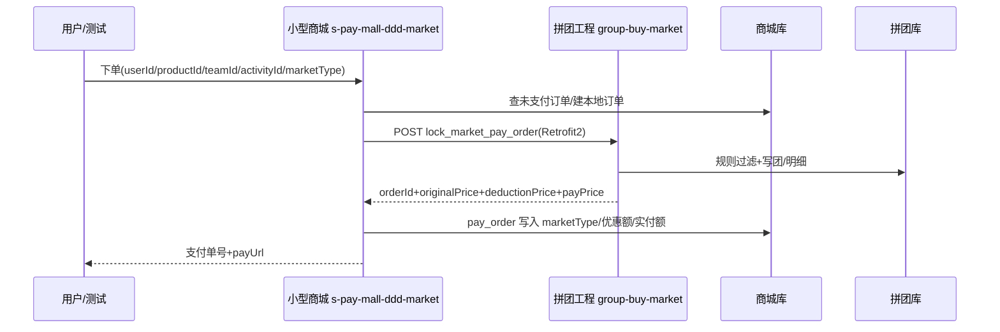

# 25 / 3-3：小商城对接营销锁单

> 从本节开始出现**两套系统**：你的拼团工程（`com.sirius`）和一个新的小型商城工程。用户在商城下单，商城调用拼团的锁单接口拿优惠价，再创建自己的支付单。
>
> 对应[原文第 25 节](../orgin-tutorial/4.第3部分：外部对接「小型支付商城」/25-3-3-小商城对接营销锁单.md)。参考分支两个：拼团侧 `3-3-250209-xfg-s-pay-mall-lock-order`，商城侧同名分支在 `reference/s-pay-mall-ddd-market`。本节后端由你手敲，前端不涉及。

## 0. 先分清谁做什么



**图的意思：** 商城不自己算拼团价，也不写拼团的表；它只负责"调接口、拿价格、记到自己的订单"。价格的可信来源始终是拼团系统。

**这一节的关键认识：** 微服务对接不是复制代码，而是**契约对接**。请求字段、响应字段、错误码，双方必须一致；任何一侧改字段名，另一侧立刻编译期发现不了、运行时才炸。

## 1. 双侧改动总览

### 1.1 拼团侧（你的工程，改动小）

目的：让锁单响应直接带三个金额，调用方不用自己再算。

| 文件 | 改动 |
| --- | --- |
| `group_buy_order_list` 表 | 新增 `pay_price` 列 |
| `GroupBuyOrderList.java`(PO) | 加 `payPrice` |
| `group_buy_order_list_mapper.xml` | resultMap、insert、未支付查询三处补 `pay_price` |
| `MarketPayOrderEntity.java` | 加 `originalPrice`、`payPrice` |
| `TradeRepository.java` | 锁单返回与查询未支付单两处 builder 补金额 |
| `LockMarketPayOrderResponseDTO.java`(api) | 加 `originalPrice`、`payPrice` |
| `MarketTradeController.java` | 两个返回分支补金额字段 |

注意：**新团和旧团的金额都在锁单入参里，两处 builder 都要补**；只改一处会出现"新单有价、旧单没价"的不一致。

### 1.2 商城侧（新工程，改动多）

| 模块 | 新增/修改 | 作用 |
| --- | --- | --- |
| `gateway/dto` | `LockMarketPayOrderRequestDTO/ResponseDTO`、`Response` | 对齐拼团契约 |
| `gateway/IGroupBuyMarketService.java` | `@POST("api/v1/gbm/trade/lock_market_pay_order")` | Retrofit2 接口定义 |
| `config/Retrofit2Config.java` | `groupBuyMarketService()` Bean | 从配置读 api-url |
| `domain/order/model` | `MarketPayDiscountEntity`、`MarketTypeVO`、`ShopCartEntity/OrderEntity/PayOrderEntity` 补字段 | 领域层表达"这笔单走了营销" |
| `adapter/port` | `IProductPort.lockMarketPayOrder(...)` + `ProductPort` 实现 | 端口隔离：领域只依赖接口 |
| `dao/po/PayOrder.java` + mapper | 加 `market_type/market_deduction_amount/pay_amount` | 落库 |
| `service/AbstractOrderService.java` | 创建订单流程插锁单步骤 | 核心业务变化 |
| `trigger/http/AliPayController.java` | 入参加 teamId/activityId/marketType | 从页面传进来 |
| `application-dev.yml` | `app.config.group-buy-market.*` | api-url/notify-url/source/channel |

## 2. 照直写会怎样

不引入 port 和 Retrofit2，直接在 `AbstractOrderService` 里写 HTTP 调用：

```java
// 反例：领域服务里直接拼 HTTP
String body = HttpUtil.post("http://127.0.0.1:8091/api/v1/gbm/trade/lock_market_pay_order", json);
JSONObject result = JSON.parseObject(body);
```

三个问题：

1. **换不掉**：URL、序列化、重试全写死在领域层，测试必须启动真服务。
2. **依赖方向乱了**：domain 直接依赖 HTTP 客户端细节，违反这个项目"领域定义接口、基础设施实现"的规则。
3. **契约无保护**：字段名靠手写字符串，拼团改了 `payPrice`，商城编译照样通过，运行时拿 null。

所以商城侧的分层是：**domain 定义 `IProductPort` 接口 → infrastructure 用 Retrofit2 实现**。这和你拼团工程里 `ITradeRepository` / `TradeRepository` 的关系完全同构，不是新知识。

## 3. 动手顺序（按依赖，先契约后使用方）

### 第一轮：拼团侧 pay_price 贯通

1. 独立测试库执行：

```sql
alter table group_buy_order_list
    add column pay_price decimal(10, 2) default null comment '支付金额';
```

2. PO、Mapper 三处、实体、仓储两处 builder、api DTO、Controller 两个返回分支，按 1.1 表逐个补。改完自查这条链：

```text
试算 payPrice → PayDiscountEntity → 明细 insert → 表 pay_price
→ 未支付查询 select → PO → MarketPayOrderEntity → ResponseDTO → JSON
```

### 第二轮：商城侧工程与配置

商城仓库从 `reference/s-pay-mall-ddd-market` 复制到你自己的学习目录（参考仓库只读，不直接在里面改）。然后：

1. `application-dev.yml` 加 `app.config.group-buy-market` 配置块（api-url 指向 `127.0.0.1:8091`）。
2. `gateway/dto` 三个 DTO：字段名与拼团 `LockMarketPayOrderRequestDTO/ResponseDTO` **逐字对齐**。
3. `IGroupBuyMarketService` + `Retrofit2Config`。
4. 独立商城库执行 `pay_order` 增列 SQL（`market_type/market_deduction_amount/pay_amount`）。

### 第三轮：领域与订单流程

1. `MarketTypeVO`（0 无营销、1 拼团营销）与 `MarketPayDiscountEntity`。
2. `PayOrder` PO、mapper insert/update 补三列。
3. `ShopCartEntity` 加 teamId/activityId/marketTypeVO；`AliPayController` 入参透传。
4. `IProductPort` 加 `lockMarketPayOrder`；`ProductPort` 实现里调 `groupBuyMarketService.lockMarketPayOrder(...)`，组装请求（`outTradeNo` 用商城 orderId，`notifyUrl` 从配置读）。
5. `AbstractOrderService.createOrder` 两个分支插锁单（参考 2-13 的链路：先锁单成功，金额才可信），`doPrepayOrder` 带上营销实体重载。

**商城侧锁单失败的语义要先想清楚**：拼团返回非 `0000` 时，商城这笔单走"无营销"还是直接失败？参考实现是抛异常让创建订单失败——营销单锁不上就不该按原价下单。你在教程里保持这个语义，不要静默降级成原价。

### 验证（不连库的部分我先跑）

我会在仓库外副本做：商城侧 DTO 与拼团 DTO 字段逐字 diff、`AbstractOrderService` 流程的替身测试（锁单成功/失败两个分支）、拼团侧局部编译。结果写进本教程验证记录。真实双服务联调按下面步骤你来：

## 4. 你的真实联调步骤

前提：两个独立库、两套 Redis 范围、两个工程都能在 IDEA 启动。

1. **先启动拼团**（8091），确认日志正常；再启动商城（默认 8080）。
2. 在拼团独立库确认活动 100123 有效、商品 9890001 有折扣配置。
3. 跑商城 `OrderServiceTest.test_createOrder`：新用户 + `teamId=null` + `activityId=100123` + `MarketTypeVO.GROUP_BUY_MARKET`。
4. 看商城日志：应有"营销锁单"请求与 `code=0000` 响应，金额 `100/10/90`。
5. 查两个库：
   - 拼团 `group_buy_order_list`：新明细，`pay_price=90.00`。
   - 商城 `pay_order`：`market_type=1`、`market_deduction_amount=10.00`、`pay_amount=90.00`。
6. 用 `teamId=null` 再跑一个用户，把返回的 teamId 填给第三个用户参团，验证拼团人数与商城订单同时增长。
7. 停掉拼团服务再下单：商城应报错而不是按原价成单。

## 5. 边界与下一节

- 本节只做**锁单**对接；结算回调、支付成功后的联动是 3-4。
- Retrofit2 是同步 `Call.execute()` 的简单用法，超时、重试、熔断都没有配，不能写成"生产级容错"。
- 商城的 `ProductRPC` 仍是写死的商品数据，商品服务对接在后面章节。

先从拼团侧 pay_price 开始手敲；完成后告诉我，我审阅第一轮再发商城侧的对照要点。
