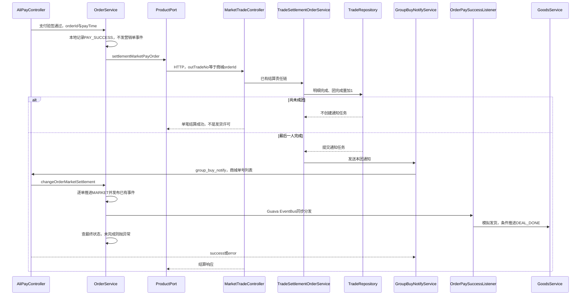

#  26 / 3-4：小商城对接营销结算

> 承接3-3：已经能锁团并按实付额生成支付表单，现在补上“钱付了以后怎么办”。
>
> 原文：[26 / 3-4](../orgin-tutorial/4.第3部分：外部对接「小型支付商城」/26-3-4-小商城对接营销结算.md)。参考仅使用商城分支 `3-4-250215-xfg-s-pay-mall-settlement-order`（`721e5cc0ab2e765c07cf562a7d32ad31607ec6a4`），通过git show/diff读取，不使用master后续能力。
>
> **这是手敲施工图，不是已经写入工程的实现。** 后端由你写；AI只维护教程、审阅并在仓库外验证。当前节不做3-5前端、MQ、退款、重新部署。

## 0. 工程、目标与动手门槛

| 工程 | 本节职责 |
| --- | --- |
| `E:\dev\java\group-buy-market\s-pay-mall-market` | 主战场：支付成功分流、调用拼团结算、接成团通知、模拟发货 |
| `E:\dev\java\group-buy-market\group-buy-market` | 已有结算和通知任务；只把通知白名单补上商城本地接收口 |
| `E:\dev\java\group-buy-market\s-pay-mall` | 原商城严格只读，不修改任何文件或Git状态 |

2026-11-06接手实查：两可写仓库工作区干净、分支均为main；HEAD分别为拼团 `a59864f`、商城 `bf40698`。你已确认手敲前自行创建对接分支，AI不执行Git写操作。3-3保持已通过，缺少额外截图不构成重新验收理由。进度与欠账只记[学习指南](../learning-guide.md)。

学完应能解释：

1. 为什么“支付成功”和“可以发货”不是同一件事。
2. 如何把支付宝实际支付时间和商城订单号传到拼团。
3. 为什么结算HTTP成功不代表已成团，成团通知才解锁后续处理。
4. 如何用状态条件阻止重复通知倒退，并解释仍存在的故障窗口。

**运行前**：IDEA Project SDK、运行JRE、Maven Runner选JDK8；商城运行local，数据库必须为独立的 `s-pay-mall-market`（连接执行 `select database();`），拼团使用隔离测试库和Redis范围。不能因为复制了代码就认为数据隔离。新商城8080、拼团8091；不要停原商城或云服务。本节不重建表、不重放含DROP的脚本、不清空Redis。

现有商城测试是Spring集成测试，可能写库；不全包运行，不要求新增纯学习测试。代理的探针与业务自测证据分开记录，条数只引用实际输出。

## 1. 先用一笔交易想明白

商品原价100、优惠10、付款90。两人团里，甲付90不代表乙已付款。

- **商城支付成功**：可信支付入口确认钱已付，记录 `PAY_SUCCESS` 和实际 `pay_time`。
- **拼团单笔结算**：把甲的锁单明细置完成，团的 `complete_count` 加1。没凑够人时不通知商城发货。
- **拼团成团通知**：最后一人结算后，拼团创建 `notify_task`，把同团已付商城单号列表发回商城。
- **商城交易完成**：收到通知，订单到 `MARKET`，已有进程内事件触发模拟发货，到 `DEAL_DONE`。

普通单不等团，直接 `PAY_SUCCESS → DEAL_DONE`。这里的“发货”只有日志和状态更新，**没有物流、积分充值或真实商品履约**。



从支付宝回调开始看：商城先记钱，再通知拼团。最后一人可能在这次HTTP尚未返回时就收到拼团反向回调，所以**不能用一个本地事务把远程请求包住**；否则回调连接可能看不到未提交的PAY_SUCCESS。图中的EventBus是原来的进程内调用，不是MQ。

### 1.1 为什么需要这些类型和边界

| 直写的问题 | 本节怎么拆 | 代价 |
| --- | --- | --- |
| domain直接拼HTTP请求 | 继续用IProductPort，ProductPort做外部适配 | 多一层DTO转换，domain不反向依赖infra |
| 付钱就发货 | OrderService按已持久化marketType分流 | 多一个等待成团的状态阶段 |
| 订单服务负责物流细节 | 按本节参考引入最小goods服务与仓储 | 当前只有一跳转发，为履约职责边界，不另造框架 |
| 通知重复把DEAL_DONE改回MARKET | SQL按旧状态推进，完成单跳过 | 要检查更新数和当前状态 |
| EventBus监听器失败却回success | 发事件后查询订单最终状态 | 多一次读；仍不能提供持久消息保证 |

用到的是**端口适配、观察者/发布订阅**，不是新增策略模式或状态类框架。已有模板方法只管下单，这节不改它。保留你的 `IPayPort/AlipayPort` 和类型化消息，不照抄参考把SDK搬回domain、把事件改成JSON。

### 1.2 库表到底变什么

**无DDL增量**：商城status本来是字符串，加枚举不等于加列；pay_time已存在。3-3金额列继续使用，不重新试算或改价。

| 表 | 本节数据变化 |
| --- | --- |
| 商城pay_order | 营销：PAY_WAIT → PAY_SUCCESS → MARKET → DEAL_DONE；普通：PAY_WAIT → PAY_SUCCESS → DEAL_DONE；pay_time来自可信支付时间 |
| 拼团group_buy_order_list | 已有结算把status 0→1，写out_trade_time；out_trade_no仍是商城order_id |
| 拼团group_buy_order | complete_count加1，最后一人令status 0→1；lock_count不因付款减少 |
| 拼团notify_task | 仅成团建任务，parameter_json含teamId/outTradeNoList，保存开团时的notify_url |

**时间不是“回调到达时间”**：回调延迟到团窗口之后，实际付款可能仍在窗口内。已有 `SettableRuleFilter` 用 `outTradeTime < validEndTime` 判断，所以不能用 `new Date()` 或SQL `now()`冒充实际付款时间。支付宝回调用gmt_payment，查单用sendPayDate。

## 2. 不改代码的现状探针

IDEA按这条线读真实文件，不启动会写库的测试：

1. 商城 `AliPayController.payNotify` 目前只传orderId；`NoPayNotifyOrderJob` 也只传orderId。
2. `OrderService.changeOrderPaySuccess` 目前不区分营销，直接仓储更新并发事件。
3. 商城Mapper的pay_time目前写now()，没有 `queryOrderByOrderId`、MARKET和模拟履约更新。
4. `OrderPaySuccessListener` 已订阅 `PaySuccessMessage` 对象，只记日志；保留它的类型，不转String。
5. 拼团已有 `MarketTradeController.settlementMarketPayOrder` 和结算/通知任务，不重写责任链。
6. **拼团GroupBuyNotifyService只允许8091旧演示地址**，商城地址会直接被拒绝；这不是“网络偶发失败”。

缺口依次对应后面的改造。下文代码路径除第11节的拼团发送器外，都相对 **s-pay-mall-market根目录**；完整文件用于避免漏改签名，可在IDEA比较后只手敲变化部分，不必重抄旧代码。

## 3. 第一步：先补数据载体和网络DTO

为什么先做：后面的接口签名、builder要引用它们。先落被依赖者，IDE才不会到处红。本步只增加表达能力，不运行中间态业务。

在 `s-pay-mall-domain/src/main/java/com/sirius/domain/order/model/entity/OrderEntity.java` 类内增加以下字段，原字段不动；已有String不需import：

```java
/** 支付后从本地订单读取用户，不使用回调外部传入的任意用户。 */
private String userId;
```

在 `s-pay-mall-domain/src/main/java/com/sirius/domain/order/model/valobj/OrderStatusVO.java` 的分号前追加一项：

```java
MARKET("MARKET", "拼团成团，等待模拟履约"),
```

这两处是**增量片段**，不是全类覆盖。后续代码已保留原构造方式，现有源码未使用OrderEntity全参构造器；若你另加调用，需同步检查。

**文件**：`s-pay-mall-infrastructure/src/main/java/com/sirius/infrastructure/gateway/dto/SettlementMarketPayOrderRequestDTO.java`

```java
package com.sirius.infrastructure.gateway.dto;

import lombok.Data;
import java.util.Date;

/** 单笔营销结算请求：告诉拼团哪笔外部订单在什么时间付了款。 */
@Data
public class SettlementMarketPayOrderRequestDTO {
    private String source;
    private String channel;
    private String userId;
    /** 商城orderId，不是拼团自己的orderId。 */
    private String outTradeNo;
    /** 可信支付时间；Jackson默认Date写毫秒时间戳，与现有拼团契约配套。 */
    private Date outTradeTime;
}
```

**文件**：`s-pay-mall-infrastructure/src/main/java/com/sirius/infrastructure/gateway/dto/SettlementMarketPayOrderResponseDTO.java`

```java
package com.sirius.infrastructure.gateway.dto;

import lombok.Data;

/** 单笔营销结算结果；有teamId不代表整个团已完成。 */
@Data
public class SettlementMarketPayOrderResponseDTO {
    private String userId;
    private String teamId;
    private Long activityId;
    private String outTradeNo;
}
```

**文件**：`s-pay-mall-api/src/main/java/com/sirius/api/dto/NotifyRequestDTO.java`

```java
package com.sirius.api.dto;

import lombok.Data;
import java.util.List;

/** 拼团成团通知；列表里的外部单号均为商城订单号。 */
@Data
public class NotifyRequestDTO {
    private String teamId;
    private List<String> outTradeNoList;
}
```

## 4. 第二步：先声明底层DAO能力

现在缺的是“按单号拿回用户/营销类型/状态”和“有条件推进状态”。不能把订单号列表直接无条件批量更新：其中可能有已完成单、普通单或不存在单。

**文件**：`s-pay-mall-infrastructure/src/main/java/com/sirius/infrastructure/dao/IOrderDao.java`
```java
package com.sirius.infrastructure.dao;

import com.sirius.infrastructure.dao.po.PayOrder;
import org.apache.ibatis.annotations.Mapper;
import org.apache.ibatis.annotations.Param;
import java.util.List;

/** 订单数据访问；条件更新返回影响行数，由业务决定是否发布事件。 */
@Mapper
public interface IOrderDao {
    void insert(PayOrder payOrder);
    PayOrder queryUnPayOrder(PayOrder payOrder);
    void updateOrderPayInfo(PayOrder payOrderReq);
    /** 只允许PAY_WAIT变为PAY_SUCCESS，携带真实payTime。 */
    int changeOrderPaySuccess(PayOrder payOrderReq);
    List<String> queryNoPayNotifyOrder();
    List<String> queryTimeoutCloseOrderList();
    boolean changeOrderClose(@Param("orderId") String orderId);
    /** 查询完整订单快照；不存在返回null。 */
    PayOrder queryOrderByOrderId(@Param("orderId") String orderId);
    /** 只允许已付款的营销单PAY_SUCCESS进入MARKET。 */
    int changeOrderMarketSettlement(@Param("orderId") String orderId);
    /** 普通单从PAY_SUCCESS、营销单从MARKET进入DEAL_DONE。 */
    int changeOrderDealDone(@Param("orderId") String orderId);
}
```

此刻Java可编译，但SQL尚未补齐，**不能调用新方法**；Mapper统一在第10节补，避免在Java类型还没定时来回改XML。

## 5. 第三步：订单仓储接口与实现一起落盘

仓储负责本地状态和事件，不负责远程拼团HTTP。营销支付成功只记钱，不发货；成团通知才发事件。重复回调查状态，不能把DEAL_DONE倒退。

**文件**：`s-pay-mall-domain/src/main/java/com/sirius/domain/order/adapter/repository/IOrderRepository.java`
```java
package com.sirius.domain.order.adapter.repository;

import com.sirius.domain.order.model.aggregate.CreateOrderAggregate;
import com.sirius.domain.order.model.entity.OrderEntity;
import com.sirius.domain.order.model.entity.PayOrderEntity;
import com.sirius.domain.order.model.entity.ShopCartEntity;
import java.util.Date;
import java.util.List;

/** 订单本地存取与状态推进；不在这里执行远程营销结算。 */
public interface IOrderRepository {
    void doSaveOrder(CreateOrderAggregate aggregate);
    OrderEntity queryUnPayOrder(ShopCartEntity shopCartEntity);
    void updateOrderPayInfo(PayOrderEntity payOrderEntity);
    /** 原有普通支付入口，下一阶段与全部调用方一起改为带payTime的签名。 */
    void changeOrderPaySuccess(String orderId);
    /** 营销单只记支付成功和时间，等待成团才触发履约。 */
    void changeMarketOrderPaySuccess(String orderId, Date payTime);
    /** 完整订单含用户、营销类型和状态；不存在返回null。 */
    OrderEntity queryOrderByOrderId(String orderId);
    /** 成团后逐单推进MARKET并触发模拟履约；未完成抛异常以便通知重试。 */
    void changeOrderMarketSettlement(List<String> outTradeNoList);
    /** 超1分钟仍PAY_WAIT；不含已付待成团或营销结算失败的PAY_SUCCESS。 */
    List<String> queryNoPayNotifyOrder();
    List<String> queryTimeoutCloseOrderList();
    boolean changeOrderClose(String orderId);
}
```

**文件**：`s-pay-mall-infrastructure/src/main/java/com/sirius/infrastructure/adapter/repository/OrderRepository.java`
```java
package com.sirius.infrastructure.adapter.repository;

import com.google.common.eventbus.EventBus;
import com.sirius.domain.order.adapter.event.PaySuccessMessageEvent;
import com.sirius.domain.order.adapter.repository.IOrderRepository;
import com.sirius.domain.order.model.aggregate.CreateOrderAggregate;
import com.sirius.domain.order.model.entity.OrderEntity;
import com.sirius.domain.order.model.entity.PayOrderEntity;
import com.sirius.domain.order.model.entity.ProductEntity;
import com.sirius.domain.order.model.entity.ShopCartEntity;
import com.sirius.domain.order.model.valobj.OrderStatusVO;
import com.sirius.infrastructure.dao.IOrderDao;
import com.sirius.infrastructure.dao.po.PayOrder;
import com.sirius.types.exception.AppException;
import org.springframework.stereotype.Repository;
import javax.annotation.Resource;
import java.util.Date;
import java.util.List;

/** 订单与PO转换、条件状态推进；进程内事件不是可靠消息队列。 */
@Repository
public class OrderRepository implements IOrderRepository {
    @Resource
    private IOrderDao orderDao;
    @Resource
    private PaySuccessMessageEvent paySuccessMessageEvent;
    @Resource
    private EventBus eventBus;

    @Override
    public void doSaveOrder(CreateOrderAggregate aggregate) {
        ProductEntity product = aggregate.getProductEntity();
        OrderEntity order = aggregate.getOrderEntity();
        PayOrder po = new PayOrder();
        po.setUserId(aggregate.getUserId());
        po.setProductId(product.getProductId());
        po.setProductName(product.getProductName());
        po.setOrderId(order.getOrderId());
        po.setOrderTime(order.getOrderTime());
        po.setTotalAmount(order.getTotalAmount());
        po.setStatus(order.getOrderStatusVO().getCode());
        po.setMarketType(order.getMarketType());
        orderDao.insert(po);
    }

    @Override
    public OrderEntity queryUnPayOrder(ShopCartEntity cart) {
        PayOrder request = new PayOrder();
        request.setUserId(cart.getUserId());
        request.setProductId(cart.getProductId());
        PayOrder po = orderDao.queryUnPayOrder(request);
        if (po == null) return null;
        return OrderEntity.builder()
                .productId(po.getProductId()).productName(po.getProductName())
                .orderId(po.getOrderId()).orderTime(po.getOrderTime())
                .orderStatusVO(OrderStatusVO.valueOf(po.getStatus()))
                .totalAmount(po.getTotalAmount()).payUrl(po.getPayUrl())
                .marketType(po.getMarketType())
                .marketDeductionAmount(po.getMarketDeductionAmount())
                .payAmount(po.getPayAmount()).build();
    }

    @Override
    public void updateOrderPayInfo(PayOrderEntity result) {
        orderDao.updateOrderPayInfo(PayOrder.builder()
                .orderId(result.getOrderId()).status(result.getOrderStatus().getCode())
                .payUrl(result.getPayUrl()).marketType(result.getMarketType())
                .marketDeductionAmount(result.getMarketDeductionAmount())
                .payAmount(result.getPayAmount()).build());
    }

    @Override
    public void changeOrderPaySuccess(String orderId) {
        int updated = orderDao.changeOrderPaySuccess(PayOrder.builder()
                .orderId(orderId).status(OrderStatusVO.PAY_SUCCESS.getCode()).build());
        if (updated == 0) return;
        // 普通单不等团。保留原来的类型化事件，并从本地订单补齐用户。
        OrderEntity order = queryOrderByOrderId(orderId);
        eventBus.post(paySuccessMessageEvent.buildEventMessage(
                PaySuccessMessageEvent.PaySuccessMessage.builder()
                        .userId(order.getUserId()).tradeNo(orderId).build()).getData());
    }

    @Override
    public void changeMarketOrderPaySuccess(String orderId, Date payTime) {
        // 重复通知更新0行，不覆盖首次支付时间，也不在这里发布履约事件。
        orderDao.changeOrderPaySuccess(PayOrder.builder()
                .orderId(orderId).status(OrderStatusVO.PAY_SUCCESS.getCode())
                .payTime(payTime).build());
    }

    @Override
    public OrderEntity queryOrderByOrderId(String orderId) {
        PayOrder po = orderDao.queryOrderByOrderId(orderId);
        if (po == null) return null;
        return OrderEntity.builder()
                .userId(po.getUserId()).productId(po.getProductId())
                .productName(po.getProductName()).orderId(po.getOrderId())
                .orderTime(po.getOrderTime()).totalAmount(po.getTotalAmount())
                .orderStatusVO(OrderStatusVO.valueOf(po.getStatus()))
                .payUrl(po.getPayUrl()).marketType(po.getMarketType())
                .marketDeductionAmount(po.getMarketDeductionAmount())
                .payAmount(po.getPayAmount()).build();
    }

    @Override
    public void changeOrderMarketSettlement(List<String> orderIds) {
        for (String orderId : orderIds) {
            orderDao.changeOrderMarketSettlement(orderId);
            OrderEntity order = queryOrderByOrderId(orderId);
            if (order.getOrderStatusVO() == OrderStatusVO.DEAL_DONE) continue;
            if (order.getOrderStatusVO() != OrderStatusVO.MARKET) {
                throw new AppException("MKT_STATE", "成团订单未进入MARKET");
            }
            // MARKET可能是上次更新后事件失败留下的，不只在update=1时发布。
            eventBus.post(paySuccessMessageEvent.buildEventMessage(
                    PaySuccessMessageEvent.PaySuccessMessage.builder()
                            .userId(order.getUserId()).tradeNo(orderId).build()).getData());
            // Guava会记录并吞掉订阅异常；post返回不代表模拟履约成功。
            if (queryOrderByOrderId(orderId).getOrderStatusVO() != OrderStatusVO.DEAL_DONE) {
                throw new AppException("MKT_DELIVERY", "模拟履约未完成，请重试成团通知");
            }
        }
    }

    @Override
    public List<String> queryNoPayNotifyOrder() {
        return orderDao.queryNoPayNotifyOrder();
    }
    @Override
    public List<String> queryTimeoutCloseOrderList() {
        return orderDao.queryTimeoutCloseOrderList();
    }
    @Override
    public boolean changeOrderClose(String orderId) {
        return orderDao.changeOrderClose(orderId);
    }
}
```

此步普通支付仍保留原单参签名，让原OrderService和两个入口继续编译；**第8节会同时修改仓储声明/实现、服务声明/实现和两个调用方，贯通payTime**。不要在SQL尚未补齐的中间态运行支付业务。

## 6. 第四步：网络契约与端口实现成对接上

### 6.1 Retrofit只声明协议，不吞业务失败

**文件**：`s-pay-mall-infrastructure/src/main/java/com/sirius/infrastructure/gateway/IGroupBuyMarketService.java`
```java
package com.sirius.infrastructure.gateway;

import com.sirius.infrastructure.gateway.dto.LockMarketPayOrderRequestDTO;
import com.sirius.infrastructure.gateway.dto.LockMarketPayOrderResponseDTO;
import com.sirius.infrastructure.gateway.dto.SettlementMarketPayOrderRequestDTO;
import com.sirius.infrastructure.gateway.dto.SettlementMarketPayOrderResponseDTO;
import com.sirius.infrastructure.gateway.response.Response;
import retrofit2.Call;
import retrofit2.http.Body;
import retrofit2.http.POST;

/** 拼团HTTP契约；HTTP状态与业务响应码都要由适配器检查。 */
public interface IGroupBuyMarketService {
    /** 锁团并确定金额；outTradeNo是商城订单号。 */
    @POST("api/v1/gbm/trade/lock_market_pay_order")
    Call<Response<LockMarketPayOrderResponseDTO>> lockMarketPayOrder(
            @Body LockMarketPayOrderRequestDTO request);
    /** 推进单笔结算，不保证整团已完成。 */
    @POST("api/v1/gbm/trade/settlement_market_pay_order")
    Call<Response<SettlementMarketPayOrderResponseDTO>> settlementMarketPayOrder(
            @Body SettlementMarketPayOrderRequestDTO request);
}
```

### 6.2 端口声明后立即实现，不另抽营销框架

`IProductPort.java` 先增加 `import java.util.Date;`，接口末尾增加完整方法声明：

```java
/** 单笔支付通知拼团；失败抛异常，不能记日志后当作成功返回。 */
void settlementMarketPayOrder(String userId, String orderId, Date payTime);
```

紧接着修改 `s-pay-mall-infrastructure/src/main/java/com/sirius/infrastructure/adapter/port/ProductPort.java`。保留3-3锁单方法及其所有金额校验，不整类替换。补import：

```java
import com.sirius.infrastructure.gateway.dto.SettlementMarketPayOrderRequestDTO;
import com.sirius.infrastructure.gateway.dto.SettlementMarketPayOrderResponseDTO;
import java.util.Date;
```

类末尾增加完整方法：

```java
@Override
public void settlementMarketPayOrder(String userId, String orderId, Date payTime) {
    SettlementMarketPayOrderRequestDTO request = new SettlementMarketPayOrderRequestDTO();
    request.setSource(source);
    request.setChannel(channel);
    request.setUserId(userId);
    request.setOutTradeNo(orderId);
    request.setOutTradeTime(payTime);
    try {
        retrofit2.Response<Response<SettlementMarketPayOrderResponseDTO>> http =
                groupBuyMarketService.settlementMarketPayOrder(request).execute();
        if (!http.isSuccessful()) {
            if (http.errorBody() != null) http.errorBody().close();
            throw new AppException("MKT_HTTP", "营销结算HTTP调用失败");
        }
        Response<SettlementMarketPayOrderResponseDTO> body = http.body();
        if (body == null) throw new AppException("MKT_RESPONSE", "营销结算返回空响应");
        if (!"0000".equals(body.getCode())) {
            throw new AppException("MKT_REJECTED", "营销结算失败：" + body.getInfo());
        }
        SettlementMarketPayOrderResponseDTO data = body.getData();
        if (data == null || !orderId.equals(data.getOutTradeNo())
                || !userId.equals(data.getUserId())
                || data.getTeamId() == null || data.getActivityId() == null) {
            throw new AppException("MKT_RESPONSE", "营销结算响应与本单不匹配");
        }
    } catch (IOException e) {
        throw new AppException("MKT_NETWORK", "营销结算连接失败", e);
    }
}
```

为什么只catch IOException：业务拒绝也要向上传，不能被catch(Exception)吞掉。本节沿用已有 `channel` 拼写，不抄参考的 `chanel`。失败不意味着拼团没提交：可能是提交成功、响应丢失，见第13节边界。

## 7. 第五步：最小模拟履约，接口与实现紧挨着

现在缺一个真正把模拟订单推进到完成的消费者。不是用一条“发货成功”日志证明履约，而是把状态检查落到SQL。

**文件**：`s-pay-mall-domain/src/main/java/com/sirius/domain/goods/adapter/repository/IGoodsRepository.java`

```java
package com.sirius.domain.goods.adapter.repository;

/** 模拟履约存储端口，不代表已有物流或库存能力。 */
public interface IGoodsRepository {
    /** 只有满足履约前置状态才推进；返回本次影响行数。 */
    int changeOrderDealDone(String orderId);
}
```

**文件**：`s-pay-mall-infrastructure/src/main/java/com/sirius/infrastructure/adapter/repository/GoodsRepository.java`

```java
package com.sirius.infrastructure.adapter.repository;

import com.sirius.domain.goods.adapter.repository.IGoodsRepository;
import com.sirius.infrastructure.dao.IOrderDao;
import org.springframework.stereotype.Repository;
import javax.annotation.Resource;

/** 复用商城订单DAO保存模拟履约结果，不跨库写拼团表。 */
@Repository
public class GoodsRepository implements IGoodsRepository {
    @Resource
    private IOrderDao orderDao;
    @Override
    public int changeOrderDealDone(String orderId) {
        return orderDao.changeOrderDealDone(orderId);
    }
}
```

**文件**：`s-pay-mall-domain/src/main/java/com/sirius/domain/goods/service/IGoodsService.java`

```java
package com.sirius.domain.goods.service;

/** 本节模拟履约用例。 */
public interface IGoodsService {
    /** 根据本地前置状态完成模拟订单；重复调用不倒退状态。 */
    void changeOrderDealDone(String orderId);
}
```

**文件**：`s-pay-mall-domain/src/main/java/com/sirius/domain/goods/service/GoodsService.java`

```java
package com.sirius.domain.goods.service;

import com.sirius.domain.goods.adapter.repository.IGoodsRepository;
import lombok.extern.slf4j.Slf4j;
import org.springframework.stereotype.Service;
import javax.annotation.Resource;

/** 模拟履约：这里只推进订单，不实际调用物流或为账户充值。 */
@Slf4j
@Service
public class GoodsService implements IGoodsService {
    @Resource
    private IGoodsRepository repository;
    @Override
    public void changeOrderDealDone(String orderId) {
        int updated = repository.changeOrderDealDone(orderId);
        log.info("模拟履约结果 orderId={} updated={}", orderId, updated);
    }
}
```

**文件**：`s-pay-mall-trigger/src/main/java/com/sirius/trigger/listener/OrderPaySuccessListener.java`
```java
package com.sirius.trigger.listener;

import com.google.common.eventbus.Subscribe;
import com.sirius.domain.goods.service.IGoodsService;
import com.sirius.domain.order.adapter.event.PaySuccessMessageEvent;
import lombok.extern.slf4j.Slf4j;
import org.springframework.stereotype.Component;
import javax.annotation.Resource;

/** 消费已有类型化事件；营销单的发布时点推迟到成团后。 */
@Slf4j
@Component
public class OrderPaySuccessListener {
    @Resource
    private IGoodsService goodsService;
    @Subscribe
    public void handleEvent(PaySuccessMessageEvent.PaySuccessMessage message) {
        log.info("收到允许后续处理的订单事件 orderId={} userId={}",
                message.getTradeNo(), message.getUserId());
        goodsService.changeOrderDealDone(message.getTradeNo());
    }
}
```

GuavaConfig不改，仍注册这个监听器。事件类名沿用历史 `PaySuccessMessageEvent`，本节注释说明语义：普通单付款就允许后续处理，营销单要等成团。不要把这条进程内通知包装成“可靠支付消息”。

## 8. 第六步：服务分流，支付入口一起改签名

现在仓储、端口、消费者都有了，才能组装流程。注意父类 `port` 是IProductPort，子类同名字段是你已有的IPayPort：**远程营销调用使用super.port**，不误调用支付端口，不为命名问题重构旧下单。

本节作为一次编辑批次改所有签名调用，结束再编译。先在 `IOrderRepository.java` 增加普通支付时间参数：

```java
/** 普通单首次支付推进后发事件，payTime为实际付款时间。 */
void changeOrderPaySuccess(String orderId, Date payTime);
```

紧接着在 `OrderRepository.java` 将对应方法头改为 `public void changeOrderPaySuccess(String orderId, Date payTime)`，其开头构建PO的完整语句改为下列内容，方法后面的更新数判断与发事件逻辑不动：

```java
int updated = orderDao.changeOrderPaySuccess(PayOrder.builder()
        .orderId(orderId).status(OrderStatusVO.PAY_SUCCESS.getCode())
        .payTime(payTime).build());
```

**文件**：`s-pay-mall-domain/src/main/java/com/sirius/domain/order/service/IOrderService.java`
```java
package com.sirius.domain.order.service;

import com.sirius.domain.order.model.entity.PayOrderEntity;
import com.sirius.domain.order.model.entity.ShopCartEntity;
import java.util.Date;
import java.util.List;

/** 下单及支付/成团用例入口；支付时间只能来自可信支付入口。 */
public interface IOrderService {
    PayOrderEntity createOrder(ShopCartEntity shopCartEntity) throws Exception;
    /** 记录支付事实；营销单再通知拼团，普通单直接后续处理。 */
    void changeOrderPaySuccess(String orderId, Date payTime);
    /** 验证成团订单列表后推进并模拟履约；失败抛异常供HTTP回调返回error。 */
    void changeOrderMarketSettlement(List<String> outTradeNoList);
    List<String> queryNoPayNotifyOrder();
    List<String> queryTimeoutCloseOrderList();
    boolean changeOrderClose(String orderId);
}
```

**文件**：`s-pay-mall-domain/src/main/java/com/sirius/domain/order/service/OrderService.java`
```java
package com.sirius.domain.order.service;

import com.sirius.domain.order.adapter.port.IPayPort;
import com.sirius.domain.order.adapter.port.IProductPort;
import com.sirius.domain.order.adapter.repository.IOrderRepository;
import com.sirius.domain.order.model.aggregate.CreateOrderAggregate;
import com.sirius.domain.order.model.entity.MarketPayDiscountEntity;
import com.sirius.domain.order.model.entity.OrderEntity;
import com.sirius.domain.order.model.entity.PayOrderEntity;
import com.sirius.domain.order.model.valobj.MarketTypeVO;
import com.sirius.domain.order.model.valobj.OrderStatusVO;
import com.sirius.types.exception.AppException;
import org.springframework.stereotype.Service;
import javax.annotation.Resource;
import java.math.BigDecimal;
import java.util.Date;
import java.util.List;

/** 下单保留原金额快照；支付后按持久化的营销类型决定何时允许履约。 */
@Service
public class OrderService extends AbstractOrderService {
    @Resource
    private IPayPort port;
    public OrderService(IOrderRepository repository, IProductPort port) {
        super(repository, port);
    }
    @Override
    protected void doSaveOrder(CreateOrderAggregate aggregate) {
        repository.doSaveOrder(aggregate);
    }
    @Override
    protected PayOrderEntity doPrepayOrder(String productName, String orderId,
            BigDecimal totalAmount, MarketPayDiscountEntity discount) throws Exception {
        BigDecimal payAmount = discount == null ? totalAmount : discount.getPayPrice();
        String form = port.doPrepayOrder(productName, orderId, payAmount);
        PayOrderEntity result = new PayOrderEntity();
        result.setOrderId(orderId);
        result.setPayUrl(form);
        result.setOrderStatus(OrderStatusVO.PAY_WAIT);
        result.setMarketType(discount == null ? MarketTypeVO.NO_MARKET.getCode()
                : MarketTypeVO.GROUP_BUY_MARKET.getCode());
        result.setMarketDeductionAmount(discount == null ? BigDecimal.ZERO
                : discount.getDeductionPrice());
        result.setPayAmount(payAmount);
        repository.updateOrderPayInfo(result);
        return result;
    }

    @Override
    public void changeOrderPaySuccess(String orderId, Date payTime) {
        if (orderId == null || orderId.trim().isEmpty() || payTime == null) {
            throw new AppException("PAY_PARAMETER", "缺少订单号或实际支付时间");
        }
        OrderEntity order = repository.queryOrderByOrderId(orderId);
        if (order == null) throw new AppException("PAY_ORDER", "支付订单不存在");
        OrderStatusVO status = order.getOrderStatusVO();
        if (status == OrderStatusVO.MARKET || status == OrderStatusVO.DEAL_DONE) return;
        if (status != OrderStatusVO.PAY_WAIT && status != OrderStatusVO.PAY_SUCCESS) {
            throw new AppException("PAY_STATE", "当前订单状态不可接收支付成功");
        }
        if (MarketTypeVO.GROUP_BUY_MARKET.getCode().equals(order.getMarketType())) {
            // 本地提交后才发HTTP，反向成团回调才能查到支付事实。
            repository.changeMarketOrderPaySuccess(orderId, payTime);
            // PAY_SUCCESS也允许重试远程调用，不能因本地已支付就直接跳过。
            super.port.settlementMarketPayOrder(order.getUserId(), orderId, payTime);
        } else {
            repository.changeOrderPaySuccess(orderId, payTime);
        }
    }

    @Override
    public void changeOrderMarketSettlement(List<String> orderIds) {
        if (orderIds == null || orderIds.isEmpty()
                || orderIds.stream().anyMatch(id -> id == null || id.trim().isEmpty())) {
            throw new AppException("MKT_PARAMETER", "成团订单列表不能为空");
        }
        // 先检查整批，避免明显非法列表处理到一半才发现普通单/未支付单。
        for (String id : orderIds) {
            OrderEntity order = repository.queryOrderByOrderId(id);
            if (order == null || !MarketTypeVO.GROUP_BUY_MARKET.getCode()
                    .equals(order.getMarketType())) {
                throw new AppException("MKT_ORDER", "成团列表含不存在或非营销订单");
            }
            OrderStatusVO status = order.getOrderStatusVO();
            if (status != OrderStatusVO.PAY_SUCCESS && status != OrderStatusVO.MARKET
                    && status != OrderStatusVO.DEAL_DONE) {
                throw new AppException("MKT_STATE", "成团列表含未支付订单");
            }
        }
        repository.changeOrderMarketSettlement(orderIds);
    }
    @Override
    public List<String> queryNoPayNotifyOrder() {
        return repository.queryNoPayNotifyOrder();
    }
    @Override
    public List<String> queryTimeoutCloseOrderList() {
        return repository.queryTimeoutCloseOrderList();
    }
    @Override
    public boolean changeOrderClose(String orderId) {
        return repository.changeOrderClose(orderId);
    }
}
```

**同一次修改**把现有两处调用接上，不能留旧签名红错：

- `s-pay-mall-trigger/src/main/java/com/sirius/trigger/http/AliPayController.java` 增加 `import java.text.SimpleDateFormat;`；在验签通过且trade_status为TRADE_SUCCESS分支，把原单参调用换成：

```java
SimpleDateFormat format = new SimpleDateFormat("yyyy-MM-dd HH:mm:ss");
format.setLenient(false);
orderService.changeOrderPaySuccess(tradeNo, format.parse(params.get("gmt_payment")));
```

沿用本地沙箱环境的时区，与支付宝该时间字段口径核对；不要随手改为UTC或new Date。已有try/catch会在解析/结算异常时返回 `false`；**“验签通过就必须success”这个旧注释要改为“验签及本节业务处理成功才确认，异常不确认”**。

- `s-pay-mall-trigger/src/main/java/com/sirius/trigger/job/NoPayNotifyOrderJob.java` 只替换原调用行，保留 `code=10000 && tradeStatus=TRADE_SUCCESS` 两重检查：

```java
orderService.changeOrderPaySuccess(orderId, response.getSendPayDate());
```

参考分支只看code=10000的旧问题不要带回来。查单时间为空会被服务拒绝，不能凭查询接口成功伪造支付时间。

## 9. 第七步：商城成团HTTP入口，契约与实现成对追加

为什么有两个回调：`alipay_notify_url`来自支付宝，证明付款；`group_buy_notify`来自拼团，证明整团完成。两者不是同一种JSON或验签协议，不能混成一个入口。

`IPayService.java` 增加 `import com.sirius.api.dto.NotifyRequestDTO;`，接口末尾增加：

```java
/** 成团通知：正常返回纯文本success，校验或处理失败返回error。 */
String groupBuyNotify(NotifyRequestDTO requestDTO);
```

紧接着在 `AliPayController.java` 加同一个DTO import，类内增加完整方法：

```java
@Override
@PostMapping("group_buy_notify")
public String groupBuyNotify(@RequestBody NotifyRequestDTO request) {
    try {
        if (request == null || StringUtils.isBlank(request.getTeamId())) return "error";
        orderService.changeOrderMarketSettlement(request.getOutTradeNoList());
        return "success";
    } catch (Exception e) {
        log.error("成团通知处理失败 teamId={}", request == null ? null : request.getTeamId(), e);
        return "error";
    }
}
```

返回体必须是纯文本 `success`，不是 `{ "code":"0000" }`，也不是带引号的JSON字符串。拼团发送器逐字比较它。请求JSON格式错误会被Spring拒绝，拼团把非成功HTTP视为error，不会误确认。

**安全边界**：这是本地教学服务间回调，没有签名认证；商城订单未存teamId，不能校验本批订单确实属于传入团。列表检查只能挡不存在/普通/未付款订单，挡不住伪造的“已付款营销单成团通知”。因此**不把新入口暴露公网、不复用公网商城部署、不用CORS当认证**。生产化要可信通知身份与订单-团关联核验，本节不宣称已具备。

## 10. 第八步：Mapper最后补全，所有新方法才真正可运行

修改 `s-pay-mall-app/src/main/resources/mybatis/mapper/pay_order_mapper.xml`。

原 `changeOrderPaySuccess` 只替换为以下完整语句，保留PAY_WAIT条件：

```xml
<update id="changeOrderPaySuccess" parameterType="com.sirius.infrastructure.dao.po.PayOrder">
    update pay_order set status = #{status}, pay_time = #{payTime}, update_time = now()
    where order_id = #{orderId} and status = 'PAY_WAIT'
</update>
```

在 `</mapper>` 前追加三个完整语句：

```xml
<select id="queryOrderByOrderId" resultMap="dataMap">
    select user_id, product_id, product_name, order_id, order_time, total_amount,
           status, pay_url, pay_time, market_type, market_deduction_amount, pay_amount
    from pay_order where order_id = #{orderId}
</select>

<update id="changeOrderMarketSettlement">
    update pay_order set status = 'MARKET', update_time = now()
    where order_id = #{orderId} and market_type = 1 and status = 'PAY_SUCCESS'
</update>

<update id="changeOrderDealDone">
    update pay_order set status = 'DEAL_DONE', update_time = now()
    where order_id = #{orderId}
      and ((market_type = 0 and status = 'PAY_SUCCESS')
        or (market_type = 1 and status = 'MARKET'))
</update>
```

**不改**3-3新增的金额映射/insert/查询，不改关单SQL，不扩大查单范围。这里每条更新都用稳定的商城order_id，SQL参数为 `#{...}`，不拼接字符串。

为什么不写批量IN：逐单条件更新更容易确定哪单实际推进；批量通知部分失败后，重试会跳过DEAL_DONE，停在MARKET的再次触发模拟处理。代价是多次数据库访问，只适用于本节小规模组队，不宣称高吞吐方案。

为什么不加大事务：状态更新、同步监听器、反向HTTP彼此有关；把它们随手套同一个事务不仅不保证跨系统原子性，还可能让回调看不到已付事实。当前逐单提交、失败重试，**不能叫批量原子提交**。真实履约的外部副作用也不能靠SQL更新数实现恰好一次。

## 11. 第九步：只改拼团发送器与新商城local地址

### 11.1 拼团侧白名单最小增加一个接收口

**这一处路径相对group-buy-market根目录**。不是改原商城，也不是修改reference。保留旧演示地址，再加本地商城正式口，不能删除限制允许任意地址。

**文件**：`group-buy-market-infrastructure/src/main/java/com/sirius/infrastructure/gateway/GroupBuyNotifyService.java`
```java
package com.sirius.infrastructure.gateway;

import okhttp3.*;
import org.springframework.stereotype.Service;
import javax.annotation.Resource;
import java.io.IOException;

/** 本地成团通知发送器；只允许两个已知接收口，拒绝任意回调URL。 */
@Service
public class GroupBuyNotifyService {
    @Resource
    private OkHttpClient okHttpClient;

    public String groupBuyNotify(String apiUrl, String parameterJson) throws IOException {
        if (!"http://127.0.0.1:8091/api/v1/test/group_buy_notify".equals(apiUrl)
                && !"http://127.0.0.1:8080/api/v1/alipay/group_buy_notify".equals(apiUrl)) {
            return "error";
        }
        Request request = new Request.Builder().url(apiUrl)
                .post(RequestBody.create(parameterJson,
                        MediaType.get("application/json; charset=utf-8"))).build();
        try (Response response = okHttpClient.newCall(request).execute()) {
            if (!response.isSuccessful() || response.body() == null) return "error";
            return "success".equals(response.body().string()) ? "success" : "error";
        }
    }
}
```

已有OkHttp客户端未在本节加重定向防护；固定初始URL不等于全链路SSRF防御。本地接收口不返回重定向，本节不宣称可安全接受不可信第三方服务。

### 11.2 新商城local只改一项，不覆盖整份配置

路径相对 `s-pay-mall-market`：`s-pay-mall-app/src/main/resources/application-local.yml`。在现有 `app.config.group-buy-market` 下把旧notify-url改为：

```yaml
notify-url: http://127.0.0.1:8080/api/v1/alipay/group_buy_notify
```

api-url、source、channel保持3-3已验证值；支付宝、微信密钥和数据库配置不复制到教程，不更改云端或原商城。此URL是两个本机后端之间的调用，**不用Natapp**；支付宝可信回调若需要公网可达，则复用你确认安全且只转发支付通知路径的测试通道，不能因此重新部署或把成团回调一起公开。

**必须新开团**：notify_url在开团时持久化到group_buy_order，之后创建notify_task也读这个快照。改商城配置不会更新旧团、旧任务；本节不用3-3旧团当新的正向证据，不手改历史通知地址冒充自然链路。

## 12. 第十步：真实验证操作单

以下是**待用户执行的步骤与预期判据，不是代理已实测结果**。以真实接口+IDEA断点+数据库前后查询为主，不新增纯学习测试。全程只用隔离数据，不运行整个app测试包。

### V0：本地启动与数据确认

1. 在两个IDEA窗口核对绝对工程路径、JDK8及profile；商城连接执行 `select database();` 必须为 `s-pay-mall-market`，拼团确认隔离库与Redis范围。
2. 用新测试用户、有效活动、同商品/渠道；活动ID100123、商品9890001、s01/c01只是已有示例，实际有效性以当前库为准。核对活动/团有效期和参与次数。
3. 不为方便悄悄修改真实活动目标。**建议目标至少2人**，可实际看见“首人付款不发货”；如隔离活动原为1人，仅能验证立即成团，不能据此宣称未成团路径通过。需要调整测试活动时由你确认并记录原值、新值及恢复，不改已有团快照。
4. 启动拼团8091、新商城8080，确认新回调地址已配置。先不提交支付表单。

### V1：一团两单，首人付款只记钱

在接口工具向商城 POST `http://127.0.0.1:8080/api/v1/alipay/create_pay_order`，Content-Type为application/json：

```json
{
  "userId": "lesson26-a",
  "productId": "9890001",
  "teamId": null,
  "activityId": 100123,
  "marketType": 1
}
```

先从库记录商城order_id、拼团team_id和该团target_count；不从锁单响应猜teamId。新建表单金额应继续是实付快照（如90），本节不能退回原价。

**真实付款方式**：使用本次返回的HTML表单进入沙箱，不用3-3过期表单；你可在接口工具保存data解码后的HTML到仓库外临时文件并用浏览器打开。不要把完整带签名表单上传聊天或提交Git。登录沙箱并付款不是前端功能开发。代理如需操作浏览器，先使用ego-browser；工具不可用会如实说明，不另用浏览器冒充实测。

若当前没有安全可用的支付宝回调通道，不为本节重新部署：可在付款后等待现有 `NoPayNotifyOrderJob` 通过真实支付宝查单推进。它只扫描超过1分钟的PAY_WAIT；需要及时付款、关注团有效期。这能验证**真实查单路径**，不能替代验签回调路径的证据。不要用伪造未签名回调当付款证明。

断点建议：

| 位置 | 观察 | 原因 |
| --- | --- | --- |
| AliPayController验签后或NoPayNotifyOrderJob查单成功后 | gmt_payment或sendPayDate | 实际支付时间，不是当前时间 |
| OrderService营销分支 | 从本地读的userId、marketType=1、商城orderId | 不能用客户端任意用户或拼团内部单号 |
| ProductPort结算执行前 | outTradeNo、outTradeTime、source/channel | 请求与3-3锁单同一业务身份 |
| 拼团OutTradeNoRuleFilter/SettableRuleFilter | 初始锁单存在，支付时间在窗口内 | 保留已有责任链 |
| OrderPaySuccessListener | **首人未成团时不应命中** | 付款不是成团许可 |

预期：商城A停 `PAY_SUCCESS`，pay_time是实际付款时间；拼团A明细status=1、out_trade_time对应；团complete_count=1、status=0；本团尚无notify_task；无模拟履约完成。

### V2：最后一人付款，观察反向通知与完成

换新用户 `lesson26-b`，同活动商品，teamId填写V1真实团号，再调用下单并真实付款。确保在团窗口内且有空位，不并发压团。

预期链路：最后一笔结算 → 拼团团status=1 → notify_task创建，列表含A/B商城单号 → 新商城 `groupBuyNotify` → 各单MARKET → 类型化事件 → 模拟履约DEAL_DONE → 返回纯文本success → 拼团任务标成功。

在 `OrderRepository.changeOrderMarketSettlement` 发事件前断点，才能看见短暂MARKET；最终查库通常已是DEAL_DONE，看不到MARKET不是漏状态。调试别暂停到HTTP超时后还按正常路径解释。

商城连接查询（用户自行将单号替换为真实值）：

```sql
select user_id, order_id, market_type, status, pay_time,
       total_amount, market_deduction_amount, pay_amount
from pay_order where order_id in ('实际A商城单号', '实际B商城单号');
```

拼团连接查询：

```sql
select user_id, team_id, order_id, out_trade_no, status, out_trade_time
from group_buy_order_list where team_id = '实际团号';
select team_id, target_count, lock_count, complete_count, status, notify_url
from group_buy_order where team_id = '实际团号';
select team_id, notify_url, notify_status, notify_count, parameter_json
from notify_task where team_id = '实际团号';
```

判据：两侧关联号一致；金额不改；明细完成、团complete_count达到target_count、lock_count仍是锁单人数；任务地址是8080新口，响应确认为success。notify_status按本工程已有Mapper的成功值核对，不能只看任务存在就认定已通知成功。

### V3：重放成团通知，不倒退、不重复推进

只在隔离环境，取V2实际任务JSON，用接口工具POST到 `http://127.0.0.1:8080/api/v1/alipay/group_buy_notify`：

```json
{
  "teamId": "实际团号",
  "outTradeNoList": ["实际A商城单号", "实际B商城单号"]
}
```

连续两次均应success；商城保持DEAL_DONE，断点不再发布已完成单事件，不重新执行状态推进。换空列表、未知单号、普通单、尚未支付的营销单，均不应返回success或改订单。**这些手工请求只验证本地接收逻辑，不能当成真实成团证据**。

### V4：普通单回归

新用户只传userId/productId，不传营销字段，真实付款或真实查单推进。应不调用ProductPort营销结算、不新增拼团明细；商城普通单PAY_SUCCESS直接经已有事件到DEAL_DONE。新事件已填本地userId，不再用null用户做未来业务依据。

### V5：远程失败不能向支付方确认成功

只操作你本轮测试实例。用一笔全新隔离营销单，付款前在结算端口断点；由你暂停/停止本轮拼团实例以制造连接失败，不动云服务和原商城。

预期：商城已记PAY_SUCCESS、未履约；若从支付宝回调进入，当前回调返回false；若从查单Job进入，任务记录异常。恢复拼团后通过同一笔可信支付通知重试（或在IDEA用本次已核实的支付时间调用同一领域入口），观察是否补上结算。IDEA手动调用只记为领域恢复验证，不假称支付宝真实重发。

**不能宣称Job已经覆盖恢复**：现有queryNoPayNotifyOrder只查PAY_WAIT，而此单已经PAY_SUCCESS。当前依赖支付方后续回调或人工确认后的恢复；本节不增加营销补偿Job。

本节用户实操只要求V0准备及V1–V5。2026-11-06用户确认V1–V5已完成；原V6扩展故障实验取消，不记用户欠账。后续教程只给必做项。代理必要的隔离故障检查自行执行，和用户真实验证分开记录。

## 13. 与参考的差异、取舍和未解决问题

参考并不天然正确。2026-11-06用户明确：发现缺陷就选择更好的版本，讲清理由；但不借题越节。

| 参考3-4做法/已有缺口 | 本节选择 |
| --- | --- |
| ProductPort catch Exception只记日志，和“失败抛异常重试”的注释矛盾 | 检查HTTP/业务/本单响应，失败向上传 |
| 营销支付成功未携带payTime；普通SQL用now | 两路都带可信支付时间，SQL使用payTime |
| 查订单判断了orderId为空，而非查询结果为空；漏状态映射 | 检查PO并映射用户、状态及原金额 |
| 无条件批量MARKET、发每单事件 | 先验证整批，逐单条件更新，完成单跳过，MARKET可重试 |
| 改消息为JSON String | 保留当前类型化事件与注册方式，用户从本地订单补齐 |
| 参考无条件DEAL_DONE | 普通PAY_SUCCESS或营销MARKET才允许模拟完成 |
| 新商城地址被既有拼团白名单拦截 | 只增加明确本地地址，保留旧演示口 |
| EventBus发布返回就默认处理成功 | 成团回调查询最终状态，未完成则error |

仍明确留在边界外：

1. **营销结算不是强幂等接口**。拼团按status=0查外部单，已结算再调可能E0104；本地PAY_SUCCESS不足以区分“对方未处理”与“已处理但响应丢失”。不能把所有E0104当成功，也不能宣称同单支付回调永远成功。需要可查询的结算结果/强幂等契约时另设计，不临时扩成生产框架。
2. **并发与终态竞态未被完整解决**。本节商城条件SQL避免倒退，模拟履约更新最多推进一次；事件仍可能并发重复发布，拼团侧旧明细更新缺状态条件、末笔判断使用旧快照等风险仍在。只跑顺序两人团不能宣称并发正确。
3. **普通单进程内事件仍有丢失窗口**：更新PAY_SUCCESS后进程退出/监听失败，原重复支付回调不会再发事件。成团单可通过通知重试恢复MARKET，但任务重试有次数上限；没有outbox、MQ或对账补偿。普通路径新增模拟履约也不意味着这项历史可靠性欠账被修好。
4. **缺少服务间认证和订单-团关联核验**。新回调只用于本机受控测试；不能公开部署为可信发货依据。原支付入口也未在本节新增app_id/收款方/金额核对，不宣称完整生产支付安全。
5. **不修改3-3已确认内容**。旧建表脚本缺金额增量、旧14位订单不能自动缩短、活动/团上下文未落商城库等仍按学习指南记录，不为本节重新索要3-3截图。
6. **本地事务不是分布式事务**。本节会出现“商城已付、拼团未结算”或“拼团已成团、商城未模拟完成”的半成功，不用成功日志掩盖这些状态。

## 14. 自测：先独立回答，再看参考分析

1. 在自己的代码里指出：首人付款时哪个分支故意不发事件？为什么？
2. 支付回调迟到两分钟，为什么不能把当前时间传给拼团？哪条规则用到它？
3. super.port和子类port分别是什么？本节为什么不改IPayPort？
4. 成团通知重复来了，哪两条SQL条件防止订单倒退？停在MARKET时为什么允许再发事件？
5. ProductPort抛异常了，为什么不能说现有Job一定会自动补上？
6. EventBus.post没抛异常，是否能证明履约成功？本节怎样核对、又还缺什么？
7. notify-url改了但任务仍发8091，最先该查哪里？

<details>
<summary>参考分析（先答再展开）</summary>

1. OrderService营销分支走changeMarketOrderPaySuccess只记钱；要等成团通知才发布允许履约的事件。
2. 已有SettableRuleFilter比较实际支付时间和团有效结束时间，迟到回调不该抹掉原本有效的付款事实。
3. super.port是IProductPort；子类port是IPayPort。申请支付表单这条链已在3-3完成，本节只补支付后处理。
4. MARKET只从营销PAY_SUCCESS推进；DEAL_DONE只从普通PAY_SUCCESS/营销MARKET推进。MARKET可能是上次写状态后事件失败留下，重试只在update=1才发会卡死。
5. 本地已变PAY_SUCCESS，现有查单只扫PAY_WAIT；注释不能改变SQL，需真实回调重试或明确人工恢复。
6. 不能，Guava会吞订阅异常；本节成团处理后查DEAL_DONE，未完成返回error。仍无持久投递/批量原子性/真实履约恰好一次。
7. 查group_buy_order和notify_task已持久化的地址；配置只影响新开团，不回写历史快照。

</details>

只记三件事：**钱付了先记支付事实；整团完成才允许营销订单模拟履约；失败与重试必须以实际状态为准。**

做完本节告诉我“写完了”，我再读你两仓库真实文件验收。验收通过才整理两仓库commit message与下一会话提示词，随后停下，由你自行提交。本教程不提前交付3-5。

## 15. 备课验证记录

2026-11-06，验证副本位于 `E:/workspace/gbm-lesson26-wduu5cbe`。从两侧当前源码复制根POM和六模块src/POM，排除target、日志及真实local/prod配置；完整文件代码块从本教程抽取，增量片段按文中位置应用到累积副本。**没有写入用户业务工程，没有子Agent，没有Git写操作。**

| 项目 | 本轮结果 | 证据与限制 |
| --- | --- | --- |
| 商城Maven全模块构建 | 通过，业务测试跳过 | JDK8 + Maven3.9.4，副本 `mvn -o -DskipTests package`，父工程和六模块SUCCESS，BUILD SUCCESS；两个既有测试源码编译，不计为2项测试通过 |
| 拼团Maven全模块构建 | 失败：环境阻塞 | resources插件2.5在离线仓库来源ID处报present, but unavailable，尚未进入Java编译；未下载依赖、改POM或Maven环境 |
| 拼团主源码直接编译 | 通过 | 用本机已有依赖编译141主源码，javac退出0；不替代Maven模型解析、打包或测试 |
| 针对性隔离探针 | 通过12项 | 实际输出RESULT: 12 tests passed；覆盖营销付款不提前发事件、普通付款单次完成、营销网络失败后同单恢复、成团批次及重复通知、非法批次先拦截、Guava吞异常后error和MARKET恢复、支付参数/状态拒绝、真实Retrofit/Jackson本地HTTP契约、HTTP/业务/空响应/错单拒绝、成团HTTP方法参数拒绝、真实MyBatis绑定、双地址白名单与精确回执 |
| 破坏性实验 | 预期失败，恢复后通过 | 将营销付款的changeMarketOrderPaySuccess改为普通changeOrderPaySuccess，确认修改生效；探针报must not deliver before team、退出1。实际是提前发事件，模拟DAO仍因状态条件拒绝最终完成，不能描述为已真实提前发货。还原源码SHA-256一致，12项重新通过 |
| 文档与源码一致性检查 | 通过 | 15个完整Java代码块及后续签名增量与编译副本核对；相对链接可解析、资源XML可解析；原双工程255个源码/POM/资源快照哈希未变，商城Git仍干净 |
| 真实业务联调 | 未运行 | 未连接MySQL/Redis、未执行SQL、未向支付宝付款、未启动真实双服务；探针DAO是替身、本地HTTP是协议替身，Controller为直接方法调用，不冒充Spring网络集成 |
| 全量app测试、并发与事务回滚 | 未运行 | 未确认本轮隔离数据，禁止全包写库测试；不据局部通过宣称全工程业务通过 |
| Mermaid10.1.0渲染、浏览器 | 未运行 | 时序图已静态检查；未找到现成目标版本解析环境，没有安装。未开始浏览器任务，不声称ego-browser已实测 |

12项是本节新增隔离检查，不是上一节13项的延续或全套回归条数。源码抽取验证不含真实local配置合并；地址的最终运行效果需要用户V0–V2验证。第一次破坏脚本预想先因状态断言失败，实际先因提前发事件断言失败，调整失败判据后重新做了破坏/哈希恢复/12项复跑；不掩盖这次预测差异。

机制核对使用了Guava官方EventBus说明（订阅异常不向发布者传播）和MyBatis更新返回行数说明；实际探针同时核对本工程所用依赖。以上为备课记录，不代替用户实现验收，当前状态见学习指南。

## 16. 2026-11-06 用户手敲代码审阅与收尾

### 本轮对象与结论

两仓库均在用户创建的 `261106-sirius-s-pay-mall-settlement-order` 分支。只读审阅HEAD与工作区完整差异（包含已暂存后又修改的新文件），在全新 `E:/workspace/gbm-review26-g81bgv3d` 复制当前真实源码/POM/资源262文件并记录哈希；**没有把教程实现覆盖到审阅副本**。

本节范围未发现新的必须修改项。此前V2故障的两处手敲错误已修正：

- 商城GoodsRepository.changeOrderDealDone已调用同名DAO，不再误调进入MARKET的方法；错误版本会令履约更新0行。
- OrderService.changeOrderMarketSettlement已在整批校验循环结束后只调用一次仓储，不再每检查一单就处理整批。
- AppException双参构造器已调用super(message)，异常栈可显示业务文字；不将其描述为全部历史构造器都已修复。

### 验证证据边界

| 来源 | 结果 | 范围 |
| --- | --- | --- |
| 代理实测 | 商城全模块BUILD SUCCESS，业务测试跳过 | JDK8 + Maven3.9.4离线package，父工程与六模块SUCCESS；2个现有测试源码编译，不等于测试执行 |
| 代理实测 | 12项隔离回归通过 | 使用当前用户OrderService、OrderRepository、GoodsService、GoodsRepository、监听器、Controller及网络适配器；保留DAO替身、本地HTTP替身和真实Mapper加载的边界，非连库集成 |
| 代理破坏实验 | 故障按预期失败，恢复后12项重过 | 仅外部副本把GoodsRepository改回调用MARKET DAO；普通单履约更新0行，ordinary once断言失败（早于成团用例）；还原源码SHA-256一致后12项通过 |
| 代理实测 | 拼团141主源码javac通过 | Maven仍在resources插件2.5仓库来源ID处失败；直接编译不替代完整Maven构建 |
| 用户确认 | V1–V5真实验证已完成 | 以用户本次明确反馈为准；没有另采集全套请求/双库快照，不写成代理亲验，不重复索要已确认材料 |
| 跳过 | 原V6不做 | 不作为用户欠账，后续不再给选做作业；代理已在隔离探针验证MARKET失败返回error/恢复以及关键DAO回归 |
| 未运行 | 代理真实DB/Redis/支付宝/双服务、全量app测试、并发与事务回滚 | 未取得本轮数据隔离证据，不运行会污染数据的全包测试；本节通过不代表上述范围通过 |

当前goods仓储包路径为 `goods.adaoter.repository`，虽为拼写差异但声明与引用一致、已编译和执行，不作为功能阻断，不替用户重命名。拼团MarketTradeController只改了响应builder排版，无新语义。

收尾仅更新教程、唯一学习指南和长期教学偏好；后端文件保持用户版本。仍保留第13节的可靠性、安全与并发限制，不为验收通过隐去。Git提交由用户执行，本会话到此停止，不提前备课3-5。
