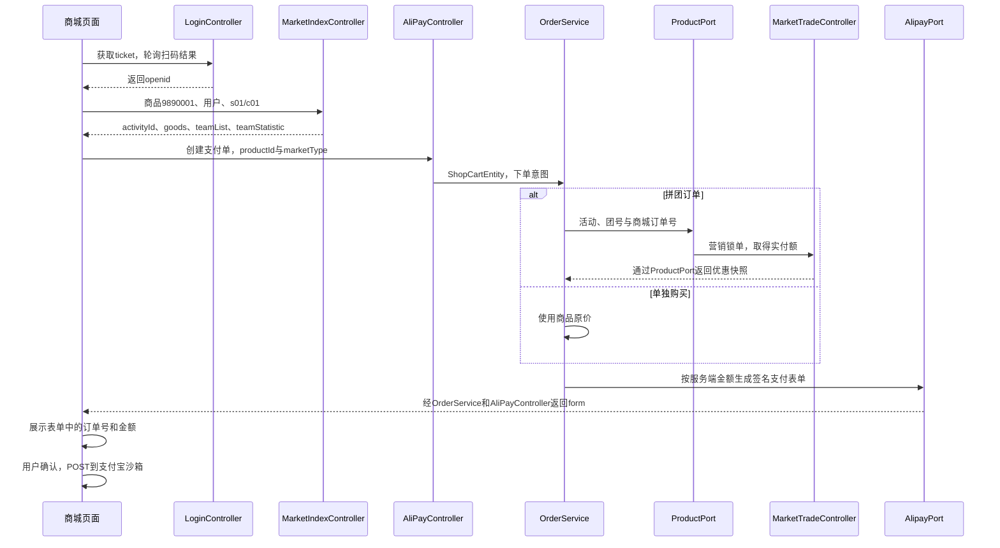
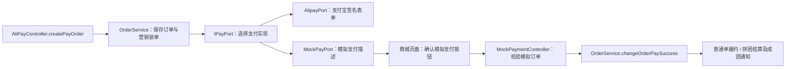

# 27 / 3-5：小商城UI与接口对接

承接已完成的锁单和结算，本节把扫码、商品展示、开团/参团与支付宝沙箱支付串成浏览器链路，不接MQ、退款或部署。原文入口：[27 / 3-5](../orgin-tutorial/4.第3部分：外部对接「小型支付商城」/27-3-5-小商城UI与接口对接.md)，两参考仓库只对照 `3-5-250216-xfg-s-pay-mall-ui`。

## 一、业务流程与设计原因

商品原价100元，活动优惠10元：单独买付100，开团或参团付90。首页试算只是“现在展示什么价”，真正收费要经过商城下单、营销锁单、生成支付表单；不能把按钮上的90元直接传给支付平台。



从商城页面开始看：查询直接找拼团，交易统一找商城。箭头传的是请求或响应，不表示前端能决定价格。拼团订单由商城生成12位订单号，再作为营销的 `outTradeNo`；因此浏览器不再像旧演示那样生成单号或直接调用营销结算。

### 1. 扫码、页面和服务端各负责什么

- 商城 `LoginController` 获取微信二维码ticket，页面用ticket显示二维码，并串行轮询 `check_login`。先关注测试号再扫码，现有入口处理的是 `SCAN` 事件。
- 成功响应中的 `data` 是openid。前端沿用 `loginToken` Cookie保存它，首页读作 `userId`；**Cookie名字叫Token，不代表内容就是可信认证令牌**。本节不改后端认证，只用于本机受控学习，不暴露公网交易接口。
- 首页查询把试算、进行中的团、统计组合成一次响应。这是给页面用的组合查询，不是新的定价系统。团的 `lockCount` 是占用名额，`completeCount` 是已付款人数；锁满不等于已成团。
- 顶层必须返回 `activityId`：没有任何进行中的团时，`teamList` 为空，不能靠第一张团卡片找活动，也不能在JavaScript里写死100123。

### 2. 三种购买共用一个商城入口

| 按钮 | `marketType` | `activityId` | `teamId` |
| --- | --- | --- | --- |
| 单独购买 | 0 | 不传 | 不传 |
| 开团购买 | 1 | 本次首页返回值 | `null` |
| 参与拼团 | 1 | 本次首页返回值 | 被点击的团号 |

请求都发往商城 `/api/v1/alipay/create_pay_order`，`productId` 使用首页的 `goods.goodsId`，本例为9890001。不传金额、通知地址或外部单号，这些由服务端确定。

商城已有同用户、同商品的未支付单时，会复用同营销类型的 `PAY_WAIT` 表单。选择另一种营销方式会返回 `MKT_CONFLICT`，页面应显示错误，不能偷偷把原价单改成拼团单；想依次验证两种购买，先完成原单，或换一个确认没有未支付单的测试用户。

### 3. 点击下单后，数据怎么变化

| 时点 | 商城 `pay_order` | 拼团 |
| --- | --- | --- |
| 单独购买下单成功 | `CREATE → PAY_WAIT`，实付100 | 不应新增营销明细 |
| 开团/参团下单成功 | `CREATE → PAY_WAIT`，保留原价/优惠/实付快照 | 新增锁单明细，团锁单量增加；尚未支付，完成量不增加 |
| 用户关闭确认框 | 保留原单，未付款 | 已锁名额仍保留，不是退单 |
| 支付平台可信通知到达 | 按3-4已有流程记录支付事实 | 拼团单再由商城调用营销结算；最后一人付款才推进成团通知 |

本节只接上已有结算链，不重写它。**浏览器回跳只表示导航回来了**，不能据此改订单状态或弹“支付成功”；判断支付事实要看服务端验签日志及数据库。

## 二、手敲步骤

后端只需下面两处增量，由你在**拼团工程**手敲。商城的 `CreatePayRequestDTO → AliPayController → ShopCartEntity → ProductPort` 已有活动ID透传，`MessageTextEntity` 也已接收 `MsgID`，不再重抄；本节不跟着参考调整定时任务频率。

### 1. 先给首页响应增加活动ID

现有DTO只返回商品、团和统计，缺少独立的活动标识。在 `GoodsMarketResponseDTO` 顶层、`private Goods goods;` 前新增字段，不要放进内部的 `Goods` 或 `Team` 类。类上补一句职责说明，字段注释说明它为什么必须独立返回。

顶层 `@Data` 之前增加职责注释：`/** 首页展示结果：活动标识、商品试算价、进行中的团及活动统计。 */`。字段增量如下。

**文件**：`group-buy-market-api/src/main/java/com/sirius/api/dto/GoodsMarketResponseDTO.java`
```java
    /** 本次商品试算对应的活动；即使没有进行中的团，页面也能据此开团。 */
    private Long activityId;
```

Lombok已有 `@Data` 和 `@Builder`，会生成取值方法及构建器入口，不用手写getter。此时DTO已经有字段，但响应值仍需下一步赋值。

### 2. 用同一次试算结果补映射

`queryGroupBuyMarketConfig` 已从 `trial` 取出了 `activityId`。定位到方法末尾的 `GoodsMarketResponseDTO response = ...`，只替换这段构建代码，其他校验、试算、团列表及异常分支保持不动。

**文件**：`group-buy-market-trigger/src/main/java/com/sirius/trigger/http/MarketIndexController.java`

```java
            GoodsMarketResponseDTO response = GoodsMarketResponseDTO.builder()
                    .activityId(activityId)
                    .goods(goods)
                    .teamList(teams)
                    .teamStatistic(teamStatistic)
                    .build();
```

不是重新查询活动：使用同一次试算选中的ID，保证页面价格和下单活动一致。IDEA在这行打断点，观察 `activityId`，再看响应顶层是否与它相同；不要拿团列表里的活动ID替代。

### 3. 读AI实现的商城前端，不手敲样式

页面源统一在**商城对接工程** `docs/dev-ops/nginx/html/`，`index.html`、`login.html` 分别加载 `js/index.js`、`js/login.js`。旧拼团演示页面不改；被忽略的 `static/html` 和 `build` 副本不作为本节页面源。

如果用 IDEA 内置静态服务打开页面（常见地址是 `localhost:63342`），它没有 Nginx 的 `/api` 反向代理，所以脚本会把商城请求明确发往 `http://127.0.0.1:8080`；用 Nginx 80/443 访问时则继续使用同源 `/api`。两种入口都不要用 `file://` 打开。

在IDEA打开以下三个关键位置即可。

**`js/login.js`：扫码响应 → Cookie → 首页。** ticket获取成功后每3秒串行轮询，只有0003才继续等待，异常或60秒过期显示重试。这样不让慢响应和旧二维码轮询互相覆盖。成功分支保存的是openid，不是密码：

```javascript
document.cookie = `loginToken=${encodeURIComponent(result.data)}; Max-Age=2592000; Path=/; SameSite=Lax`
window.location.href = 'index.html'
```

**`js/index.js` 的 `renderMarketConfig`：首页响应 → DOM。** 价格来自 `goods`，统计来自 `teamStatistic`，卡片来自 `teamList`。用户ID用 `textContent` 放进页面，避免把数据当HTML执行；目标名额减锁单量才是剩余可占名额。倒计时归零或团已锁满时禁用参团；首页没有商城支付状态，不能仅凭卡片用户ID相同就声称“可继续支付”。重试原购买仍由商城判断能否复用订单。

**同文件的 `createPayOrder`：购买意图 → 商城请求。** 普通单不携带活动和团；拼团单才补两个字段：

```javascript
const request = {userId, productId: marketConfig.goods.goodsId, marketType}
if (marketType === 1) Object.assign(request, {activityId: marketConfig.activityId, teamId})
```

服务端成功返回的是HTML表单，不是支付成功通知。`preparePaymentForm` 只接受支付宝沙箱POST表单，取出 `biz_content` 中的实付金额和商城单号用于确认窗口；普通单显示100，拼团显示90，不像参考代码那样都展示拼团价。若复用了旧单，则显示旧表单真实金额，不用当前试算价覆盖它。

确认时只提交本次创建的隐藏表单，原样保留签名字段，不执行响应里的脚本，也不删页面其他表单。下单按钮在请求中禁用，确认提交后也禁用；这只能减少重复点击，服务端旧单复用仍是必要保护。

## 三、必做真实验证

### 1. 准备当前两服务和页面入口

1. IDEA确认打开的是拼团工程与 `s-pay-mall-market`，均使用JDK8；商城运行local，拼团使用本机已准备好的隔离测试配置。不启动或改动原 `s-pay-mall`。
2. 两侧数据库分别执行 `select database();`，确认商城为独立对接库、拼团为测试库；核对Redis测试范围。不重建表、不重放含DROP的脚本、不清空缓存。
3. 使用当前有效的商品9890001、活动与团人数配置，保证商城商品原价与营销商品原价同为100；本例活动优惠10、两人成团。若你当前有效活动价格不同，以本次真实响应为准，双服务必须一致。
4. 页面必须通过HTTP托管商城 `docs/dev-ops/nginx/html/`；继续使用你当前本地页面入口，让同源 `/api/` 转到商城8080。若从IDEA内置服务器打开，须确认其把同源 `/api/` 转到了商城，否则扫码和下单会404；不要用 `file://`。只调整本地入口，不重新部署。`js/index.js` 中营销地址默认是本机8091。
5. 检查当前微信与支付宝的已有回调入口仍指向本次商城服务，支付宝 `return_url` 回到本次页面入口。没有有效回调入口时先解决当前配置可达性，不能拿旧原商城或云端订单当本节验证。

### 2. 扫码进入真实营销首页

打开商城 `login.html`，微信先关注测试号再扫码。浏览器F12 → Network观察：

- 获取ticket和 `check_login` 都请求商城；未扫返回0003，扫码后返回0000和openid。
- 页面自动进入 `index.html`，当前用户应为该openid，不再用旧 `username` 演示Cookie。
- 首页向拼团POST `query_group_buy_market_config`，请求含9890001与s01/c01，响应顶层有真实 `activityId`。页面原价100、活动价90、统计和团卡片与响应一致；空团列表也应能开团。

如果页面提示“缺少活动ID”，看第一、二步手敲及IDEA实际运行的最新编译结果，不要在JavaScript写死活动ID绕过。

### 3. 单独购买：原价收款，不产生营销单

用没有同商品未支付单的测试用户点击“单独购买”。Network检查商城下单请求：`marketType=0`、`productId=9890001`，没有 `activityId`、`teamId` 和金额字段。

确认窗口应显示**支付表单中的100.00及12位商城单号**；点击“前往沙箱”，在沙箱收银台核对同一单号与金额再付款。返回页面后，在商城库查询该单：

```sql
select user_id, product_id, order_id, market_type, status, pay_time,
       total_amount, market_deduction_amount, pay_amount
from pay_order where order_id = '本次普通商城单号';
```

预期 `market_type=0`、原价/实付100、优惠0，可信回调后已有普通单流程推进至 `DEAL_DONE`，`pay_time` 非空。拼团库不应为该号新增记录：

```sql
select user_id, team_id, out_trade_no, status
from group_buy_order_list where out_trade_no = '本次普通商城单号';
```

若窗口和收银台金额不一致，先停付款，核对返回表单的 `biz_content`；若只回跳但状态未动，看商城验签及回调路由，不要手动改状态冒充完成。

### 4. 开团和参团：浏览器走商城，双库单号相同

用测试用户A点击“开团购买”，检查请求 `marketType=1`、活动ID等于首页响应、`teamId=null`；窗口应显示90.00。下单后先不支付，用窗口中的商城单号在拼团库查到对应 `out_trade_no`，记下团号；确认已锁单但 `complete_count` 尚未增加，再完成沙箱付款。

换一个已扫码的测试用户B，刷新首页找到A的团，点击该团的“参与拼团”。检查请求中的 `teamId` 是这张卡片的团号，不是新开团；B的确认窗口也应为90.00。B付款后检查两库：

```sql
-- 商城库：把下面两个值替换成确认窗口显示的真实商城单号。
select user_id, order_id, market_type, status, pay_time,
       total_amount, market_deduction_amount, pay_amount
from pay_order where order_id in ('A商城单号', 'B商城单号');
```

```sql
-- 拼团库：同团两笔out_trade_no应与商城order_id逐笔相等。
select user_id, team_id, out_trade_no, status, out_trade_time
from group_buy_order_list where team_id = '本次真实团号';
select team_id, target_count, lock_count, complete_count, status
from group_buy_order where team_id = '本次真实团号';
```

两人成团示例中，最终锁单量和完成量均为2；商城营销单保留100/10/90快照，经已有成团通知推进至 `DEAL_DONE`。这次是在页面入口下验证，不需要重做3-4的故障清单。B看不到A的团时，先看首页 `teamList`、团时效、剩余名额与活动ID，不直接改支付状态绕过。

### 5. 取消与拒绝：不假成功、不悄悄换单

仍用一名无未支付单的用户开团，下单成功后点“暂不支付”：不应跳沙箱、提示支付成功或调用营销结算。数据库中的 `PAY_WAIT` 和已锁名额仍存在，这是本节明确的取消语义。

随后点击“单独购买”，应显示服务端 `MKT_CONFLICT`，不打开支付窗口、不按原价另扣一次；再点原来的拼团购买，应由商城复用同一未支付单号与表单。最后完成该沙箱订单，避免把演练留下的锁单误当成可用名额。失败时在F12核对商城响应与日志：前端只负责展示拒绝，不能把业务错误当成功处理。

## 追加：本地模拟支付（沙箱不可用时）

### 一、业务流程与设计原因

这一段替代上文“进入支付宝收银台付款”的动作，其余下单、锁单、结算、成团通知与查库步骤照常执行。不模拟二维码、支付宝App或平台签名；真实支付宝Controller及验签一行不动。



从原下单入口开始，仍让 `OrderService` 决定金额并写入 `PAY_WAIT`；只把支付端口换成模拟实现。页面读取模拟支付描述展示订单号和金额，用户按按钮后进入独立的 `MockPaymentController`，与真实回调在订单服务处汇合。这是已有端口的替换实现，不新建一套订单逻辑。

模拟返回JSON描述，不伪装成支付宝HTML：`paymentMode`、订单号、金额、一次生成的随机token。描述保存在现有 `pay_url` 字段，重试未支付单仍复用它。token只是本地演练的确认凭据，不是支付宝签名；确认入口同时要求local、显式开关、本机直连和匹配的模拟订单，不能拿真实支付宝订单号直接改成已支付。

模拟入口不做HTTP“自我回调”：直接复用支付成功服务。它验证的是**我们自己的双服务业务链路**，不验证支付宝验签、真实交易查询、平台通知或资金到账。接口串行处理确认，阻止本进程同时重复确认；已完成单只返回已处理。若停在 `PAY_SUCCESS`，说明已有支付事实但后续尚需核对，明确拒绝盲重试，不把3-4已有非强幂等结算说成已解决。

### 二、手敲步骤

以下Java均在**商城对接工程 s-pay-mall-market**手敲，拼团端不加模拟接口。前端配套由AI维护，不需要手敲。只在本机测试，不通过Natapp、Nginx或公网提供模拟确认接口。

#### 1. 新增模拟支付端口

已有 `IPayPort` 的签名足够，不改接口或 `OrderService`。创建下列实现，返回服务端决定的金额，并用UUID区分模拟确认凭据；没有请求支付宝，也没有提前推进订单。

**文件**：`s-pay-mall-infrastructure/src/main/java/com/sirius/infrastructure/adapter/port/MockPayPort.java`

```java
package com.sirius.infrastructure.adapter.port;

import com.alibaba.fastjson.JSONObject;
import com.sirius.domain.order.adapter.port.IPayPort;
import org.springframework.boot.autoconfigure.condition.ConditionalOnProperty;
import org.springframework.context.annotation.Profile;
import org.springframework.stereotype.Service;

import java.math.BigDecimal;
import java.util.UUID;

/** 本地支付替身：产生确认描述，不扣款，也不推进支付状态。 */
@Service
@Profile("local & !prod")
@ConditionalOnProperty(name = "payment.mock.enabled", havingValue = "true")
public class MockPayPort implements IPayPort {
    @Override
    public String doPrepayOrder(String productName, String orderId, BigDecimal totalAmount) {
        JSONObject payment = new JSONObject();
        payment.put("paymentMode", "MOCK");
        payment.put("orderId", orderId);
        payment.put("payAmount", totalAmount.toPlainString());
        payment.put("token", UUID.randomUUID().toString());
        return payment.toJSONString();
    }
}
```

随后给已有 `AlipayPort` 增加import和类注解，不修改方法。保证开启模拟时只有一个 `IPayPort` Bean，避免注入冲突；默认仍使用支付宝。

**文件**：`s-pay-mall-infrastructure/src/main/java/com/sirius/infrastructure/adapter/port/AlipayPort.java`

```java
import org.springframework.boot.autoconfigure.condition.ConditionalOnProperty;
```

加在原来的 `@Service` 下方：

**文件**：`s-pay-mall-infrastructure/src/main/java/com/sirius/infrastructure/adapter/port/AlipayPort.java`
```java
@ConditionalOnProperty(name = "payment.mock.enabled", havingValue = "false", matchIfMissing = true)
```

#### 2. 新增独立模拟确认Controller

不能关闭真实回调验签，也不能接受任意订单号就宣称付款。这个入口查现有订单、校验订单里保存的模拟描述及token，再调用原支付成功方法。金额和支付时间都不从客户端接收。

**文件**：`s-pay-mall-trigger/src/main/java/com/sirius/trigger/http/MockPaymentController.java`

```java
package com.sirius.trigger.http;

import com.alibaba.fastjson.JSONObject;
import com.sirius.api.response.Response;
import com.sirius.domain.order.adapter.repository.IOrderRepository;
import com.sirius.domain.order.model.entity.OrderEntity;
import com.sirius.domain.order.model.valobj.OrderStatusVO;
import com.sirius.domain.order.service.IOrderService;
import lombok.Data;
import lombok.extern.slf4j.Slf4j;
import org.springframework.boot.autoconfigure.condition.ConditionalOnProperty;
import org.springframework.context.annotation.Profile;
import org.springframework.web.bind.annotation.*;

import javax.annotation.Resource;
import javax.servlet.http.HttpServletRequest;
import java.net.InetAddress;
import java.util.Date;

/** 仅供本机演练的支付确认入口，与支付宝回调及其验签完全分离。 */
@Slf4j
@RestController
@Profile("local & !prod")
@ConditionalOnProperty(name = "payment.mock.enabled", havingValue = "true")
@CrossOrigin(origins = {"http://localhost:63342", "http://127.0.0.1:63342"})
@RequestMapping("/api/v1/mock/payment")
public class MockPaymentController {
    @Resource
    private IOrderRepository repository;
    @Resource
    private IOrderService orderService;

    /** 只接收本机模拟订单凭据；成功后复用原支付成功业务，不代表真实到账。 */
    @PostMapping("/confirm")
    public synchronized Response<String> confirm(@RequestBody ConfirmRequest request,
                                                  HttpServletRequest http) {
        try {
            if (!InetAddress.getByName(http.getRemoteAddr()).isLoopbackAddress()
                    || http.getHeader("X-Forwarded-For") != null
                    || http.getHeader("Forwarded") != null) {
                return result("MOCK_DENIED", "模拟支付只允许本机直连");
            }
            if (request.getOrderId() == null || !request.getOrderId().matches("\\d{12}")
                    || request.getToken() == null) {
                return result("MOCK_PARAMETER", "缺少模拟订单号或确认凭据");
            }
            OrderEntity order = repository.queryOrderByOrderId(request.getOrderId());
            if (order == null || order.getPayUrl() == null
                    || !order.getPayUrl().trim().startsWith("{")) {
                return result("MOCK_ORDER", "订单不存在或不是模拟支付订单");
            }
            JSONObject payment = JSONObject.parseObject(order.getPayUrl());
            if (!"MOCK".equals(payment.getString("paymentMode"))
                    || !order.getOrderId().equals(payment.getString("orderId"))
                    || !request.getToken().equals(payment.getString("token"))) {
                return result("MOCK_TOKEN", "模拟支付凭据不匹配");
            }
            OrderStatusVO status = order.getOrderStatusVO();
            if (status == OrderStatusVO.MARKET || status == OrderStatusVO.DEAL_DONE) {
                return result("0000", "该模拟订单已处理，不重复结算");
            }
            if (status != OrderStatusVO.PAY_WAIT) {
                return result("MOCK_STATE", "当前状态为" + status + "，请先核对双库，不重复确认");
            }
            orderService.changeOrderPaySuccess(order.getOrderId(), new Date());
            return result("0000", "模拟支付确认完成；是否成团以服务端订单记录为准");
        } catch (Exception e) {
            log.error("模拟支付处理失败 orderId={}", request.getOrderId(), e);
            return result("MOCK_FAILED", "模拟处理失败，请检查日志及双库状态，不连续重试");
        }
    }

    private Response<String> result(String code, String info) {
        return Response.<String>builder().code(code).info(info).build();
    }

    /** 不接收客户端金额或付款时间，避免页面篡改服务端订单事实。 */
    @Data
    public static class ConfirmRequest {
        private String orderId;
        private String token;
    }
}
```

这里的 `synchronized` 只保护当前本机Controller实例，不能宣传成分布式幂等；本节不为模拟引入锁框架或跨服务补偿。

#### 3. 模拟期间停用支付宝主动查单，最后开启配置

模拟订单不在支付宝存在，不能让 `NoPayNotifyOrderJob` 每3秒拿模拟单号查询支付宝。只给这个Job增加与真实端口相同的条件；`TimeoutCloseOrderJob` 仍保留本地超时关单。

**文件**：`s-pay-mall-trigger/src/main/java/com/sirius/trigger/job/NoPayNotifyOrderJob.java`

```java
import org.springframework.boot.autoconfigure.condition.ConditionalOnProperty;
```

加在原来的 `@Component` 下方：

**文件**：`s-pay-mall-trigger/src/main/java/com/sirius/trigger/job/NoPayNotifyOrderJob.java`
```java
@ConditionalOnProperty(name = "payment.mock.enabled", havingValue = "false", matchIfMissing = true)
```

最后在私有 `application-local.yml` 的**顶层**追加，不能缩进到alipay或spring内部：

**文件**：`s-pay-mall-app/src/main/resources/application-local.yml`
```yaml
payment:
  mock:
    enabled: true
```

启动local后选择的是 `MockPayPort`，不需要删支付宝配置。恢复时改 `enabled: false` 并重启：模拟端口和Controller消失，真实端口及查单Job恢复。不要只换前端地址，也不要把开关带到prod。

**旧未支付单不会自动转换支付方式。** 开启模拟后已有支付宝 `PAY_WAIT` 仍会复用原表单；恢复支付宝后已有模拟单也不会变成支付宝单。每次切换使用没有同商品未完成单的测试用户，或先完成当前模式的订单；不要单边改号、改状态或清空拼团关联记录。

#### 4. 前端配套与请求链路

AI维护的商城 `js/index.js` 已增加模拟响应分支：只有 `paymentMode=MOCK` 的描述才打开“本地模拟支付（不扣款）”，展示后端返回的订单号及金额；点击“确认模拟支付”后POST商城 `/api/v1/mock/payment/confirm`，请求仅含 `orderId`、`token`。

模拟成功后显示“模拟支付确认完成”，再刷新首页；失败保留明确错误，不显示真支付成功。取消只关弹窗，不请求确认接口，不释放锁单。真实支付宝HTML仍走原来的沙箱白名单及表单提交，不放宽真实支付表单的地址限制。

### 三、必做真实验证

这里的“真实”指当前两服务、真实测试数据库和HTTP链路，不是支付宝实际付款。保持隔离库与Redis范围，商城local，直接用IDEA的63342页面入口；微信扫码登录仍用原能力。

1. **确认模式与隔离。** 重启商城，选没有遗留未完成单的用户。点击普通购买，下单响应的 `data` 应为包含 `paymentMode=MOCK` 的JSON字符串，弹窗显示100元，不跳支付宝；数据库仍是 `PAY_WAIT`。若仍返回支付宝表单，先检查开关、运行profile及是否复用旧单。用相同请求但错误token确认应返回 `MOCK_TOKEN`，状态不变；不要复制token到日志或公开截图。
2. **普通购买。** 点“确认模拟支付”，Network看到 `/api/v1/mock/payment/confirm` 返回0000；商城单到 `DEAL_DONE`、`pay_time` 非空，100/0/100快照不变；拼团库没有该 `out_trade_no`。使用上文SQL检查，不手动改表。重发同一正确确认请求应返回已处理，不重复履约。
3. **开团、参团、成团。** A开团先取消，确认没有confirm请求、仍为 `PAY_WAIT`、团只增加锁单量；再次按原购买继续模拟确认，A单到 `PAY_SUCCESS`，团完成量为1。B扫码参同团，确认请求中的teamId正确，再模拟确认。两人团最终锁单量/完成量均为2，已有成团通知推进两笔商城单到 `DEAL_DONE`；用上文双库SQL核对100/10/90快照及商城orderId等于营销out_trade_no。普通单和A、B使用不同测试用户。
4. **错误及关闭入口。** 上一步任一确认返回非0000就停下，贴错误码与脱敏日志，不通过连续点击或改表绕过。完成模拟订单后，将开关设false并重启，再向confirm发原请求，应为404；模拟入口必须消失。此时可以尝试原支付宝链路，沙箱仍繁忙则不反复提交、不伪造已付款。继续模拟时重新设true并重启。

本地模拟链路通过后，可按此范围完成本节并继续学习；支付宝签名、收银台、真实支付通知及交易查询仍须待沙箱恢复后补验，不能用模拟结果替代。
