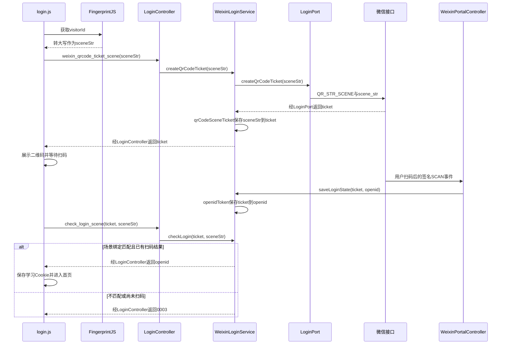

# 29 / 3-6：浏览器指纹无痕登录

承接3-5，本节把固定场景二维码改成“浏览器指纹关联的扫码流程”，仍须微信扫码，不增加指纹游客入口，也不改支付、MQ或部署。原文：[29 / 3-6](<../orgin-tutorial/4.第3部分：外部对接「小型支付商城」/29-3-6-通过浏览器指纹获取登录ticket 无痕登录.md>)；只对照商城参考分支 `3-6-250223-xfg-s-pay-mall-fingerprintjs`。

## 一、业务流程与设计原因

### 1. 先分清：识别浏览器，不等于认证用户

现在商城申请二维码时，`LoginPort.buildWeixinQrCodeRequest()` 使用固定的 `scene_id=100601`。所有浏览器提交相同场景，不能指望这个固定值区分登录尝试；也不能把“每次调用微信一定返回相同ticket”当成接口保证。本节改为传入字符串场景，让申请和轮询能够检查绑定关系。

**浏览器指纹**是根据浏览器、系统、画布等环境特征计算出的标识，本节使用 FingerprintJS 的 `visitorId`。它能辅助关联浏览器环境，但不是随机秘密、身份证、微信openid或服务端认证令牌：

- 同一浏览器通常相近，不保证永远不变；不同设备也可能得到相同标识。
- 无痕窗口不保证新指纹，也不代表无法追踪；指纹技术反而可能跨无痕窗口识别相似环境。
- 指纹在客户端生成，可以篡改和重放。两项参数匹配只表示“提交值与服务端记录相符”，不能证明来自原浏览器。

保留作者章节编号和标题，**不照搬参考分支把指纹直接写进 `loginToken` 的免扫码按钮**。本节的登录结果仍来自微信扫码，现有Cookie保存openid的教学设计也不因此变成生产认证。真实上线需另外设计可信会话及业务鉴权，不在这一节扩建。

你当前用控制台把Cookie切成 `xfg01` 等身份的交易测试方式保持不变，不新增页面功能。扫码账号是否在人群内不影响登录：登录成功后，活动资格才由营销规则另外判断；三人成团测试与本节扫码验证分开。

### 2. 三条链怎样接起来



从浏览器读图：先取得指纹，申请二维码，再每3秒带着同一指纹和ticket询问结果。微信扫码回调走另一条服务端入口；**显示二维码、打开页面都不会产生openid**。两个条件都满足，新轮询接口才返回结果。

这里只沿用已有“端口与适配器”：领域服务编排缓存，`ILoginPort` 描述所需能力，基础设施 `LoginPort` 翻译成微信请求。新增的是方法重载，不是另造设计模式；同名不同参数方便兼容旧调用，代价是需要明确哪些入口带检查。

### 3. 数据究竟存在哪里

| 数据 | 写入时机 | 用途与生命周期 |
| --- | --- | --- |
| `qrCodeSceneTicket`：sceneStr → ticket | 微信成功返回二维码后 | 新增Guava进程内缓存，写入后1分钟失效；同场景重新取码覆盖旧绑定 |
| `openidToken`：ticket → openid | 已有签名校验通过的SCAN回调 | 沿用现有1小时缓存，不改变回调 |
| `loginToken` Cookie | 新轮询返回扫码成功后 | 内容仍是openid，首页继续读作userId；不是可信认证凭证 |

**没有新增表、没有改订单状态、没有调整人群名单，也不新增Redis。** 服务重启会丢失Guava缓存；多实例也不共享。参考把两种映射放在同一个缓存，本节分开，避免任意场景值与ticket在同一键空间互相覆盖，并能单独设置绑定有效期。

二维码有效期改为60秒，绑定缓存为1分钟，页面仍在取码后等待60秒；三个计时起点略有差别，临界时应重新取码，不把前端提示当服务端有效性的保证。同一浏览器多标签通常指纹相同，后一次取码可能使前一次不能通过绑定检查——本节只保留“同场景最新一次绑定”，不承诺多标签并行登录。

## 二、手敲步骤

下面后端代码全部在 **商城对接工程 `s-pay-mall-market`** 手敲，拼团后端不改。每个代码块路径均相对商城仓库根目录。按“接口增加方法 → 紧接实现”的小组完成，不运行中间只改接口的状态；原商城、原文与参考仓库不修改。

### 1. 登录端口：先能把场景传给微信

现在缺的是“带字符串场景申请二维码”。不要再复制一整套取access_token和HTTP调用流程：旧无参数方法生成随机场景，再委托新方法，实际请求只有一份。UUID由JDK提供，本节不为生成一个标识新增Hutool。

在 `ILoginPort` 原无参数方法后增加下面的方法；原方法和模板通知方法保留。

**文件**：`s-pay-mall-domain/src/main/java/com/sirius/domain/auth/adapter/port/ILoginPort.java`

```java
    /**
     * @param sceneStr 本次二维码的字符串场景；不是可信用户身份
     * @return 微信二维码ticket；副作用：向微信申请临时二维码
     */
    String createQrCodeTicket(String sceneStr) throws IOException;
```

立即改 `LoginPort`：增加 `import java.util.UUID;`，完整替换原 `createQrCodeTicket()`，并紧接添加重载方法。`getAccessToken()`、`sendLoginTemplate()` 保持原样。

**文件**：`s-pay-mall-infrastructure/src/main/java/com/sirius/infrastructure/adapter/port/LoginPort.java`

```java
    @Override
    public String createQrCodeTicket() throws IOException {
        // 兼容旧入口，但不再让所有请求使用同一个固定场景。
        return createQrCodeTicket(UUID.randomUUID().toString().replace("-", ""));
    }

    @Override
    public String createQrCodeTicket(String sceneStr) throws IOException {
        String accessToken = getAccessToken();
        WeixinQrCodeRequestDTO request = buildWeixinQrCodeRequest(sceneStr);

        Call<WeixinQrCodeResponseDTO> call = weixinApiService.createQrCode(accessToken, request);
        WeixinQrCodeResponseDTO response = call.execute().body();
        if (response == null || response.getTicket() == null) {
            throw new IOException("微信二维码接口返回为空");
        }
        return response.getTicket();
    }
```

同一组修改中，完整替换原私有 `buildWeixinQrCodeRequest()`；已有DTO已包含 `scene_str` 和 `QR_STR_SCENE`，不用再建类型。

**文件**：`s-pay-mall-infrastructure/src/main/java/com/sirius/infrastructure/adapter/port/LoginPort.java`

```java
    private WeixinQrCodeRequestDTO buildWeixinQrCodeRequest(String sceneStr) {
        WeixinQrCodeRequestDTO.ActionInfo.Scene scene = WeixinQrCodeRequestDTO.ActionInfo.Scene.builder()
                .scene_str(sceneStr)
                .build();
        WeixinQrCodeRequestDTO.ActionInfo info = WeixinQrCodeRequestDTO.ActionInfo.builder()
                .scene(scene)
                .build();
        return WeixinQrCodeRequestDTO.builder()
                .expire_seconds(60)
                .action_name(WeixinQrCodeRequestDTO.ActionNameTypeVO.QR_STR_SCENE.getCode())
                .action_info(info)
                .build();
    }
```

区别不是把整数换成字符串那么简单：`action_name` 必须同步改为 `QR_STR_SCENE`，微信才按字符串场景处理。IDEA断点看request，应有正确的 `scene_str` 和60秒有效期；原DTO的整数 `scene_id` 默认值不是当前类型使用的场景。

### 2. 独立绑定缓存：为下一步领域服务先准备依赖

若还往 `openidToken` 放场景映射，读取时容易混淆“这是ticket还是openid”。在现有 `GuavaConfig` 中、`openidToken()` 后新增Bean；现有 `Cache`、`CacheBuilder`、`TimeUnit`、`Bean` 导入均可复用，不改已有缓存和事件总线。

**文件**：`s-pay-mall-app/src/main/java/com/sirius/config/GuavaConfig.java`

```java
    /** 二维码场景到ticket的短期绑定；写入一分钟后失效，与扫码结果分开。 */
    @Bean(name = "qrCodeSceneTicket")
    public Cache<String, String> qrCodeSceneTicket() {
        return CacheBuilder.newBuilder()
                .expireAfterWrite(1, TimeUnit.MINUTES)
                .maximumSize(10000)
                .build();
    }
```

`expireAfterWrite` 从最后一次写入计时，轮询读取不会续命；`maximumSize` 限制尚未过期的绑定数量，不是限流或生产容量保证。名称明确后，下一步用 `@Resource(name = ...)` 注入，避免多个同类型Cache选错。

### 3. 领域服务：申请成功后绑定，轮询先查绑定

`ILoginService` 在原 `createQrCodeTicket()` 后增加带场景重载，在原 `checkLogin(String ticket)` 后增加双参数重载。原方法与 `saveLoginState()` 保留。

**文件**：`s-pay-mall-domain/src/main/java/com/sirius/domain/auth/service/ILoginService.java`

```java
    /** 按场景申请二维码并保存短期绑定；sceneStr不是用户身份。 */
    String createQrCodeTicket(String sceneStr) throws Exception;

    /** 仅当场景与ticket匹配时返回扫码openid；未扫码、失效或不匹配均返回null。 */
    String checkLogin(String ticket, String sceneStr);
```

立即在 `WeixinLoginService` 中添加下面的字段和两个重载方法，放在已有 `openidToken` 字段后即可，原方法不改。

**文件**：`s-pay-mall-domain/src/main/java/com/sirius/domain/auth/service/WeixinLoginService.java`

```java
    @Resource(name = "qrCodeSceneTicket")
    private Cache<String, String> qrCodeSceneTicket;

    @Override
    public String createQrCodeTicket(String sceneStr) throws Exception {
        // 限定本节接受的场景字符和长度，拒绝空值，不把参数校验等同于认证。
        if (sceneStr == null || !sceneStr.matches("[A-Za-z0-9_-]{1,64}")) {
            throw new IllegalArgumentException("二维码场景参数非法");
        }
        String ticket = loginPort.createQrCodeTicket(sceneStr);
        if (ticket == null || ticket.trim().isEmpty()) {
            throw new IOException("微信未返回有效二维码ticket");
        }
        // 微信成功返回后才建立绑定；同场景重新取码，以最后写入的为准。
        qrCodeSceneTicket.put(sceneStr, ticket);
        return ticket;
    }

    @Override
    public String checkLogin(String ticket, String sceneStr) {
        if (ticket == null || ticket.trim().isEmpty()
                || sceneStr == null || !sceneStr.matches("[A-Za-z0-9_-]{1,64}")) {
            return null;
        }
        String boundTicket = qrCodeSceneTicket.getIfPresent(sceneStr);
        if (!ticket.equals(boundTicket)) {
            return null;
        }
        // 绑定正确仍不代表扫码完成，必须继续查微信回调写入的结果。
        return checkLogin(ticket);
    }
```

这一步的关键是顺序：**不匹配先返回null；匹配后再查扫码状态**。即使 `openidToken` 已有结果，错误场景也不能从新接口拿到openid。`saveLoginState()` 仍由签名校验后的微信回调调用，不把前端提交的指纹传入它。

### 4. API与HTTP入口：前端有两个明确的新地址

在 `IAuthService` 内添加下面两个重载；旧方法保留。

**文件**：`s-pay-mall-api/src/main/java/com/sirius/api/IAuthService.java`

```java
    /** 按浏览器场景获取微信二维码ticket，非法场景返回0002。 */
    Response<String> weixinQrCodeTicket(String sceneStr);

    /** 按ticket和场景查询扫码结果；未扫码、不匹配或绑定过期返回0003。 */
    Response<String> checkLogin(String ticket, String sceneStr);
```

立即在 `LoginController` 增加 `import org.springframework.web.bind.annotation.RequestParam;`，再增加下面两个完整方法。显式写参数名，不依赖编译器是否保留Java参数名称；原入口保持原样。

**文件**：`s-pay-mall-trigger/src/main/java/com/sirius/trigger/http/LoginController.java`

```java
    /** 新取码入口：校验场景后由领域服务申请并绑定ticket。 */
    @Override
    @GetMapping("weixin_qrcode_ticket_scene")
    public Response<String> weixinQrCodeTicket(@RequestParam("sceneStr") String sceneStr) {
        try {
            return Response.<String>builder()
                    .code(ResponseCode.SUCCESS.getCode())
                    .info(ResponseCode.SUCCESS.getInfo())
                    .data(loginService.createQrCodeTicket(sceneStr))
                    .build();
        } catch (IllegalArgumentException e) {
            return Response.<String>builder()
                    .code(ResponseCode.ILLEGAL_PARAMETER.getCode())
                    .info(ResponseCode.ILLEGAL_PARAMETER.getInfo())
                    .build();
        } catch (Exception e) {
            return Response.<String>builder()
                    .code(ResponseCode.UN_ERROR.getCode())
                    .info(ResponseCode.UN_ERROR.getInfo())
                    .build();
        }
    }

    /** 新轮询入口：不区分尚未扫码与绑定不符，统一返回未登录。 */
    @Override
    @GetMapping("check_login_scene")
    public Response<String> checkLogin(@RequestParam("ticket") String ticket,
                                       @RequestParam("sceneStr") String sceneStr) {
        try {
            String openId = loginService.checkLogin(ticket, sceneStr);
            if (StringUtils.isBlank(openId)) {
                return Response.<String>builder()
                        .code(ResponseCode.NO_LOGIN.getCode())
                        .info(ResponseCode.NO_LOGIN.getInfo())
                        .build();
            }
            return Response.<String>builder()
                    .code(ResponseCode.SUCCESS.getCode())
                    .info(ResponseCode.SUCCESS.getInfo())
                    .data(openId)
                    .build();
        } catch (Exception e) {
            return Response.<String>builder()
                    .code(ResponseCode.UN_ERROR.getCode())
                    .info(ResponseCode.UN_ERROR.getInfo())
                    .build();
        }
    }
```

旧 `/weixin_qrcode_ticket` 和 `/check_login` 只为兼容已有调用保留：**旧查询没有场景检查，不能宣称全系统强制指纹绑定**。本节只验证新页面走新接口，不把保留兼容入口说成防盗号；公网认证不依靠它。

### 5. 前端由AI实现，你只跟读关键链路

页面源仍为商城 [login.html](../../../s-pay-mall-market/docs/dev-ops/nginx/html/login.html) 和 [js/login.js](../../../s-pay-mall-market/docs/dev-ops/nginx/html/js/login.js)。本地固定版本 [fp-4.6.2.min.js](../../../s-pay-mall-market/docs/dev-ops/nginx/html/js/vendor/fp-4.6.2.min.js) 在业务脚本之前加载，不每次访问外部CDN；[许可文件](../../../s-pay-mall-market/docs/dev-ops/nginx/html/js/vendor/FingerprintJS-LICENSE.txt) 随库保留。4.6.2采用BSL 1.1，不是无条件商用MIT；本节仅本地学习，生产使用或对外分发另核许可。

请求前调用 `FingerprintJS.load({monitoring: false})`，再 `agent.get()`，取32位十六进制 `visitorId` 转大写作 `sceneStr`。关闭monitoring是为了不发送库的使用统计；微信二维码和商城接口仍有必要网络请求，不等于整个页面离线。

抓住两个请求的变化即可：

```text
GET /api/v1/login/weixin_qrcode_ticket_scene?sceneStr=<指纹大写值>
GET /api/v1/login/check_login_scene?ticket=<URL编码后的ticket>&sceneStr=<同一指纹>
```

响应仍为 `code/info/data`：取码成功用ticket构造微信二维码图片地址；轮询0003继续等，0000且有openid才写Cookie和跳首页。指纹失败、接口失败或等待超时显示重试，**不偷偷回退到旧接口，不把指纹当openid**。

保留3-5的串行轮询与入口判断：IDEA静态服务63342没有API代理，请求商城8080；Nginx 80/443使用同源API。不要用文件协议打开，不自动同步被忽略的build或static页面。

## 三、必做真实验证

### 1. 准备页面和断点，先证明“取码不是登录”

1. 在IDEA使用JDK 8运行你已完成手敲的商城对接工程；本节不要求启动拼团服务来验证扫码。不改模拟支付开关或任何安全限制。
2. 微信账号先关注当前测试公众号，使用3-5已有的有效回调通道。若通道失效，先恢复对接副本的回调配置；不要修改原商城或覆盖云应用。未打通回调不能把等待状态记成成功。
3. 打开商城源码 `login.html` 的IDEA浏览器入口或现有本地Nginx入口，开发者工具Network勾选保留日志。不要沿用旧build页面。
4. 在 `LoginPort.createQrCodeTicket(String)` 的请求行、`WeixinLoginService` 两个新方法、`WeixinPortalController` 的 `saveLoginState` 调用处打断点。使用断点时快速观察并继续，避免暂停超过60秒；超时就重新取码。
5. Network应看到本地指纹脚本200、`weixin_qrcode_ticket_scene` 携带32位大写场景、响应0000和非空ticket。微信请求对象应为 `QR_STR_SCENE`、正确 `scene_str`、有效期60秒。
6. **先不要扫码**：页面展示二维码，轮询同一场景和ticket返回0003，不跳首页、不因指纹生成成功而写入新身份Cookie。用新打开的登录页观察即可，不要求清空整个浏览器Cookie。

失败先看本地库是否404、是否打开了正确页面源、新接口是否404、微信access_token或回调通道是否可用。指纹脚本被阻止时应显示错误与重试，Network不应悄悄出现旧取码接口。

### 2. 再证明“绑定匹配 + 微信扫码”才拿到结果

1. 在二维码有效期内，用已关注测试号的微信扫码。
2. `WeixinPortalController` 验签后应进入SCAN分支，调用 `saveLoginState(ticket, openid)`；确认ticket与页面本次持有的相同，不改回调代码或伪造扫码。
3. 后续新轮询先查到匹配绑定，再读到openid，返回0000；页面跳首页，Cookie内容是实际扫码openid，不是visitorId。
4. 此微信用户未列入活动人群时，首页显示不可参团属于预期业务限制，**不为本节修改人群或要求三人成团**。这不影响扫码成功结论。

若一直0003：先确认回调有没有到达、事件是否SCAN、ticket是否一致、应用是否重启、是否有同指纹另一页面重新取码覆盖绑定，或断点停得太久。不要通过改Cookie冒充这一步的微信扫码成功。

### 3. 用同一已扫码ticket验证错误场景确实被拦下

在上一步成功后、绑定尚未过期时，复制Network里的ticket与sceneStr。在IDEA HTTP Client或接口工具中执行下面两项GET，商城本地直连使用8080：

```http
GET http://127.0.0.1:8080/api/v1/login/check_login_scene?ticket=<将ticket完整URL编码>&sceneStr=<原sceneStr>

GET http://127.0.0.1:8080/api/v1/login/check_login_scene?ticket=<同一个URL编码ticket>&sceneStr=WRONG_SCENE
```

第一项预期0000且data为扫码openid；第二项预期0003且不返回openid。**必须用已有扫码结果的ticket来测错场景**：未扫码时无论检查是否存在都可能0003，证明不了拦截有效。若操作超过一分钟，重新取码、扫码后再做，不延长缓存以迁就测试。

另外，向取码新接口传 `sceneStr=`，预期0002且不调用微信。轮询缺失必填参数预期HTTP 400，不与正常等待的业务码0003混为一谈。

### 4. 验证过期和重新申请

1. 仍使用上一步已扫码的ticket，不重新取码，等到距离申请超过一分钟后，再请求原ticket与原sceneStr，预期0003；虽然旧扫码结果可能仍在1小时缓存里，绑定过期已不能通过新接口。
2. 重新打开登录页，取新二维码；暂不扫码，应维持0003。新页面不能因为指纹与上次相同就自动继承openid。
3. 此时回查原ticket与原场景，预期仍0003；观察缓存中该场景已绑定本次ticket。不要把不同标签、不同浏览器是否碰巧得到相同指纹当成本节通过标准。

本节完成后，不必重跑3-3至3-5已通过的链路。后续需要演示三人成团时，仍在首页用原有控制台Cookie切换方式选择已有人群用户，并明确那是本地演示交易身份，不是微信认证。
