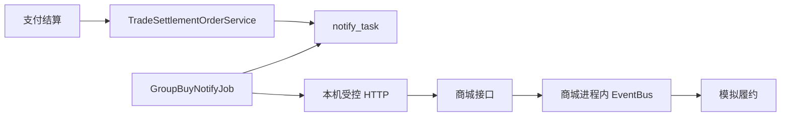
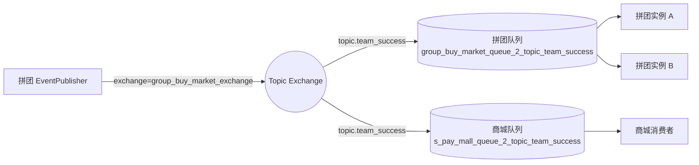

# 30 / 2-16：引入 RabbitMQ 分布式多端消费

29 / 3-6 解决的是一次微信扫码请求与浏览器指纹的关联；这一节回到交易平台的服务间通信，先把 RabbitMQ 接进两套工程，验证“一次发送、多个独立消费端各拿到一份消息”的基础能力。本节只做消息基础设施和字符串探针，不把现有结算通知改成 MQ；真实结算消息发送留在 31 / 2-17，商城业务消费留在 32 / 2-18。

本节涉及两个可写仓库：拼团 `E:\dev\java\group-buy-market\group-buy-market` 和商城对接副本 `E:\dev\java\group-buy-market\s-pay-mall-market`。原商城 `s-pay-mall`、`reference/` 和 `docs/orgin-tutorial/` 只读。

## 一、业务流程与设计原因

### 1. 先看现有通知链路为什么不够

当前拼团的成团通知大致是：



起点是拼团结算服务，最后由定时任务通过 HTTP 调商城。商城收到请求后，仍然在自己的 JVM 内用 Guava `EventBus` 通知履约监听器。这个流程能完成本机联调，但它有三个具体边界：

- 进程内事件只存在于当前 JVM。服务重启时，尚未被监听器处理的事件没有队列可恢复；监听器抛异常也不等于消息进入了可重试存储。
- 同步 HTTP 把发送方和接收方绑在同一条请求链路上。商城未启动、网络短暂失败或处理时间过长，都会直接影响拼团这一轮通知；增加另一个消费方还要继续改发送方。
- 多实例的“同一个服务”与“多个服务”是两种分发语义。两个拼团实例如果共用一个队列，应该分摊消息；拼团和商城如果都要收到同一条消息，必须各自拥有队列。

这一节不宣称 RabbitMQ 自动解决了事务、幂等或最终一致性。它只是把“发送后由谁、何时、怎样取到消息”从调用方进程里拆出来。

### 2. 这一节要搭出的 RabbitMQ 拓扑



消息先到交换机，交换机根据路由键 `topic.team_success` 找到绑定关系，再把消息复制到两个不同的队列。拼团实例 A、B 监听同一个拼团队列，因此一条消息只会交给其中一个实例，这是同服务多实例的负载均衡；商城使用独立队列，所以同一条消息也会进入商城队列，形成多服务各收一份。

这里的四个名词要分开记：

| 名词 | 在本节中的职责 | 不能误解成 |
| --- | --- | --- |
| 生产者 | `EventPublisher` 把消息投递给交换机 | 业务已经完成 |
| 交换机 | 按路由键把消息路由到绑定队列 | 消息存储本身 |
| 队列 | 持有待消费消息，等待消费者取走 | 多实例都各收一份；同一队列是竞争消费 |
| 消费者 | `@RabbitListener` 取消息并处理 | 一定只处理一次 |

交换机和队列设置为持久化，消息投递也设置为 `PERSISTENT`。这能覆盖 broker 重启后的部分恢复场景，但仍需要 broker 确实落盘、连接正常以及生产者确认机制；本节没有配置 publisher confirm，所以 `RabbitTemplate` 方法正常返回不能被说成“broker 已持久化并且商城业务已完成”。

### 3. 确认、失败、重复和幂等的边界

本节监听器显式使用 Spring AMQP 的 `AUTO` 确认模式：监听方法正常返回时，容器确认该次投递；监听方法抛出异常时，容器会拒绝或重新入队，实际是否重投还受容器的 `default-requeue-rejected` 等配置影响。`prefetch: 1` 只表示每个消费者在确认前少拿一些消息，不能推出“恰好一次”。它也不是 RabbitMQ 的 `autoAck=true`。

因此要按下面的故障顺序思考：

1. 生产者连接 broker 失败：本次发送抛出异常，调用方需要记录并决定重试；本节没有把发送失败写入 outbox。
2. 消息进了队列但消费者没启动：队列可以暂存，消费者重新启动后再取；这要求队列和消息确实持久化。
3. 消费者处理成功后、确认前进程崩溃：broker 可能再次投递，业务会看到重复消息。
4. 消费者一直失败：消息可能反复重投；死信队列、退避、最大重试次数和人工补偿不在本节实现。
5. 两个独立队列各自消费：商城消费失败不会让拼团队列自动回滚，两个服务都必须按自己的业务状态做幂等。

本节消费者只打印字符串，没有副作用，所以重复打印容易观察。后续真正处理结算消息时，消息体必须携带稳定的业务标识（例如订单号或事件号），消费者要用唯一约束、状态条件更新或已处理记录防止重复履约。不能用“日志出现一次”代替幂等设计。

### 4. 与相邻章节的边界

| 章节 | 本章负责什么 | 本章不提前做什么 |
| --- | --- | --- |
| 30 / 2-16 | 依赖、连接、交换机/队列/路由键、生产器、监听器和真实消息探针 | 不改结算服务，不发送真实结算业务事件 |
| 31 / 2-17 | 在拼团业务结算完成后组装并发送结算消息 | 不在本章提前接入 |
| 32 / 2-18 | 商城消费结算消息并推进自己的订单业务 | 不在本章提前接入 |

商城当前已有 `EventBus` 仍保留。本节先验证 RabbitMQ 能把消息送到两个消费端；不要把本节的打印监听器接到支付成功、成团通知或发货代码上。

## 二、手敲步骤

### 1. 先准备本机 broker，不改云端部署文件

使用已经准备好的本机 RabbitMQ，或由你在仓库外按自己的环境启动一个 RabbitMQ 实例。需要管理台时使用本机管理端口 `15672`，应用连接端口通常是 `5672`。账号、密码和地址只填在本机私有配置或环境变量中，不写进教程、提交或截图。

本节只要求 broker 可连接，不要求云服务器、Nginx、Docker Compose 部署。若本机没有 RabbitMQ，先停在这里，不用为了赶章节修改部署配置。

### 2. 两个工程加入 AMQP 依赖

当前两仓都是 Spring Boot `2.7.12`、Java 8。参考分支里的 `3.2.0` 依赖版本属于另一套工程，不能照抄。根 POM 如果在自己的 `<dependencyManagement>` 中重新声明这个依赖，就必须明确写 `2.7.12`；各模块的实际依赖则从根 POM 管理，不再重复写版本。

拼团根 POM 的依赖管理加入：

**文件**：`pom.xml`

```xml
<dependency>
    <groupId>org.springframework.boot</groupId>
    <artifactId>spring-boot-starter-amqp</artifactId>
    <version>2.7.12</version>
</dependency>
```

然后在拼团的三个实际使用模块加入同一依赖：`group-buy-market-app/pom.xml`、`group-buy-market-infrastructure/pom.xml`、`group-buy-market-trigger/pom.xml`。三个文件都在 `<dependencies>` 内加入：

**文件**：`group-buy-market-app/pom.xml`

```xml
<dependency>
    <groupId>org.springframework.boot</groupId>
    <artifactId>spring-boot-starter-amqp</artifactId>
</dependency>
```

**文件**：`group-buy-market-infrastructure/pom.xml`

```xml
<dependency>
    <groupId>org.springframework.boot</groupId>
    <artifactId>spring-boot-starter-amqp</artifactId>
</dependency>
```

**文件**：`group-buy-market-trigger/pom.xml`

```xml
<dependency>
    <groupId>org.springframework.boot</groupId>
    <artifactId>spring-boot-starter-amqp</artifactId>
</dependency>
```

商城根 POM 同样加入依赖管理：

**文件**：`s-pay-mall-market/pom.xml`

```xml
<dependency>
    <groupId>org.springframework.boot</groupId>
    <artifactId>spring-boot-starter-amqp</artifactId>
    <version>2.7.12</version>
</dependency>
```

商城本节只需要应用启动和触发监听器，因此在 `s-pay-mall-app/pom.xml`、`s-pay-mall-trigger/pom.xml` 各加入：

**文件**：`s-pay-mall-app/pom.xml`

```xml
<dependency>
    <groupId>org.springframework.boot</groupId>
    <artifactId>spring-boot-starter-amqp</artifactId>
</dependency>
```

**文件**：`s-pay-mall-trigger/pom.xml`

```xml
<dependency>
    <groupId>org.springframework.boot</groupId>
    <artifactId>spring-boot-starter-amqp</artifactId>
</dependency>
```

先分别保存并检查 POM。此时目标只是让当前模块认识 `RabbitTemplate`、`@RabbitListener` 等类型；还没有任何队列和业务消息。

### 3. 拼团配置生产者和自己的探针队列

在拼团 `spring:` 下增加 RabbitMQ 配置。地址和账密使用你本机的环境变量；下面的默认值只给出结构，不包含真实凭据：

**文件**：`group-buy-market-app/src/main/resources/application-dev.yml`

```yaml
  rabbitmq:
    host: ${RABBITMQ_HOST}
    port: ${RABBITMQ_PORT:5672}
    username: ${RABBITMQ_USERNAME}
    password: ${RABBITMQ_PASSWORD}
    listener:
      simple:
        prefetch: 1
        acknowledge-mode: auto
    config:
      producer:
        exchange: group_buy_market_exchange
        topic_team_success:
          routing_key: topic.team_success
          queue: group_buy_market_queue_2_topic_team_success
```

`config` 是项目自定义的配置树，Spring Boot 真正识别的是 `spring.rabbitmq` 下的连接、监听和模板配置。`producer` 这一段只是让发布器和拼团监听器使用同一组交换机、路由键和队列名称。

### 4. 拼团先写发布器，再写监听器

现在还缺一个“把消息交给交换机”的适配类。它放在 infrastructure，是因为 RabbitTemplate 和 RabbitMQ 都是外部基础设施；domain 不应该反向依赖 RabbitMQ。

**文件**：`group-buy-market-infrastructure/src/main/java/com/sirius/infrastructure/event/EventPublisher.java`

```java
package com.sirius.infrastructure.event;

import lombok.extern.slf4j.Slf4j;
import org.springframework.amqp.core.MessageDeliveryMode;
import org.springframework.amqp.rabbit.core.RabbitTemplate;
import org.springframework.beans.factory.annotation.Value;
import org.springframework.stereotype.Component;

import javax.annotation.Resource;

/**
 * RabbitMQ 消息发布器；本节只发布字符串探针，不承载真实结算业务。
 */
@Slf4j
@Component
public class EventPublisher {

    @Resource
    private RabbitTemplate rabbitTemplate;

    @Value("${spring.rabbitmq.config.producer.exchange}")
    private String exchangeName;

    /**
     * 将消息交给指定交换机和路由键；正常返回只说明发送调用完成。
     */
    public void publish(String routingKey, String message) {
        try {
            rabbitTemplate.convertAndSend(exchangeName, routingKey, message, msg -> {
                // 队列和交换机持久化之外，消息本身也标记为持久化。
                msg.getMessageProperties().setDeliveryMode(MessageDeliveryMode.PERSISTENT);
                return msg;
            });
        } catch (Exception e) {
            log.error("发送 RabbitMQ 消息失败 exchange:{} routingKey:{} message:{}",
                    exchangeName, routingKey, message, e);
            throw e;
        }
    }
}
```

接着写拼团侧监听器。`@QueueBinding` 会声明持久化队列、交换机和绑定关系；因此这一节不再增加一个没有被 Spring 注册的 `RabbitMQConfig`。参考分支中的同名配置类把 `@Configuration` 注释掉了，里面的 `@Bean` 实际不会生效，照抄只会增加阅读负担。

**文件**：`group-buy-market-trigger/src/main/java/com/sirius/trigger/listener/TeamSuccessTopicListener.java`

```java
package com.sirius.trigger.listener;

import lombok.extern.slf4j.Slf4j;
import org.springframework.amqp.core.ExchangeTypes;
import org.springframework.amqp.rabbit.annotation.Exchange;
import org.springframework.amqp.rabbit.annotation.Queue;
import org.springframework.amqp.rabbit.annotation.QueueBinding;
import org.springframework.amqp.rabbit.annotation.RabbitListener;
import org.springframework.stereotype.Component;

/**
 * 拼团侧 RabbitMQ 探针消费者；本节只打印消息，不修改订单或通知状态。
 */
@Slf4j
@Component
public class TeamSuccessTopicListener {

    @RabbitListener(
            ackMode = "AUTO",
            bindings = @QueueBinding(
                    value = @Queue(
                            value = "${spring.rabbitmq.config.producer.topic_team_success.queue}",
                            durable = "true"),
                    exchange = @Exchange(
                            value = "${spring.rabbitmq.config.producer.exchange}",
                            type = ExchangeTypes.TOPIC,
                            durable = "true"),
                    key = "${spring.rabbitmq.config.producer.topic_team_success.routing_key}"
            )
    )
    public void listener(String message) {
        log.info("拼团侧收到 RabbitMQ 消息:{}", message);
    }
}
```

这里的监听器是拼团服务自己的消费端。以后拼团服务部署两个实例时，两实例必须继续使用这个相同队列名，RabbitMQ 才会在两个消费者之间分摊消息。

### 5. 商城配置独立队列并增加独立监听器

商城不能复用拼团队列。若复用，同一条消息会被两个服务竞争消费，商城可能拿不到本来应该看到的消息。商城使用同一个 exchange 和 routing key，但队列名称必须不同：

**文件**：`s-pay-mall-app/src/main/resources/application-dev.yml`

```yaml
spring:
  rabbitmq:
    host: ${RABBITMQ_HOST}
    port: ${RABBITMQ_PORT:5672}
    username: ${RABBITMQ_USERNAME}
    password: ${RABBITMQ_PASSWORD}
    listener:
      simple:
        prefetch: 1
        acknowledge-mode: auto
    config:
      consumer:
        topic_team_success:
          exchange: group_buy_market_exchange
          routing_key: topic.team_success
          queue: s_pay_mall_queue_2_topic_team_success
```

在商城触发层写只打印消息的监听器。这里不调用现有 `OrderPaySuccessListener`，也不触碰 `OrderRepository` 和支付状态。

**文件**：`s-pay-mall-trigger/src/main/java/com/sirius/trigger/listener/TeamSuccessTopicListener.java`

```java
package com.sirius.trigger.listener;

import lombok.extern.slf4j.Slf4j;
import org.springframework.amqp.core.ExchangeTypes;
import org.springframework.amqp.rabbit.annotation.Exchange;
import org.springframework.amqp.rabbit.annotation.Queue;
import org.springframework.amqp.rabbit.annotation.QueueBinding;
import org.springframework.amqp.rabbit.annotation.RabbitListener;
import org.springframework.stereotype.Component;

/**
 * 商城侧 RabbitMQ 探针消费者；本节只确认收到消息，不推进商城订单。
 */
@Slf4j
@Component
public class TeamSuccessTopicListener {

    @RabbitListener(
            ackMode = "AUTO",
            bindings = @QueueBinding(
                    value = @Queue(
                            value = "${spring.rabbitmq.config.consumer.topic_team_success.queue}",
                            durable = "true"),
                    exchange = @Exchange(
                            value = "${spring.rabbitmq.config.consumer.topic_team_success.exchange}",
                            type = ExchangeTypes.TOPIC,
                            durable = "true"),
                    key = "${spring.rabbitmq.config.consumer.topic_team_success.routing_key}"
            )
    )
    public void listener(String message) {
        log.info("商城侧收到 RabbitMQ 消息:{}", message);
    }
}
```

到这里，拼团发布器使用 `producer.exchange`，两个监听器分别用自己的队列配置，但三方的 exchange 和 routing key 一致。不要因为两个类都叫 `TeamSuccessTopicListener` 就让它们共用队列；类名可以相同，消费边界不能相同。

### 6. 写一个真实 broker 集成探针

本节的探针只验证真实 RabbitMQ，不连接替身，也不调用结算接口。它的价值是保护 `EventPublisher → exchange → 两个队列 → 两个 listener` 的拓扑；运行前要确认数据库、Redis 和 RabbitMQ 都是本机或独立测试范围，不能直接在生产配置下运行。

**文件**：`group-buy-market-app/src/test/java/com/sirius/test/RabbitMqSmokeTest.java`

```java
package com.sirius.test;

import com.sirius.infrastructure.event.EventPublisher;
import org.junit.Test;
import org.junit.runner.RunWith;
import org.springframework.beans.factory.annotation.Value;
import org.springframework.boot.test.context.SpringBootTest;
import org.springframework.test.context.junit4.SpringRunner;

import javax.annotation.Resource;

/**
 * RabbitMQ 基础设施集成探针：消息会进入真实 broker，不是内存替身。
 */
@RunWith(SpringRunner.class)
@SpringBootTest
public class RabbitMqSmokeTest {

    @Resource
    private EventPublisher eventPublisher;

    @Value("${spring.rabbitmq.config.producer.topic_team_success.routing_key}")
    private String routingKey;

    @Test
    public void publishFiveMessages() {
        for (int i = 1; i <= 5; i++) {
            eventPublisher.publish(routingKey, "RabbitMQ探针消息-" + i);
        }
    }
}
```

这个测试不等待固定秒数，也不把“测试方法返回”当作消费完成。真正的消费证据看两个应用的日志和 RabbitMQ 管理台；测试只负责让拼团应用通过真实 `RabbitTemplate` 发出 5 条消息。当前 app POM 有 `skipTests=true` 的历史配置，不能直接把 `mvn package` 的成功当成这个测试已运行；要在 IDEA 中只运行 `RabbitMqSmokeTest.publishFiveMessages`，并记录测试结果。

参考分支还增加了 `BaseEvent` 和若干未使用导入，这是后续把业务事件封装成统一信封的准备；本节发布的是字符串探针，暂不新增事件基类，也不把 31 / 2-17 的结算消息格式提前写进来。

## 三、必做真实验证

### 1. 启动前检查

准备一个独立的本机 RabbitMQ 和可写的本地测试数据库、缓存范围。私有配置中确认两套应用的 RabbitMQ 地址、端口、账号和密码一致；不要把这些值贴进教程或提交。先分别编译保存后的两仓，编译阶段至少应能解析 `RabbitTemplate`、`@RabbitListener`、`@QueueBinding` 和 `ExchangeTypes`。

RabbitMQ 管理台打开后，先不要发消息，确认连接用户可查看 exchange 和 queue。启动拼团应用和商城应用各一份，等两套监听器完成声明后检查：

- exchange 存在：`group_buy_market_exchange`，类型为 topic；
- 拼团队列存在：`group_buy_market_queue_2_topic_team_success`；
- 商城队列存在：`s_pay_mall_queue_2_topic_team_success`；
- 两个队列都绑定到同一个 exchange，绑定键都是 `topic.team_success`；
- 拼团应用日志没有连接拒绝、认证失败或监听器启动失败。

若队列没有出现，先看配置前缀、环境变量是否生效和监听器包是否被 `com.sirius.Application` 扫描，不要先改业务代码。

### 2. 发送 5 条并核对两个消费端

在确认独立测试数据后，只运行 `RabbitMqSmokeTest.publishFiveMessages` 一个测试方法。观察标准如下：

1. 测试方法能通过拼团应用中的 `EventPublisher` 调用真实 broker；
2. 拼团日志累计看到 5 条 `RabbitMQ探针消息-1` 到 `-5`；
3. 商城日志也累计看到同样 5 条；
4. RabbitMQ 管理台中两个队列的 ready/unacked 数量最终回到 0；
5. 不应出现 HTTP 成团通知、支付状态变化、商城 `DEAL_DONE` 变化或新的拼团通知任务。

如果只看到拼团日志，通常是商城队列名、exchange 或 routing key 不一致；如果只看到商城日志，检查拼团监听器是否声明成功；如果两个应用都没有日志，先查 `EventPublisher` 的连接和交换机路由，不要把“测试方法返回”当作消费完成。

### 3. 验证同队列分摊语义

在同一份独立配置下再启动一个拼团应用实例，两个拼团实例必须使用相同的拼团队列名。重新发送 5 条消息，两个拼团实例的日志总数应合计 5 条，而商城队列仍应收到 5 条。每条消息只应在两个拼团实例中的一个出现；这验证的是同队列竞争消费。

这个步骤只验证 RabbitMQ 的投递语义，不验证并发下的业务正确性。不能把它写成“多实例下结算正确”，因为本节监听器没有更新订单或库存。

### 4. 观察一次失败边界

为了验证确认语义，只在独立测试环境中把拼团监听器的日志语句临时改成抛异常，发送一条唯一探针消息，观察该消息是否按当前 `default-requeue-rejected` 配置重新投递或进入拒绝路径；确认后立刻还原代码，再发送一条消息确认监听器恢复。不要在商城业务监听器里制造异常，也不要让测试消息进入支付或履约流程。

记录时区分：

- **通过**：真实 broker 声明了两个独立队列，5 条消息分别到达两个消费端，且应用日志与管理台数量一致；
- **失败**：连接、认证、路由或监听器启动失败，保留第一处实际错误；
- **跳过**：没有本机 RabbitMQ 或没有独立测试数据，不能用仓外内存替身代替；
- **未运行**：没有启动第二个拼团实例、没有做失败重投观察，不能把这些范围写成已验证。

本节完成后仍不能声称：消息一定不丢、消费一定不重、业务一定最终完成、跨服务事务已经建立或商城已经完成结算。那些结论要等后续业务消息接入和消费者实现，并且仍需单独设计幂等与失败补偿。
