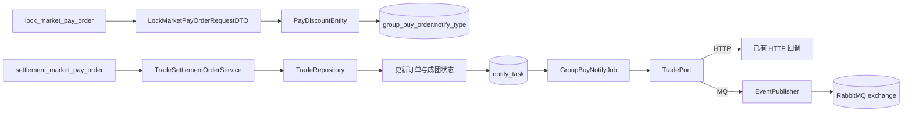
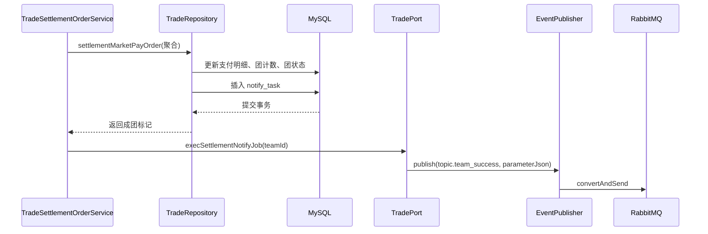

# 31 / 2-17：发送 MQ 结算消息

上一节只验证了 RabbitMQ 的交换机、队列、路由键和字符串发布器；这一节把它接到真实的拼团结算完成链路。你只改拼团工程：锁单时记录通知方式，最后一人支付完成后生成结算消息，再由已有通知任务调用 `EventPublisher`。本节不进入商城消费、不做退款，也不改原商城。

## 一、业务流程与设计原因

### 1. 先看要解决的具体问题

现在的结算链路已经能在拼团完成后生成 `notify_task`，再由 `GroupBuyNotifyJob` 定时任务通过 `TradePort` 发 HTTP。问题是：通知方式没有被记录，`TradePort` 也只认识 HTTP，所以即使第30节已经有 `EventPublisher`，真实结算仍不会进入 RabbitMQ。

本节要把“调用方想用哪种通知方式”变成订单的一部分：



锁单阶段只决定“这个团完成后走 HTTP 还是 MQ”，并把选择写入 `group_buy_order`。结算阶段从团记录读回选择，最后一个支付订单使团完成时，把同样的方式写入 `notify_task`。通知任务执行时才根据类型选择 HTTP 或 MQ。

### 2. 为什么通知方式要落库

如果只把 `notifyType` 放在当前 HTTP 请求的内存对象里，结算可能发生在另一个请求、另一个线程，甚至应用重启之后，系统就不知道这个团应该怎样通知。`group_buy_order` 是开团时保存的团级事实，`notify_task` 是成团后保存的待执行任务；两处都保存通知信息，才能支持即时触达失败后的定时补偿。

本节新增的消息契约只有这些字段：

| 字段 | 来源 | 作用 |
| --- | --- | --- |
| `notifyType` | 锁单入参并写入 `group_buy_order` | 选择 `HTTP` 或 `MQ` |
| `notifyMQ` | 拼团配置中的 `topic.team_success` | MQ 路由键，固定由服务端决定 |
| `notifyUrl` | HTTP 锁单入参 | 兼容已有 HTTP 回调 |
| `parameterJson.teamId` | 成团团记录 | 消费者定位哪个团完成 |
| `parameterJson.outTradeNoList` | 成团时查询已支付明细 | 消费者知道哪些外部订单完成支付 |

MQ 消息体的业务内容是：

```json
{"teamId":"44784629","outTradeNoList":["008981724008"]}
```

路由键仍是第30节已经验证过的 `topic.team_success`。本节不让外部调用方自由传交换机或路由键，避免调用方把业务事件发到未约定的拓扑。

### 3. 必须分清事务和消息的边界

结算仓储方法上的 `@Transactional` 包含以下数据库动作：

1. 把当前支付明细改成完成，并记录支付完成时间；
2. 增加团的完成数量；
3. 最后一人完成时，把团状态改成完成；
4. 查询本团已完成的外部订单号；
5. 插入一条 `notify_task`。

仓储方法返回后，Spring 才会完成这次事务提交；随后 `TradeSettlementOrderService` 调通知任务，`TradePort` 才调用 `EventPublisher`。因此本节采用“先提交数据库，再发 MQ”的顺序：



这个顺序有明确取舍：MQ 发送失败时，已经提交的订单和成团状态不会回滚；通知任务会保留在 `0` 或 `2` 状态，后续任务继续尝试。`RabbitTemplate.convertAndSend` 正常返回也只代表发送调用完成，不代表商城已经消费并完成结算。消费者幂等和商城业务处理属于下一节。

## 二、手敲步骤

### 1. 先做数据库增量

先确认你连接的是独立的学习数据库，并检查字段是否已经存在。不要直接重新执行整份建表脚本，也不要在原商城数据库执行。

```sql
ALTER TABLE group_buy_order
    ADD COLUMN notify_type varchar(8) NOT NULL DEFAULT 'HTTP'
        COMMENT '回调类型（HTTP、MQ）' AFTER valid_end_time;

ALTER TABLE group_buy_order
    MODIFY COLUMN notify_url varchar(255) DEFAULT NULL
        COMMENT 'HTTP 回调地址';

ALTER TABLE notify_task
    ADD COLUMN notify_type varchar(8) NOT NULL DEFAULT 'HTTP'
        COMMENT '回调类型（HTTP、MQ）' AFTER team_id,
    ADD COLUMN notify_mq varchar(128) DEFAULT NULL
        COMMENT 'MQ 路由键' AFTER notify_type;

ALTER TABLE notify_task
    MODIFY COLUMN notify_url varchar(128) DEFAULT NULL
        COMMENT 'HTTP 回调地址';
```

检查结果：`group_buy_order` 和 `notify_task` 都有 `notify_type`；`notify_task` 还有 `notify_mq`；MQ 任务的 `notify_url` 可以为空。历史 HTTP 数据会因为默认值继续按 HTTP 处理。

### 2. 先建立领域里的通知值对象

现在接口层要传入的是字符串，但领域层不应该让后续代码到处比较字符串。先建枚举和值对象，后面的实体和仓储都依赖它们。

**文件**：`group-buy-market-domain/src/main/java/com/sirius/domain/trade/model/valobj/NotifyTypeEnumVO.java`

```java
package com.sirius.domain.trade.model.valobj;

import lombok.AllArgsConstructor;
import lombok.Getter;

/**
 * 拼团完成后的通知方式。
 */
@Getter
@AllArgsConstructor
public enum NotifyTypeEnumVO {

    HTTP("HTTP", "HTTP 回调"),
    MQ("MQ", "MQ 消息通知");

    private final String code;
    private final String info;
}
```

**文件**：`group-buy-market-domain/src/main/java/com/sirius/domain/trade/model/valobj/NotifyConfigVO.java`

```java
package com.sirius.domain.trade.model.valobj;

import lombok.AllArgsConstructor;
import lombok.Builder;
import lombok.Getter;
import lombok.NoArgsConstructor;

/**
 * 拼团完成通知配置；路由键由拼团服务从配置中补齐，调用方只选择通知类型。
 */
@Getter
@Builder
@NoArgsConstructor
@AllArgsConstructor
public class NotifyConfigVO {

    /** HTTP 或 MQ。 */
    private NotifyTypeEnumVO notifyType;
    /** 服务端固定的 MQ 路由键。 */
    private String notifyMQ;
    /** HTTP 回调地址。 */
    private String notifyUrl;
}
```

值对象的作用是把“通知类型、路由键、地址”作为一个整体传递。它不是为了增加类数量，而是避免 `notifyType`、`notifyUrl` 在锁单、结算、任务之间分别传递后发生错配。

### 3. 修改锁单入参，并把通知配置送入领域

把 `LockMarketPayOrderRequestDTO` 中原来的单个 `notifyUrl` 换成配置对象，同时保留两个兼容方法：旧的 HTTP 测试可以调用 `setNotifyUrl`，新的 MQ 测试调用 `setNotifyMQ`。`notifyMQ` 不从外部传入，实际路由键由仓储读取配置。

**文件**：`group-buy-market-api/src/main/java/com/sirius/api/dto/LockMarketPayOrderRequestDTO.java`

```java
package com.sirius.api.dto;

import lombok.Data;

/**
 * 营销支付锁单请求对象。
 */
@Data
public class LockMarketPayOrderRequestDTO {

    private String userId;
    private String teamId;
    private Long activityId;
    private String goodsId;
    private String source;
    private String channel;
    private String outTradeNo;
    private NotifyConfigVO notifyConfigVO;

    /** 兼容旧 HTTP 调用：收到 notifyUrl 时自动构造 HTTP 配置。 */
    public void setNotifyUrl(String url) {
        NotifyConfigVO config = new NotifyConfigVO();
        config.setNotifyType("HTTP");
        config.setNotifyUrl(url);
        this.notifyConfigVO = config;
    }

    /** MQ 不接受外部路由键，统一使用服务端 topic.team_success。 */
    public void setNotifyMQ() {
        NotifyConfigVO config = new NotifyConfigVO();
        config.setNotifyType("MQ");
        this.notifyConfigVO = config;
    }

    @Data
    public static class NotifyConfigVO {
        /** HTTP 或 MQ。 */
        private String notifyType;
        /** 仅 HTTP 使用。 */
        private String notifyUrl;
    }
}
```

然后在 `MarketTradeController#lockMarketPayOrder` 中做三处调整：

1. 导入领域层的 `NotifyConfigVO` 和 `NotifyTypeEnumVO`；
2. 用 `LockMarketPayOrderRequestDTO.NotifyConfigVO notifyConfigVO = requestDTO.getNotifyConfigVO();` 替换原来的 `String notifyUrl = requestDTO.getNotifyUrl();`，并在调用领域服务前校验配置不为空、类型必须是 `HTTP` 或 `MQ`，HTTP 时地址不能为空；
3. 构建 `PayDiscountEntity` 时，把接口层字符串转换成领域值对象。

下面是第3处的完整替换片段，放在现有 `.outTradeNo(outTradeNo)` 后面；同时删除原来的 `.notifyUrl(notifyUrl)`：

```java
.notifyConfigVO(
        NotifyConfigVO.builder()
                .notifyType(NotifyTypeEnumVO.valueOf(notifyConfigVO.getNotifyType()))
                .notifyUrl(notifyConfigVO.getNotifyUrl())
                .build())
.build()
```

校验代码应在调用 `tradeOrderService.lockMarketPayOrder` 前完成：

```java
LockMarketPayOrderRequestDTO.NotifyConfigVO notifyConfigVO = requestDTO.getNotifyConfigVO();
if (notifyConfigVO == null
        || StringUtils.isBlank(notifyConfigVO.getNotifyType())
        || (!"HTTP".equals(notifyConfigVO.getNotifyType())
        && !"MQ".equals(notifyConfigVO.getNotifyType()))
        || ("HTTP".equals(notifyConfigVO.getNotifyType())
        && StringUtils.isBlank(notifyConfigVO.getNotifyUrl()))) {
    return Response.<LockMarketPayOrderResponseDTO>builder()
            .code(ResponseCode.ILLEGAL_PARAMETER.getCode())
            .info(ResponseCode.ILLEGAL_PARAMETER.getInfo())
            .build();
}
```

这里要注意变量类型：校验变量是 `LockMarketPayOrderRequestDTO.NotifyConfigVO`，构建领域对象时使用导入的 `com.sirius.domain.trade.model.valobj.NotifyConfigVO`。两个类同名时，按 IDEA 的自动导入结果检查，必要时给领域类型写全限定名。

### 4. 让领域对象和责任链透传配置

`PayDiscountEntity` 是锁单时的领域输入，`GroupBuyTeamEntity` 是结算时查出的团信息，二者都需要持有同一个领域值对象。把原来的 `notifyUrl` 字段替换为下面字段，并补充对应 import：

```java
/** 锁单时约定的完成通知配置。 */
private NotifyConfigVO notifyConfigVO;
```

涉及文件：

- `group-buy-market-domain/src/main/java/com/sirius/domain/trade/model/entity/PayDiscountEntity.java`
- `group-buy-market-domain/src/main/java/com/sirius/domain/trade/model/entity/GroupBuyTeamEntity.java`

结算责任链的返回对象也要换字段：

文件路径：`group-buy-market-domain/src/main/java/com/sirius/domain/trade/model/entity/TradeSettlementRuleFilterBackEntity.java`

```java
/** 开团时保存的完成通知配置。 */
private NotifyConfigVO notifyConfigVO;
```

**文件**：`group-buy-market-domain/src/main/java/com/sirius/domain/trade/service/settlement/filter/EndRuleFilter.java`

把返回对象中的：

```java
.notifyUrl(team.getNotifyUrl())
```

改成：

```java
.notifyConfigVO(team.getNotifyConfigVO())
```

在 `TradeSettlementOrderService#settlementMarketPayOrder` 组装 `GroupBuyTeamEntity` 的地方，同样把：

```java
.notifyUrl(back.getNotifyUrl())
```

改成：

```java
.notifyConfigVO(back.getNotifyConfigVO())
```

现有 `ITradeLockOrderServiceTest` 如果直接构造 `PayDiscountEntity`，也要把：

```java
.notifyUrl("http://127.0.0.1:8091/api/v1/test/group_buy_notify")
```

改成：

```java
.notifyConfigVO(NotifyConfigVO.builder()
        .notifyType(NotifyTypeEnumVO.HTTP)
        .notifyUrl("http://127.0.0.1:8091/api/v1/test/group_buy_notify")
        .build())
```

并在测试类导入领域层的 `NotifyConfigVO`、`NotifyTypeEnumVO`。这一步只迁移测试夹具使用的新领域字段，不新增测试场景。

到这里，配置已经能从锁单入口经过领域对象、结算责任链，回到结算仓储。

### 5. 把通知选择写入两张任务相关表

先给持久化对象增加字段：

文件路径：`group-buy-market-infrastructure/src/main/java/com/sirius/infrastructure/dao/po/GroupBuyOrder.java`

```java
/** 回调类型：HTTP、MQ。 */
private String notifyType;
/** HTTP 回调地址；MQ 任务为空。 */
private String notifyUrl;
```

原有 `notifyUrl` 字段保留，只在它前面增加 `notifyType`。不要删除 HTTP 地址字段。

文件路径：`group-buy-market-infrastructure/src/main/java/com/sirius/infrastructure/dao/po/NotifyTask.java`

```java
/** 回调类型：HTTP、MQ。 */
private String notifyType;
/** MQ 路由键。 */
private String notifyMQ;
/** HTTP 回调地址。 */
private String notifyUrl;
```

在 `group_buy_order_mapper.xml` 做四处对应修改：

```xml
<result column="notify_type" property="notifyType"/>
<result column="notify_url" property="notifyUrl"/>
```

把 `insert` 的字段和值分别加入 `notify_type`、`#{notifyType}`；把 `queryGroupBuyTeamByTeamId` 的查询列加入 `notify_type`。原有 `notify_url` 映射继续保留。

在 `nofify_task_mapper.xml` 做三组修改：

```xml
<result column="notify_type" property="notifyType"/>
<result column="notify_mq" property="notifyMQ"/>
<result column="notify_url" property="notifyUrl"/>
```

`insert`、两个未执行任务查询都要同时加入 `notify_type` 和 `notify_mq`。如果漏掉查询列，数据库里虽然有值，定时任务拿到的领域对象仍然是空值。

### 6. 让通知任务对象携带 MQ 信息

当前 `NotifyTaskEntity` 只有地址和 JSON，`TradePort` 没有路由 MQ 所需的数据。把它改成下面的完整内容，并用 builder 统一构造，避免增加字段后构造参数顺序错乱。

**文件**：`group-buy-market-domain/src/main/java/com/sirius/domain/trade/model/entity/NotifyTaskEntity.java`

```java
package com.sirius.domain.trade.model.entity;

import lombok.AllArgsConstructor;
import lombok.Builder;
import lombok.Data;
import lombok.NoArgsConstructor;

/**
 * 一次拼团完成通知任务；一团一条任务，负责承载发送所需的快照。
 */
@Data
@Builder
@NoArgsConstructor
@AllArgsConstructor
public class NotifyTaskEntity {

    private String teamId;
    private String notifyType;
    private String notifyMQ;
    private String notifyUrl;
    /** 已尝试次数；本次发送前读取这个数。 */
    private Integer notifyCount;
    /** 成团消息 JSON，不在发送端重新查询订单。 */
    private String parameterJson;

    public String lockKey() {
        return "notify_job_lock_key_" + teamId;
    }
}
```

在 `TradeRepository` 中，两个 `queryUnExecutedNotifyTaskList` 方法最终都要把 `NotifyTask` 转成下面这些字段。推荐把原来的位置构造改成 builder：

```java
private List<NotifyTaskEntity> toNotifyEntities(List<NotifyTask> tasks) {
    return tasks.stream()
            .map(task -> NotifyTaskEntity.builder()
                    .teamId(task.getTeamId())
                    .notifyType(task.getNotifyType())
                    .notifyMQ(task.getNotifyMQ())
                    .notifyUrl(task.getNotifyUrl())
                    .notifyCount(task.getNotifyCount())
                    .parameterJson(task.getParameterJson())
                    .build())
            .collect(Collectors.toList());
}
```

### 7. 在仓储中固定 MQ 路由键，并生成结算任务快照

在 `TradeRepository` 增加配置注入：

```java
import com.sirius.domain.trade.model.valobj.NotifyConfigVO;
import com.sirius.domain.trade.model.valobj.NotifyTypeEnumVO;
import org.springframework.beans.factory.annotation.Value;
```

```java
@Value("${spring.rabbitmq.config.producer.topic_team_success.routing_key}")
private String topicTeamSuccess;
```

在 `lockMarketPayOrder` 取得 `PayDiscountEntity` 后增加：

```java
NotifyConfigVO notifyConfigVO = payDiscountEntity.getNotifyConfigVO();
```

创建 `GroupBuyOrder` 时，把原来的：

```java
.notifyUrl(payDiscountEntity.getNotifyUrl())
```

替换为：

```java
.notifyType(notifyConfigVO.getNotifyType().getCode())
.notifyUrl(notifyConfigVO.getNotifyUrl())
```

`queryGroupBuyTeamByTeamId` 改成下面的完整方法，让结算责任链拿到通知类型，并把 MQ 路由键从服务端配置补入：

```java
@Override
public GroupBuyTeamEntity queryGroupBuyTeamByTeamId(String teamId) {
    GroupBuyOrder groupBuyOrder = groupBuyOrderDao.queryGroupBuyTeamByTeamId(teamId);
    return GroupBuyTeamEntity.builder()
            .teamId(groupBuyOrder.getTeamId())
            .activityId(groupBuyOrder.getActivityId())
            .targetCount(groupBuyOrder.getTargetCount())
            .completeCount(groupBuyOrder.getCompleteCount())
            .lockCount(groupBuyOrder.getLockCount())
            .status(GroupBuyOrderEnumVO.valueOf(groupBuyOrder.getStatus()))
            .validStartTime(groupBuyOrder.getValidStartTime())
            .validEndTime(groupBuyOrder.getValidEndTime())
            .notifyConfigVO(NotifyConfigVO.builder()
                    .notifyType(NotifyTypeEnumVO.valueOf(groupBuyOrder.getNotifyType()))
                    .notifyMQ(topicTeamSuccess)
                    .notifyUrl(groupBuyOrder.getNotifyUrl())
                    .build())
            .build();
}
```

在 `settlementMarketPayOrder` 取得团实体后增加：

```java
NotifyConfigVO notifyConfigVO = groupBuyTeamEntity.getNotifyConfigVO();
```

只在“最后一个人使团完成”的分支中，创建 `NotifyTask` 时加入：

```java
notifyTask.setNotifyType(notifyConfigVO.getNotifyType().getCode());
notifyTask.setNotifyMQ(NotifyTypeEnumVO.MQ.equals(notifyConfigVO.getNotifyType())
        ? notifyConfigVO.getNotifyMQ() : null);
notifyTask.setNotifyUrl(NotifyTypeEnumVO.HTTP.equals(notifyConfigVO.getNotifyType())
        ? notifyConfigVO.getNotifyUrl() : null);
```

消息 JSON 继续使用现有成团逻辑，只确认字段口径：

```java
notifyTask.setParameterJson(JSON.toJSONString(new HashMap<String, Object>() {{
    put("teamId", groupBuyTeamEntity.getTeamId());
    put("outTradeNoList", outTradeNoList);
}}));
```

这里不要把 `userId`、商品金额或支付时间混入本节消息。第32节消费方当前首先需要团 ID 和已完成订单号列表，其他信息可以由消费方按自己的订单库查询。

### 8. 在 TradePort 选择 HTTP 或 MQ

这是本节真正接入 `EventPublisher` 的位置。数据库事务和消息发送不要放进同一个领域方法里：`TradePort` 只负责按任务快照选择外部触达方式，发送失败交给已有通知状态机。

**文件**：`group-buy-market-infrastructure/src/main/java/com/sirius/infrastructure/adapter/port/TradePort.java`

```java
package com.sirius.infrastructure.adapter.port;

import com.sirius.domain.trade.adapter.port.ITradePort;
import com.sirius.domain.trade.model.entity.NotifyTaskEntity;
import com.sirius.domain.trade.model.valobj.NotifyTypeEnumVO;
import com.sirius.infrastructure.event.EventPublisher;
import com.sirius.infrastructure.gateway.GroupBuyNotifyService;
import com.sirius.infrastructure.redis.IRedisService;
import com.sirius.types.enums.NotifyTaskHTTPEnumVO;
import org.redisson.api.RLock;
import org.springframework.stereotype.Service;

import javax.annotation.Resource;
import java.util.concurrent.TimeUnit;

/**
 * 拼团完成通知适配器；按任务快照选择 HTTP 或 MQ。
 */
@Service
public class TradePort implements ITradePort {

    @Resource
    private GroupBuyNotifyService groupBuyNotifyService;
    @Resource
    private IRedisService redisService;
    @Resource
    private EventPublisher publisher;

    @Override
    public String groupBuyNotify(NotifyTaskEntity task) throws Exception {
        RLock lock = redisService.getLock(task.lockKey());
        boolean acquired = false;
        try {
            acquired = lock.tryLock(0, TimeUnit.SECONDS);
            if (!acquired) {
                return NotifyTaskHTTPEnumVO.NULL.getCode();
            }

            if (NotifyTypeEnumVO.HTTP.getCode().equals(task.getNotifyType())) {
                if (task.getNotifyUrl() == null || task.getNotifyUrl().trim().isEmpty()
                        || "暂无".equals(task.getNotifyUrl())) {
                    return NotifyTaskHTTPEnumVO.SUCCESS.getCode();
                }
                return groupBuyNotifyService.groupBuyNotify(
                        task.getNotifyUrl(), task.getParameterJson());
            }

            if (NotifyTypeEnumVO.MQ.getCode().equals(task.getNotifyType())) {
                publisher.publish(task.getNotifyMQ(), task.getParameterJson());
                return NotifyTaskHTTPEnumVO.SUCCESS.getCode();
            }

            return NotifyTaskHTTPEnumVO.ERROR.getCode();
        } catch (InterruptedException e) {
            Thread.currentThread().interrupt();
            return NotifyTaskHTTPEnumVO.NULL.getCode();
        } catch (Exception e) {
            // MQ 或 HTTP 发送异常不能伪装成“没抢到锁”，否则任务不会进入重试状态。
            return NotifyTaskHTTPEnumVO.ERROR.getCode();
        } finally {
            if (acquired && lock.isHeldByCurrentThread()) {
                lock.unlock();
            }
        }
    }
}
```

这里特意区分三个返回值：

- `success`：HTTP 调用返回成功，或 `EventPublisher` 正常返回；通知任务改为完成；
- `error`：已拿到锁，但外部发送失败或类型非法；通知任务进入重试，达到次数后失败；
- `null`：没有拿到分布式锁，或线程被中断；本轮不增加通知次数，下一轮再查。

因此，`EventPublisher` 的异常不会回滚已经提交的结算事务，但也不会被当成成功。这个状态转换是本节必须保留的失败边界。

## 三、必做真实验证

### 1. 先验证结构和旧 HTTP 兼容

准备一个独立的拼团测试数据库、Redis 和 RabbitMQ。确认两张表的字段已经更新，再启动拼团应用。不要直接使用会影响既有订单的团做下面验证；先准备一个目标人数为 2 或 3、尚未完成、有效期足够长的新团。

在 IDEA 中运行拼团应用，先用原来的 HTTP 锁单请求验证兼容性，再用 MQ 请求验证新分支。MQ 锁单请求的核心结构如下，订单号必须使用这次测试新生成的值：

```json
{
  "userId":"xfg03",
  "teamId":null,
  "activityId":100123,
  "goodsId":"9890001",
  "source":"s01",
  "channel":"c01",
  "outTradeNo":"本次新生成的12位订单号",
  "notifyConfigVO":{"notifyType":"MQ"}
}
```

观察并查询：

```sql
SELECT team_id, notify_type, notify_url
FROM group_buy_order
WHERE team_id = '本次返回的teamId';
```

预期：锁单接口成功；新团记录的 `notify_type` 是 `MQ`；`notify_url` 可以为空。再用旧 HTTP 方式锁一个独立新团，预期其 `notify_type` 是 `HTTP`，说明兼容分支仍然有效。

如果接口直接返回参数错误，先看 `notifyConfigVO` 是否按嵌套 JSON 发送；如果锁单成功但数据库仍没有 `notify_type`，检查 MyBatis 的 `insert` 是否加入了新列。

### 2. 让最后一个支付订单触发真实 MQ

继续使用刚才的 MQ 团，按现有本地支付/结算流程完成前面的订单。最后一个支付订单调用现有 `settlement_market_pay_order` 接口时，输入的 `outTradeNo` 必须是锁单时保存的那个外部订单号，`outTradeTime` 必须早于团的 `valid_end_time`。

在发送结算请求前打开三个观察位置：

1. IDEA 的拼团应用日志，观察 `TradeSettlementOrderService`、`EventPublisher` 和 `TeamSuccessTopicListener`；
2. RabbitMQ 管理台，观察 `group_buy_market_exchange`、拼团队列的 ready/unacked 数量；
3. MySQL 的 `notify_task` 表。

结算后执行：

```sql
SELECT team_id, notify_type, notify_mq, notify_url,
       notify_count, notify_status, parameter_json
FROM notify_task
WHERE team_id = '本次返回的teamId'
ORDER BY id DESC;
```

预期判据：

- 只有最后一个支付订单使团状态从进行中变为完成时，才插入这条通知任务；
- `notify_type = 'MQ'`；
- `notify_mq = 'topic.team_success'`；
- `notify_url` 为空；
- `parameter_json` 含 `teamId` 和 `outTradeNoList`，列表包含本团已支付完成的外部订单号；
- `TradePort` 进入 MQ 分支，`EventPublisher` 调用第30节已验证的交换机；
- 拼团侧监听器收到同一份 JSON；如果商城监听器仍在运行，它也会在自己的独立队列收到一份；
- 发送成功后 `notify_status = 1`，`notify_count` 增加 1。

本节只以拼团侧 MQ 日志和 RabbitMQ 队列为证据。商城拿到消息后怎样改自己的订单，留到 32 / 2-18。

### 3. 验证发送失败不会回滚结算，并且会留下补偿任务

必须在独立测试数据上做一次失败边界验证：准备一个新的 MQ 团，在最后一个结算请求前暂时停止 RabbitMQ 或让拼团应用使用一个无法连接 broker 的本地私有配置，然后执行结算请求。

观察两个结果：

- 结算接口可能已经完成，`group_buy_order` 的完成数量和状态已提交；
- `notify_task` 仍然存在，`notify_status` 保持初始或重试状态，日志中能看到 MQ 发送失败；不能出现“发送失败导致订单事务自动回滚”的结论。

恢复 RabbitMQ 和应用连接后，等待 `GroupBuyNotifyJob` 下一轮执行，或在 IDEA 中单独调用现有通知任务入口。预期同一条任务再次发送成功，`notify_status` 变为 `1`，RabbitMQ 收到一份成团 JSON。

如果失败后 `notify_status` 直接变成完成，检查 `TradePort` 的异常分支是否错误返回了 `success`；如果一直保持 `0/2` 且每轮重复发送，检查分布式锁释放和通知次数更新；如果订单状态也回滚，先确认故障发生在 `TradeRepository` 的数据库步骤还是提交后的 `EventPublisher` 步骤。

### 4. 本节验收口径

本节完成的标准是：真实 MQ 请求能把 `MQ` 选择写入团记录；最后一个支付订单完成结算后生成包含 `teamId`、`outTradeNoList` 的任务；`TradePort` 通过已有 `EventPublisher` 发布到 `topic.team_success`；发送成功任务变为完成；发送失败时数据库结算不回滚且任务可重试。

本节完成后仍不能声称商城已经消费并完成自己的订单、消息绝不重复、消息绝不丢失或跨服务事务已经建立。那些内容分别属于下一节的消费实现，以及后续幂等和可靠投递设计。
