# 32 / 2-18 消费 MQ 结算消息

第 31 节已经由拼团服务把成团通知发布到 RabbitMQ。本节回到商城服务：让商城真正消费 `topic.team_success`，根据消息里的商城订单号推进本地订单，并让商城锁单时明确选择 MQ 通知。本节只处理“拼团成团 → 商城消费结算消息”这条链，不改拼团第 31 节，不进入支付成功第二条 MQ、2-19、退款或部署。

## 一、业务流程与设计原因

商城订单和拼团订单在两个服务、两张数据库里。商城创建订单时生成自己的 `orderId`，并把这个值作为锁单请求的 `outTradeNo` 发给拼团服务。拼团服务保存这个外部单号，最后一名用户完成支付并使团队成团后，从 `group_buy_order_list` 查出整个团队已支付的外部单号列表，形成这样的消息：

```json
{
  "teamId": "拼团组队号",
  "outTradeNoList": ["商城订单号1", "商城订单号2"]
}
```

消费链路如下：

```mermaid
flowchart LR
    A["拼团 TradePort"] --> B["EventPublisher"]
    B --> C["group_buy_market_exchange"]
    C --> D["topic.team_success"]
    D --> E["s_pay_mall_queue_2_topic_team_success"]
    E --> F["TeamSuccessTopicListener.listener"]
    F --> G["NotifyRequestDTO"]
    G --> H["IOrderService.changeOrderMarketSettlement"]
    H --> I["OrderService：查询并校验订单"]
    I --> J["IOrderRepository / OrderRepository"]
    J --> K["IOrderDao + pay_order"]
    K --> L["PAY_SUCCESS → MARKET"]
    L --> M["Guava EventBus"]
    M --> N["OrderPaySuccessListener"]
    N --> O["GoodsService.changeOrderDealDone"]
    O --> P["MARKET → DEAL_DONE"]
```



起点是拼团服务的通知任务，终点是商城 `pay_order.status` 变成 `DEAL_DONE`。监听器只属于 `trigger` 层，负责接收和反序列化；订单状态规则仍由 `domain` 的 `OrderService` 决定；数据库更新仍由 `infrastructure` 的仓储、DAO 和 MyBatis 完成。这样消息入口不会直接绕过订单用例写表。

两个消息字段的职责不同：

- `outTradeNoList` 是业务处理键。当前商城没有保存 `teamId`，但商城订单的 `order_id` 与锁单时发给拼团的 `outTradeNo` 是同一个值，所以可以逐个查询 `pay_order.order_id`。
- `teamId` 是拼团侧的团队关联号，当前商城只把它用于日志和排查。它不会参与 `pay_order` 查询，也不能单独拿来更新商城订单。本节不为了它给商城订单表增加字段。

商城已有的结算用例已经把状态边界写清楚：`OrderService` 先检查整批订单必须存在、必须是营销单，并且状态只能是 `PAY_SUCCESS`、`MARKET` 或 `DEAL_DONE`；随后 `OrderRepository` 用条件 SQL 把 `PAY_SUCCESS` 推到 `MARKET`，再通过已有的 Guava 事件触发模拟履约，把 `MARKET` 推到 `DEAL_DONE`。

因此重复投递的口径是“条件状态幂等”，不是增加一张消息去重表：

| 消息对应的商城订单状态 | 消费结果 |
| --- | --- |
| `PAY_SUCCESS` | 推进到 `MARKET`，再完成模拟履约，最终为 `DEAL_DONE` |
| `MARKET` | 允许重试后续模拟履约，成功后为 `DEAL_DONE` |
| `DEAL_DONE` | 视为已处理，跳过，不倒退状态 |
| 订单不存在、普通单、`PAY_WAIT`、`CLOSE` | 抛出业务异常，当前消息不应确认 |

监听器使用 `ackMode = AUTO`。方法正常返回时，容器确认消息；解析失败、订单校验失败、数据库失败或模拟履约失败时，监听器记录日志并重新抛出异常，容器拒绝当前投递。当前配置没有设置最大重试次数或死信队列，Spring AMQP 的默认行为会让这类异常消息重新投递。因此“查不到订单”不是成功消费，也不是返回一个字符串就结束；它会进入重投边界，坏消息可能反复出现。本节只把这个边界验证清楚，不提前引入 2-19 的锁或新的失败补偿设计。

## 二、用户手敲步骤

### 1. 先确认已有 RabbitMQ 拓扑

打开商城工程的以下文件确认现状：

- `s-pay-mall-app/pom.xml`
- `s-pay-mall-trigger/pom.xml`
- `s-pay-mall-app/src/main/resources/application-local.yml`

两个 Maven 模块已经有 `spring-boot-starter-amqp`，不要重复添加依赖。商城使用自己的队列，配置片段应保持下面的关系；主机、账号、密码和数据库地址继续使用你本机的私有配置，不要从示例复制：

```yaml
spring:
  rabbitmq:
    listener:
      simple:
        prefetch: 1
        acknowledge-mode: auto
    config:
      consumer:
        topic_team_success:
          exchange: group_buy_market_exchange
          routing_key: topic.team_success
          queue: s_pay_mall_queue_2_topic_team_success
```

拼团服务的交换机和路由键必须分别与 `group_buy_market_exchange`、`topic.team_success` 对上；商城队列名必须独立于拼团生产者队列。先在 RabbitMQ 管理台确认交换机、路由绑定和商城队列存在。已有配置正确时不再改配置。

### 2. 让商城锁单声明使用 MQ

现在商城的 `ProductPort` 仍然通过 `setNotifyUrl` 发送旧的 HTTP 通知配置。这样即使商城有 MQ 监听器，拼团服务也会把成团任务当成 HTTP 回调，消息不会进入商城队列。先把锁单 DTO 改成和当前拼团第 31 节的嵌套通知配置对齐。

**文件**：`s-pay-mall-infrastructure/src/main/java/com/sirius/infrastructure/gateway/dto/LockMarketPayOrderRequestDTO.java`

```java
package com.sirius.infrastructure.gateway.dto;

import lombok.Data;

/** 发往拼团服务的锁单请求；通知方式由商城选择。 */
@Data
public class LockMarketPayOrderRequestDTO {
    private String userId;
    private String teamId;
    private Long activityId;
    private String goodsId;
    private String source;
    private String channel;
    /** 必须是商城自己的 orderId，拼团会原样保存为 outTradeNo。 */
    private String outTradeNo;
    private NotifyConfigVO notifyConfigVO;

    /** 保留旧 HTTP 调用的组装方式，便于兼容已有接口。 */
    public void setNotifyUrl(String url) {
        NotifyConfigVO config = new NotifyConfigVO();
        config.setNotifyType("HTTP");
        config.setNotifyUrl(url);
        this.notifyConfigVO = config;
    }

    /** MQ 使用服务端固定的 topic.team_success，不由商城传路由键。 */
    public void setNotifyMQ() {
        NotifyConfigVO config = new NotifyConfigVO();
        config.setNotifyType("MQ");
        this.notifyConfigVO = config;
    }

    @Data
    public static class NotifyConfigVO {
        /** 当前支持 HTTP、MQ。 */
        private String notifyType;
        /** 只有 HTTP 方式使用。 */
        private String notifyUrl;
    }
}
```

**文件**：`s-pay-mall-infrastructure/src/main/java/com/sirius/infrastructure/adapter/port/ProductPort.java`

在 `lockMarketPayOrder` 组装 `LockMarketPayOrderRequestDTO` 的位置，保留 `source`、`channel` 和 `outTradeNo`，把通知方式改为：

```java
request.setSource(source);
request.setChannel(channel);
request.setOutTradeNo(orderId);
request.setNotifyMQ();
```

同时删除 `ProductPort` 中只为这句 `setNotifyUrl` 服务的 `notifyUrl` 字段及其 `@Value` 注入。`application-local.yml` 里的 `notify-url` 和商城已有的 HTTP 入口先保留，作为旧 HTTP 调用的兼容配置；本节的 MQ 路径不再读取它。不要修改拼团工程的请求 DTO、控制器、通知任务或 `TradePort`。

改完后，锁单 JSON 的关键形态应是：

```json
{
  "outTradeNo": "商城订单号",
  "notifyConfigVO": {
    "notifyType": "MQ"
  }
}
```

拼团服务收到 `MQ` 后，会在团队完成时写入 `notify_task.notify_type = 'MQ'`，并由第 31 节已有的 `TradePort` 发布 `parameter_json`。如果这里仍然发送平铺的 `notifyUrl`，本节后面的 RabbitMQ 验证就不成立。

### 3. 把商城监听器从探针改成订单用例入口

当前 `TeamSuccessTopicListener` 已经声明了正确的商城队列，但方法体只打印消息。它缺少两个东西：把 JSON 转成 `NotifyRequestDTO`，以及调用已有的 `IOrderService`。不要在监听器里注入 DAO，也不要在监听器里直接写 `pay_order`。

**文件**：`s-pay-mall-trigger/src/main/java/com/sirius/trigger/listener/TeamSuccessTopicListener.java`

```java
package com.sirius.trigger.listener;

import com.alibaba.fastjson.JSON;
import com.sirius.api.dto.NotifyRequestDTO;
import com.sirius.domain.order.service.IOrderService;
import lombok.extern.slf4j.Slf4j;
import org.springframework.amqp.core.ExchangeTypes;
import org.springframework.amqp.rabbit.annotation.Exchange;
import org.springframework.amqp.rabbit.annotation.Queue;
import org.springframework.amqp.rabbit.annotation.QueueBinding;
import org.springframework.amqp.rabbit.annotation.RabbitListener;
import org.springframework.stereotype.Component;

import javax.annotation.Resource;

/** 消费拼团成团消息，驱动商城营销订单结算。 */
@Slf4j
@Component
public class TeamSuccessTopicListener {
    @Resource
    private IOrderService orderService;

    @RabbitListener(
            ackMode = "AUTO",
            bindings = @QueueBinding(
                    value = @Queue(
                            value = "${spring.rabbitmq.config.consumer.topic_team_success.queue}",
                            durable = "true"),
                    exchange = @Exchange(
                            value = "${spring.rabbitmq.config.consumer.topic_team_success.exchange}",
                            type = ExchangeTypes.TOPIC,
                            durable = "true"),
                    key = "${spring.rabbitmq.config.consumer.topic_team_success.routing_key}"
            )
    )
    public void listener(String message) {
        try {
            NotifyRequestDTO requestDTO = JSON.parseObject(message, NotifyRequestDTO.class);
            log.info("拼团回调，组队完成，结算开始 {}", JSON.toJSONString(requestDTO));
            orderService.changeOrderMarketSettlement(requestDTO.getOutTradeNoList());
        } catch (Exception e) {
            log.error("拼团回调，组队完成，结算失败 {}", message, e);
            // 不能吞异常；抛回容器才能进入当前 RabbitMQ 的重投边界。
            throw e;
        }
    }
}
```

这段代码只改变消费入口。`NotifyRequestDTO` 已存在于 `s-pay-mall-api`，字段就是 `teamId` 和 `outTradeNoList`，不用重新建 DTO。`IOrderService.changeOrderMarketSettlement` 及其仓储、DAO、Mapper 也已经存在，本节先阅读其状态条件，不要为了接入消息重复改一套订单结算逻辑。

按下面顺序跟读已有代码，理解监听器调用后的真实行为：

1. `s-pay-mall-domain/src/main/java/com/sirius/domain/order/service/OrderService.java`：整批检查订单存在、营销类型和状态。
2. `s-pay-mall-infrastructure/src/main/java/com/sirius/infrastructure/adapter/repository/OrderRepository.java`：逐单更新 `MARKET`，再调用已有支付成功事件。
3. `s-pay-mall-infrastructure/src/main/java/com/sirius/infrastructure/dao/IOrderDao.java`：确认 `queryOrderByOrderId`、`changeOrderMarketSettlement`、`changeOrderDealDone` 的参数都是商城订单号。
4. `s-pay-mall-app/src/main/resources/mybatis/mapper/pay_order_mapper.xml`：确认 `PAY_SUCCESS → MARKET` 只对营销单生效，`MARKET → DEAL_DONE` 只对营销单的 `MARKET` 状态生效。
5. `s-pay-mall-trigger/src/main/java/com/sirius/trigger/listener/OrderPaySuccessListener.java` 和 `GoodsService`：确认成团消息消费后仍复用已有的进程内模拟履约，不在本节改成第二条支付成功 MQ。

如果你的本地数据库缺少 `market_type`、`market_deduction_amount` 或 `pay_amount` 等当前代码已经使用的列，应先停止本节，核对前一节的数据库准备；本节不重写商城建表脚本，也不把表结构问题藏在消息消费者里。

## 三、必做真实验证

### 1. 验证前准备

1. 在 IDEA 中确认商城和拼团使用 JDK 8 的 Project SDK、运行 JRE；启动本机 RabbitMQ，并确认两个服务连接的是预期数据库。先在各自连接中执行 `select database()`，不要把原商城库当测试库。
2. 启动拼团服务 `8091` 和商城服务 `8080`。商城使用本地模拟支付时，只代表本机确认支付事实，不代表真实支付宝付款；本节验证的是两个 Java 进程之间的真实 RabbitMQ 消费。
3. 在 RabbitMQ 管理台确认商城队列 `s_pay_mall_queue_2_topic_team_success` 绑定到 `group_buy_market_exchange`，绑定键为 `topic.team_success`。如果队列里已有待处理业务消息，先记录，不要直接清空。
4. 在商城监听器、`OrderService.changeOrderMarketSettlement`、`OrderRepository.changeOrderMarketSettlement` 和 `GoodsService.changeOrderDealDone` 处打断点或准备看日志。

### 2. 正向跨服务消费

准备一笔新的拼团商城订单，避免复用已经完成或正在重试的旧订单。通过当前商城页面完成开团/参团和本地模拟支付，直到某个团队达到成团条件。每次支付后先记下商城弹窗或日志里的 `orderId`。

观察顺序：

1. 商城锁单日志中的请求应出现 `notifyConfigVO.notifyType = MQ`；如果拼团 `notify_task` 记录成了 `HTTP`，立即停止，回到第 2 步检查 DTO 和 `ProductPort`。
2. 最后一笔结算使拼团团队完成后，拼团日志应出现包含 `teamId` 和 `outTradeNoList` 的通知参数；`outTradeNoList` 中的值应能在商城 `pay_order.order_id` 找到。
3. RabbitMQ 中的商城队列收到消息后，商城日志应出现 `TeamSuccessTopicListener` 的“组队完成，结算开始”，随后出现模拟履约结果。
4. 用商城数据库核对消息中的每个订单号：

```sql
SELECT order_id, market_type, status, pay_time
FROM pay_order
WHERE order_id IN ('本次消息中的订单号');
```

预期每个营销订单最终为 `DEAL_DONE`，`pay_time` 不为空。不要只看页面提示；页面成功只说明支付确认接口返回，不能单独证明 MQ 已被消费。

再用拼团数据库核对同一团队的通知任务：

```sql
SELECT team_id, notify_type, notify_mq, notify_status, parameter_json
FROM notify_task
WHERE team_id = '本次消息中的 teamId'
ORDER BY id DESC;
```

预期 `notify_type` 为 `MQ`，`notify_mq` 为 `topic.team_success`，`parameter_json` 含同一 `teamId` 和商城订单号列表。这个查询证明生产端选择了 MQ；商城 `pay_order` 的状态和监听器日志证明消费端完成了本节业务。

### 3. 重复投递与幂等边界

在 RabbitMQ 管理台使用同一个交换机、路由键和原消息体再次发布一条相同的 `topic.team_success` 消息。不要修改订单号，也不要把它发到拼团生产者队列。

观察：

- `TeamSuccessTopicListener` 再次收到消息并正常返回；
- `pay_order` 中的订单仍为 `DEAL_DONE`，不会倒退到 `MARKET` 或 `PAY_SUCCESS`；
- 队列中不留下这条重复消息的未确认投递。

这个结果只证明当前状态条件能够承受重复通知。它没有证明 RabbitMQ 消息级去重，也没有证明多实例并发下的严格只执行一次；这些能力不属于本节。

### 4. 查不到订单与处理失败的重投边界

确认商城队列没有真实待处理消息后，临时发布一条只用于实验的消息，把 `outTradeNoList` 改成数据库中不存在的订单号，`teamId` 保持非空。发布后观察商城日志：`OrderService` 应报告订单不存在，监听器应记录失败并重新抛出异常，RabbitMQ 的消息会再次投递，而不是被正常确认。

实验结束后立即停止消费者或在管理台用“取出并不重新入队”的方式移除这条坏消息；不要对含真实业务消息的队列执行 purge。随后恢复队列和两个应用，确认正向订单仍保持 `DEAL_DONE`。

再检查以下边界的代码条件即可，不要为了制造故障修改生产代码：空列表或空订单号会进入参数异常；普通订单或 `PAY_WAIT`/`CLOSE` 订单会进入状态/类型异常；JSON 解析异常、数据库异常和模拟履约异常都会沿同一监听器异常路径交给容器。当前没有死信队列和最大重试策略，因此这些消息不能留在正常业务队列里长期循环。

本节退出条件是：真实 MQ 消息能从拼团发布端进入商城独立队列；消息中的 `outTradeNoList` 能映射到商城订单；营销订单能从 `PAY_SUCCESS` 完成到 `DEAL_DONE`；重复消息正常结束；查不到订单或处理失败不被错误确认，并能观察到重投边界。支付成功第二条 MQ、锁的无锁化、退款、部署和生产级死信/补偿不计入本节。
